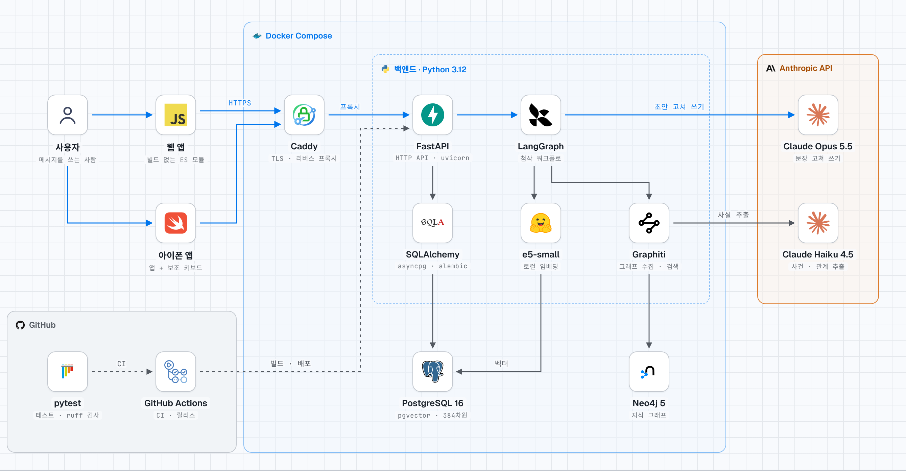

# Persona_ize

상대·상황에 맞는 **사용자 본인의 말투**로 메시지를 첨삭하되, **원문의 사실과 의도를 보존**하는 서비스.
공모전(2026-12) + 포트폴리오. 설계: [docs/design/project-design.md](docs/design/project-design.md) · 그래프 실험: [docs/design/design.md](docs/design/design.md) · 결정: [docs/project/decisions.md](docs/project/decisions.md) · API: [docs/guides/api.md](docs/guides/api.md) · **배포: [docs/guides/deploy.md](docs/guides/deploy.md)** · 문서 전체 목록: [docs/README.md](docs/README.md)

```
상대 선택 + 초안 + 상황
  → 의도·보존 항목 추출 → (검색: 페르소나 / 본인 과거 표현 / 그래프 맥락)
  → Claude 첨삭(구조화 출력) → 규칙 검증 → 실패 시 재생성 1회 → 재실패 시 원문 유지
  → 추천 표시 → 사용자가 적용·수정·취소 (자동 전송 없음)
```

실험 조건: **A** 일반 첨삭 / **B** +상대별 페르소나 / **C** +벡터 검색한 본인 과거 표현 / **D** +그래프 검색 맥락.

## 왜 만들었나
같은 말도 상사, 친구, 거래처에게 보낼 때는 다르게 써야 한다. 일반 AI 첨삭은 문장을 매끄럽게 만들지만 말투가 다 비슷해지고, 날짜나 약속 같은 사실을 바꿀 위험이 있다. Persona_ize는 **고쳐 쓰되 사실과 의도는 건드리지 않는다**를 먼저 정하고, 그걸 지키는지 규칙으로 검사한 뒤에만 결과를 보여 준다.

## 무엇을 확인했나
"어떤 맥락을 넣어야 첨삭이 나아지는가"를 네 조건으로 나눠 같은 사례에 반복해서 돌렸다.

| 조건 | 넣는 맥락 | 추천 / 원문 유지 (48회씩) | 지연 중앙값 |
| --- | --- | --- | --- |
| A | 없음 (일반 첨삭) | 48 / 0 | 3.2초 |
| B | + 상대별 페르소나 | 48 / 0 | 3.0초 |
| C | + 본인 과거 표현 (pgvector) | 48 / 0 | 3.9초 |
| D | + 대화 맥락 그래프 (Neo4j·Graphiti) | 46 / 2 | 5.0초 |

- dev 16사례 × 4조건 × 3회 = 192회 중 190회 추천. 실패 2건과 재생성 5건은 모두 검증 규칙의 오독이었다(이모지 뒤 '보낼게'를 못 읽음, '그날 이사'를 직함으로 읽음). 규칙 두 개를 고친 뒤 해당 세 사례를 36회 다시 돌려 전부 추천, 재생성 0건.
- D는 C보다 입력 토큰이 1.62배 많지만, 그래프가 필요한 5사례 중 C보다 나았던 건 1사례뿐이었다.
- "추천"은 규칙 검증을 통과했다는 뜻이지 말투가 좋다는 뜻은 아니다. 사람 블라인드 평가는 진행 중이다. 자세한 기록: [11/24 측정 메모](evals/results/2026-11-24-dev16-repeat3.md)

## 팀
4인 팀. 팀장 1명이 개발 전체(백엔드, LangGraph 워크플로, 검색, 실험 하니스, 배포, 웹·iOS 화면)를 맡고, 나머지 3명이 시나리오, 평가·품질, 지식그래프 데이터를 맡는다. 팀원은 사례·루브릭·합성 대화를 CSV/마크다운으로 PR에 올리고, 팀장이 리뷰해 코드에 연결한다. 역할별 플레이북은 [docs/project/roles/](docs/project/roles/).

## 구조



파란 선이 요청이 지나가는 길이다. 화면에서 Caddy와 FastAPI를 거쳐 LangGraph 워크플로로 들어가고, 문장을 고쳐 쓸 때만 Claude를 부른다. 회색 선은 서버 안에서 저장소로 가는 연결, 점선은 테스트와 배포.

- 파일 하나하나까지 보려면 [코드 지도](docs/floorplan/persona-ize-map.html)를 받아 브라우저로 연다(코드 파일 310개·요청 64개에 설명이 붙어 있다. 읽는 법은 [docs/floorplan/README.md](docs/floorplan/README.md)).
- 영문·어두운 배경 그림과 원본은 `docs/images/architecture-stack-*`.

## 빠른 시작

```bash
cp .env.example .env            # LLM_PROVIDER=fake면 키 없이 동작
py -3.14 -m venv .venv          # 맥: python3 -m venv .venv
.venv/Scripts/python.exe -m pip install -e "backend[dev,db,embed]"   # 그래프(D)까지: backend[dev,db,embed,graph]
make up                          # PostgreSQL(pgvector)·Neo4j 컨테이너 (Docker Desktop 필요)
make migrate                     # DB 스키마 최신으로
make import-synthetic            # 합성 대화 적재 (user=demo). 그래프까지: scripts/import_synthetic.py --graph
make test                        # 백엔드 테스트 (Postgres 없으면 통합 테스트는 skip)
make dev                         # 화면 http://localhost:8000 · Swagger /docs
```

인메모리로만 빠르게 보려면 `.env`의 `DATABASE_URL`을 비운다 (C/D 검색은 가져온 대화를 메모리에 둔다). API 상세: [docs/guides/api.md](docs/guides/api.md).

실제 Claude를 쓰려면 `.env`에 `LLM_PROVIDER=anthropic`, `ANTHROPIC_API_KEY`, `LLM_MODEL`을 채운다. Console에서 사용량 한도를 먼저 건다.

Docker로 전체(PostgreSQL+pgvector, Neo4j, 백엔드): `make up-all` → 화면 http://localhost:8000 · Swagger `/docs` · 운영 대시보드 `/admin`(`.env`의 `ADMIN_USERNAMES`에 내 아이디) · Neo4j Browser http://localhost:7474
호스트 파이썬을 못 쓰는 PC는 테스트·lint도 컨테이너로: `make test-docker` · `make lint-docker`.

### 배포
리눅스 VM 한 대에 Docker Compose로 올린다(Caddy 자동 HTTPS → 백엔드 → PostgreSQL·Neo4j, 주기 백업 포함). 순서와 점검표는 [docs/guides/deploy.md](docs/guides/deploy.md).
```bash
cp .env.production.example .env.production   # 도메인·비밀번호·초대 코드·관리자 아이디·API 키·비용 상한을 채운다
scripts/ops/deploy.sh                        # 백업 → 이미지 빌드 → 기동 → 스모크 테스트
scripts/ops/run.sh scripts/reset_password.py --username <관리자 아이디> --create
```
로컬에서 운영 구성을 연습하는 법은 deploy.md 14장(가짜 모델, `https://localhost`).

### 수직 기능 시험 (상대 1 · 페르소나 1 · 원문 1)

```bash
curl -s -X POST localhost:8000/v1/contacts -H "X-User-Id: me" -H "Content-Type: application/json" -d '{"alias":"박지현","relationship_type":"superior"}'
```
```bash
curl -s -X PUT localhost:8000/v1/contacts/<id>/persona -H "X-User-Id: me" -H "Content-Type: application/json" -d '{"settings":{"formality":5,"address_term":"팀장님","forbidden_phrases":["ㅋㅋ"]},"expected_version":0}'
```
```bash
curl -s -X POST localhost:8000/v1/rewrites -H "X-User-Id: me" -H "Idempotency-Key: t1" -H "Content-Type: application/json" -d '{"contact_id":"<id>","draft_text":"오늘 정리해서 내일 오전까지 보내드릴게요.","situation":"업무 보고","condition":"B"}'
```

## 폴더 (담당)

| 폴더 | 담당 | 내용 |
|---|---|---|
| `backend/` | 팀장 | FastAPI · 워크플로 · 검증 · 저장소. [app/prompts/](backend/app/prompts) 는 비전공자도 수정 |
| `evals/` | 평가·품질 | 사례 CSV, 보존 규칙, 루브릭, 실행 하니스 |
| `data/synthetic/` | 사용자·시나리오 | 합성 과거 대화 JSON |
| `graph/` | 지식그래프 | 스키마, 호칭 병합·질의 정답, Graphiti 스파이크 |
| `docs/` | 전원 | `design/` 설계 · `guides/` 안내서(배포·API·데이터 형식·시연) · `project/` 결정·남은 일·역할 · `images/` 그림 · `floorplan/` 코드 지도 · `archive/` 예전 문서. 목록은 [docs/README.md](docs/README.md) |
| `backend/app/web/` | 팀장 | PC 웹 앱(빌드 없는 ES 모듈, 서버 `/`에서 서빙)·운영 대시보드(`/admin`)·시연 프로토타입(`/static/proto.html`). `apps/web/`(React)는 보류 |
| `apps/ios/` | 팀장 | 아이폰 앱(SwiftUI)·보조 키보드 확장. 설치는 `apps/ios/README.md`, 화면 설계는 `docs/design/iphone-mobile.md` |
| `docker/`, `scripts/ops/` | 팀장 | 운영 구성(Caddy·백업)과 배포·복원 스크립트 |

협업 규칙(GitHub Desktop, PR, 폴더 소유): [CONTRIBUTING.md](CONTRIBUTING.md) · 역할·일정: [docs/project/team-roles-and-schedule.md](docs/project/team-roles-and-schedule.md) · **역할별 플레이북**: [시나리오](docs/project/roles/scenario.md) · [평가·품질](docs/project/roles/evaluation.md) · [지식그래프](docs/project/roles/graph.md) · **평가 사례·합성 대화 쓰는 법: [docs/guides/dataset-guide.md](docs/guides/dataset-guide.md)**

## 명령어

| 명령 | 내용 |
|---|---|
| `make test` | 백엔드 테스트 |
| `make lint` | ruff |
| `make test-docker` · `make lint-docker` | 위 둘을 컨테이너에서 (호스트 venv를 못 쓰는 PC) |
| `scripts/ops/deploy.sh` · `make prod-ps` · `make backup` | 운영 배포·상태·백업 ([docs/guides/deploy.md](docs/guides/deploy.md)) |
| `python scripts/smoke_test.py --base-url <주소>` | 떠 있는 서버의 전 흐름 점검(가입 → 첨삭 → 계정 삭제) |
| `make eval` | 평가 사례 A/B/C 실행 → `evals/results/` (D와 반복 실행은 `evals/run_eval.py --conditions A,B,C,D --repeat 3`) |
| `make graph-dry-run` | 그래프 스파이크 변환만 확인 |
| `python scripts/validate_data_files.py` | CSV/JSON 접점 파일 형식 검사 |
| `make usage-report` | 사용자·일(KST)·조건별 첨삭 호출 수·토큰 (최근 7일, `scripts/usage_report.py --help`) |
| `make graph-reset USER=demo` | 그 사용자의 그래프를 지우고 다시 수집 (`--dry-run`으로 먼저 확인, haiku 비용) |
| `make housekeeping` | 만료·폐기 세션, 오래된 가져오기 작업·사용량 카운터 정리 |
| `curl localhost:8000/healthz?deep=true` | Postgres·Neo4j 연결까지 확인 (문제면 503) |

Windows에 `make`가 없으면 Makefile의 명령을 그대로 실행한다.

## 상태 (2026-11-25)
- 저장소: `github.com/SkyWith628/persona-ize` (공개).
- 백엔드: 상대·페르소나, 첨삭 워크플로(LangGraph: 의도·보존 추출 → 검색 → 프롬프트 → 검증 → 재생성 1회 → 원문 유지), PostgreSQL(Alembic), C(pgvector 문체 kNN)·D(Graphiti 그래프 맥락) 검색, 말투 프로필(문장 어미·호칭 구간, 모델 호출 없음)과 설정 제안, 삭제(대화방·상대·계정), 사용량 제어, 세션 쿠키·Bearer·소셜 로그인, 회원관리, 대화 가져오기(카카오톡·텔레그램·붙여넣기, 개인정보 패턴 가림, 그래프 수집 상한), 운영 대시보드.
- 화면: PC 웹 앱(`/`), 모바일 웹(`/m`), 운영 대시보드(`/admin`), 안내 문서 초안. 아이폰 앱·보조 키보드는 `apps/ios/`(CI에서 빌드·시뮬레이터까지, 실기기 미검증).
- 검증: 백엔드 테스트 1,564개 · 화면 단위 테스트 227개. 11/24에 PC 화면으로 가입 → 가져오기 → 제안 → 첨삭 → 이력 → 계정 삭제를 실제 모델로 끝까지 확인했고, 모바일 웹은 폰 크기에서 전 탭을 확인했다.
- 실측: Opus 5.5로 dev 16사례 × A/B/C/D × 3회 — 192회 중 190회 추천, 원문 유지 2건, 재생성 5건. 여기서 나온 규칙 둘을 고친 뒤 해당 세 사례는 36회 전부 추천([11/24 메모](evals/results/2026-11-24-dev16-repeat3.md)). 이전 측정은 `evals/results/`. 평가 사례는 20개(dev 16 · test 4), 블라인드 평가는 진행 중.
- 배포: 운영 모드 검사·보안 헤더·요청 제한, 운영용 Docker 구성(Caddy HTTPS, 백업), 배포·복원 스크립트, 스모크 테스트([docs/guides/deploy.md](docs/guides/deploy.md)).
- 학습 모델(제안, 아직 만들거나 학습시킨 것 없음): 규칙 검증이 놓치는 "뜻이 달라진 경우"를 직접 학습한 작은 모델로 보완하는 [설계안](docs/design/ml-design-2026-11-24.md)과, 모델 네 개의 설계서([판정 모델](docs/design/ml-judge-design-2026-11-25.md) · [수집 전 거르기](docs/design/ml-prefilter-design-2026-11-25.md) · [문체 유사도](docs/design/ml-style-sim-design-2026-11-25.md) · [조건 선택기](docs/design/ml-condition-selector-design-2026-11-25.md)), 판정 모델 후보의 [비용 측정](docs/design/ml-judge-bench-2026-11-25.md)(GPU 메모리·학습 속도·CPU 판정 시간).
- 문서: 11/25에 `docs/`를 쓰임새별 폴더로 나누고 구조 그림과 코드 지도를 넣었다. 예전 설계도와 회의 자료는 `docs/archive/`.
- 시연: [docs/guides/demo-script.md](docs/guides/demo-script.md) (demo 계정의 카카오톡 대화 551건, 4장면, 보험). 시연 데이터 적재는 `scripts/load_kakao_demo.py`.
- 다음: [docs/project/backlog.md](docs/project/backlog.md) — 팀장 단독 항목(A), 팀원 산출물 대기(B), 보류(C).
