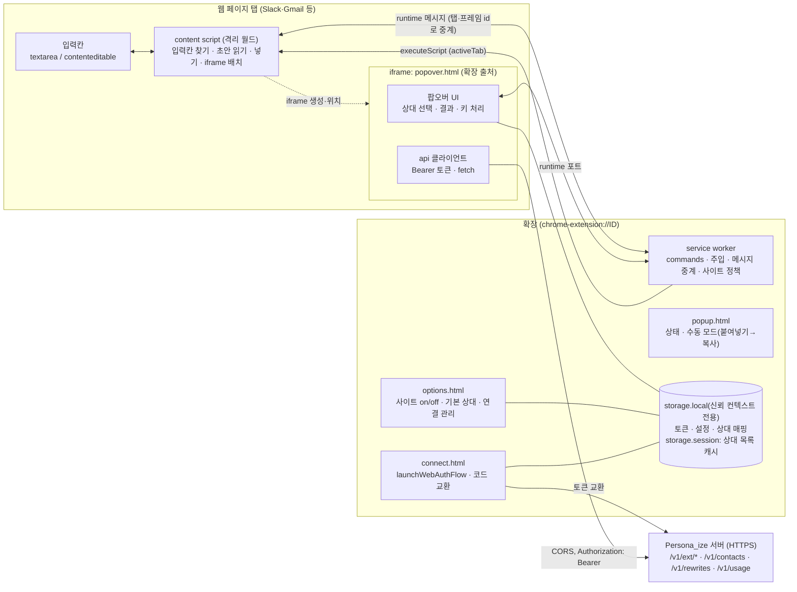
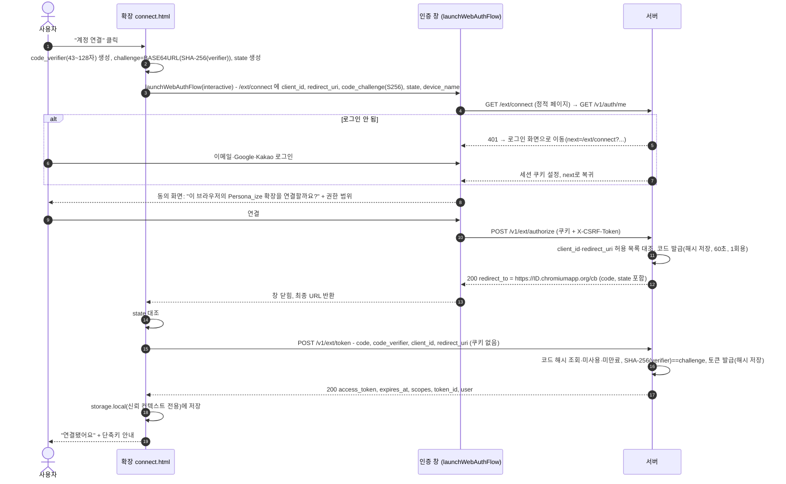

# 브라우저 확장 설계 (Chrome·Edge, Manifest V3)

작성 2026-11-16 · 상태: 설계(구현 전) · 범위: `apps/extension/`(신규)와 그에 필요한 백엔드 추가분의 명세
기준 문서: `project-design.md`, `wireframes-v2.html` P1·P2, `wireframe-review-2026-11-10.md`, 회원·소셜 로그인 API 계약 v1(2026-11-16 작업 중)

## 요약

PC 웹 메신저·웹메일의 입력칸에서 단축키를 누르면 입력칸 옆에 팝오버가 뜨고, 초안을 상대에 맞는 내 말투로 다듬어 **입력칸에 넣기까지만** 한다(전송은 사용자). 확장은 `activeTab` + `scripting`만으로 동작해 설치 때 "모든 사이트 읽기" 경고가 없고, 사용자가 단축키를 누른 탭에서만, 누른 순간에만 입력칸을 읽는다. 서버 인증은 웹 세션 쿠키를 빌려 쓰지 않고 **확장 전용 토큰**(웹에서 로그인 → PKCE 코드 교환 → 범위가 좁고 폐기 가능한 Bearer 토큰)으로 한다. 팝오버는 페이지 DOM이 아니라 **확장 페이지를 담은 iframe**이라 토큰·상대 목록이 페이지 스크립트에 닿지 않고, API 호출도 그 페이지에서 직접 해 서비스 워커 수명 제한(30초)을 피한다. 백엔드 추가는 토큰 테이블·엔드포인트 5개·`current_user_id` 분기·CORS 한 줄·`rewrite_requests.channel` 열이다. 설치형 메신저(카카오톡 PC·사내 메신저)는 여전히 트레이 프로그램(P1·P2 원안)의 몫이다.

## 결정 표

| # | 주제 | 결정 | 버린 대안과 이유 |
|---|---|---|---|
| 1 | 대상 | Chrome·Edge MV3. v1 검증 사이트: Slack 웹, Telegram Web, Gmail 작성창. 그 밖의 사이트는 "일반 입력칸" 최선 동작(사이트별 켜기) | Firefox·Safari 동시 지원 — API·서명·심사가 달라 일정 초과. 카카오톡은 웹 클라이언트가 없어 대상이 아님 |
| 2 | 구조 | 서비스 워커(라우터) + 요청 시 주입하는 content script(읽기·넣기) + **iframe 팝오버(확장 페이지, API 호출 담당)** + 옵션 페이지 + 액션 팝업(상태·수동 모드) | Shadow DOM만 쓰는 인페이지 UI — 가볍지만 UI·토큰이 content script 신뢰 구역에 놓임. 사이드 패널 — 입력칸 옆에 못 붙고 P1 흐름과 다름 |
| 3 | 읽기·넣기 | 선택 영역 우선, 없으면 입력칸 전체. 넣기는 `execCommand("insertText")` → 합성 paste/beforeinput → 네이티브 setter 순으로 시도하고 **되읽어 검증**, 실패하면 클립보드 복사 | 값 직접 대입만 — 실행 취소가 깨지고 React·Quill류 편집기가 변경을 모름 |
| 4 | 인증 | **(b) 확장 전용 토큰**: `launchWebAuthFlow` + PKCE(S256) 코드 교환, 불투명 토큰(해시 저장), 범위 `contacts:read`·`rewrite`, 30일, 계정 화면·관리자 폐기 | (a) 쿠키 편승 — 백엔드 변경 0이지만 범위 제한·개별 폐기 불가, 서드파티 쿠키 차단 시 실패. (c) 기기 코드 — 브라우저 안에서 굳이 코드를 옮겨 적을 이유가 없음 |
| 5 | 상대 선택 | 사이트 어댑터가 뽑은 대화 키 → 로컬 매핑(해시 키) → 별칭 일치 → 사이트 기본 상대 → 직전 상대. 항상 ▾로 수동 변경. 서버에는 `contact_id`만 | 서버에서 제목·URL로 추정 — 페이지 정보가 서버로 나감 |
| 6 | 권한 | `activeTab`, `scripting`, `storage`, `identity`. 호스트 권한 없음(API는 CORS 허용 목록) | `<all_urls>` 또는 사이트별 host permission — 설치 경고·심사 지연, 상시 버튼이 필요해질 때 `optional_host_permissions`로 추가 |
| 7 | API | 기존 `GET /v1/contacts`, `POST /v1/rewrites`(+`Idempotency-Key`), `POST …/feedback`, `GET /v1/usage` 그대로. 채널은 `X-Client-Channel` 헤더 → `rewrite_requests.channel` | 본문에 `channel` 필드 추가 — 입력 해시·스키마가 바뀜 |
| 8 | UX | 단축키 → 팝오버(포커스 이동) → `R` 다시 만들기 / `Tab` 직접 고치기 / `Esc` 초안 그대로 → `Enter` 입력칸에 넣기 | "더 짧게(1)·더 공손하게(2)" — 프롬프트가 아직 지원하지 않음(11-16 결정). v2 |
| 9 | 단축키 | Windows·Linux `Ctrl+Shift+Space`, Mac `Command+Shift+Space`. 변경은 `chrome://extensions/shortcuts` | P2의 `Ctrl+Alt+Space` — **`chrome.commands`가 Ctrl+Alt 조합을 금지**한다. `Ctrl+Shift+P`는 검토에서 기각 |
| 10 | 빌드 | TypeScript + esbuild(번들만, 프레임워크 없음). 테스트 Vitest + Playwright(번들 Chromium에 확장 로드) | 무빌드 순수 JS — content script가 ES module import를 못 써 공유 코드가 중복됨. Vite+CRXJS — 이 규모엔 과함 |
| 11 | 출시 | 시연은 압축 해제 로드(`key`로 ID 고정) → 웹 스토어 **비공개(Private, 테스터)** → 일부 공개(Unlisted) | 처음부터 공개 등록 — 심사 수일~수 주, 개인정보처리방침 필요 |

---

## 1. 범위와 대상

**브라우저**: Chrome, Edge(둘 다 Chromium MV3). Edge는 `identity.getAuthToken`만 미지원이고 `launchWebAuthFlow`·`commands`·`scripting`·`sidePanel`·`storage`는 지원한다[R14].

**v1 검증 사이트(어댑터 제공, 수동 테스트 매트릭스 대상)**

| 사이트 | 주소 | 입력칸 | 비고 |
|---|---|---|---|
| Slack 웹 | `app.slack.com` | contenteditable 리치 편집기 | 넣기 난도 가장 높음(0단계 스파이크 대상) |
| Telegram Web | `web.telegram.org/k`, `/a` | contenteditable | 두 클라이언트(K·A)의 DOM이 다름 |
| Gmail | `mail.google.com` 작성·답장 창 | contenteditable | 인용문·서명이 같은 입력칸 안에 있음 → 선택 영역 또는 인용 앞부분만 |
| 서비스 자체 시연 페이지 | 배포 주소 `/` | `textarea` | 자동화 테스트 기준 |

**일반 모드**: 위 밖의 사이트도 `textarea`/`input[type=text]`/contenteditable이면 동작을 시도한다. 단, 처음 쓰는 사이트는 팝오버가 "이 사이트에서 쓸까요?"를 한 번 묻고 허용 목록에 넣는다(P2의 "쓸 수 있는 프로그램"에 대응).

**명시적 제외**
- 설치형 데스크톱 메신저(카카오톡 PC, 텔레그램 데스크톱, 사내 메신저): 확장은 브라우저 탭 안에서만 동작한다. **카카오톡은 개인 대화용 웹 클라이언트가 없다**(공식 문서로 재확인하지는 못함 — §12). 이 영역은 트레이 프로그램(P1·P2) 계획 그대로다.
- 메일 자동 분석, 한→영 번역(검토 #10에서 2단계로 미룸), 받은 메시지 읽기(B 조건의 "최근 맥락" 자동 수집), 자동 전송.
- 모바일 브라우저, Firefox, Safari.

**트레이 프로그램과의 관계**: 둘은 대체가 아니라 채널이 다르다. 확장 = 브라우저 탭, 트레이 = 그 밖의 창. 팝오버 화면 흐름(P1), 설정 항목(P2), 인증(§4의 토큰 발급 흐름), 채널 기록(§7)을 같게 설계해 트레이를 나중에 만들 때 서버 쪽은 `client` 값 하나만 더하면 된다. 일정상 공모전(12월) PC 시연은 확장으로 하고, 트레이는 그 뒤로 둔다(열린 질문 1).

## 2. 구조



### 구성 요소와 책임

| 구성 | 파일 | 하는 일 | 하지 않는 일 |
|---|---|---|---|
| service worker | `background.ts` | `commands.onCommand` 수신, 사이트 정책 확인, `scripting.executeScript`로 content script 주입, content script ↔ 팝오버 메시지 중계 | 서버 호출, 상태 보관(전역 변수 금지) |
| content script | `content.ts` + `sites/*.ts` | 포커스된 입력칸 판별·거부(비밀번호 등), 초안·선택 범위 읽기, 대화 힌트 추출, iframe 생성·위치, 넣기·검증 | 토큰 접근, 서버 호출, 결과 렌더링 |
| 팝오버 | `popover.html/ts` | 상대 결정, API 호출, 결과·상태 표시, 키보드 처리, 클립보드 대체 경로 | 페이지 DOM 접근 |
| 연결 페이지 | `connect.html/ts` | `launchWebAuthFlow`, PKCE, 토큰 저장, 첫 실행 안내(보안 정책 고지) | — |
| 옵션 | `options.html/ts` | P2: 단축키 표시(변경은 브라우저 화면으로 안내), 사이트 on/off, 사이트별 기본 상대, 초안 가져오는 방식, 연결 해제, 로컬 데이터 지우기 | — |
| 액션 팝업 | `popup.html/ts` | 로그인·사용량 상태, "이 탭 입력칸 다듬기" 버튼, **수동 모드**(초안 붙여넣기 → 결과 복사) — 넣기가 안 되는 사이트의 탈출구 | — |

### UI 표면 선택

| 후보 | P1 대응 | 판단 |
|---|---|---|
| **iframe 팝오버(확장 페이지), 입력칸 옆 고정** | 팝오버·키보드만으로 끝내기 그대로 | **채택.** 페이지 스크립트가 내용을 읽거나 키 입력을 가로채지 못하고, 확장 출처라 서버 호출·신뢰 저장소 접근이 가능 |
| Shadow DOM 인페이지 UI | 같음 | 탈락. 닫힌 shadow root여도 키 이벤트가 페이지 리스너에 보이고, UI 코드가 "덜 신뢰되는" content script 쪽에 놓여 토큰을 메시지로 우회해야 한다 |
| 사이드 패널(`sidePanel`) | 다름(브라우저 옆 고정) | 탈락(v1). 단축키로 열 수는 있다[R6]. iframe이 막히는 사이트의 대체 표면 후보로 보류 |
| 액션 팝업 | 다름(툴바 아래) | 보조. 상태 확인과 수동 모드 |

iframe은 `web_accessible_resources`에 `popover.html`을 등록해야 한다. 사이트가 확장 설치 여부를 탐지하지 못하게 `use_dynamic_url: true`를 켠다[R10]. 페이지 CSP(`frame-src`)가 확장 iframe을 막는지는 사이트별 확인이 필요하다(§12) — 막히면 인페이지 토스트 "이 페이지에서는 팝오버를 띄울 수 없어요. 툴바 아이콘을 눌러 주세요"로 수동 모드에 보낸다.

### 메시지 흐름 (단축키 한 번)

1. 사용자: 단축키. → `commands.onCommand("rewrite", tab)`. 이 제스처로 `activeTab`이 그 탭에 부여된다[R4].
2. SW: 사이트 정책(차단/허용/미정) 조회 → `executeScript({target:{tabId}, files:["content.js"]})`(중복 주입 방지 플래그) → `tabs.sendMessage(tabId, {type:"pi/open"})`.
3. content script: 입력칸 판별 → 통과하면 iframe 생성(포커스 이동 → IME 조합 확정) → 초안·선택 범위·대화 힌트를 메모리에 잡고 SW에 `pi/draft` 전송.
4. 팝오버: 포트 연결 후 `pi/draft` 수신(SW가 `sender.tab.id`/`frameId`로 짝을 맞춰 중계) → 상대 결정 → `POST /v1/rewrites`.
5. 사용자: `Enter`. 팝오버 → SW → content script `pi/insert {text, expectDraft}` → 넣기·검증 → 결과 회신 → 팝오버 닫힘, 입력칸에 포커스 복귀.

content script와 팝오버 사이는 `window.postMessage`를 쓰지 않는다(페이지가 위조·도청 가능). SW는 content script의 메시지를 공격자가 만든 것으로 가정하고[R9] 형식(`type`·길이 상한 2,000자·`sender.tab` 존재)만 검증해 **같은 탭의 팝오버로만** 넘긴다. content script 메시지가 서버 호출이나 토큰 접근을 일으키는 경로는 없다.

### 상태 저장

| 데이터 | 위치 | 이유 |
|---|---|---|
| 확장 토큰, 만료 시각, 서버 주소 | `storage.local` + `setAccessLevel("TRUSTED_CONTEXTS")` | 브라우저 재시작 뒤에도 연결 유지. `storage.local`은 기본값이 content script에 노출이라 접근 수준을 반드시 낮춘다[R3] |
| 사이트 정책, 사이트별 기본 상대, 대화→상대 매핑, 초안 가져오는 방식 | `storage.local` | 기기별 설정. `storage.sync`는 쓰지 않는다(매핑이 구글 계정으로 동기화되는 것을 피함) |
| 상대 목록 캐시, 오늘 사용량 | `storage.session` | 메모리 전용·재시작 시 삭제·기본적으로 content script 비노출[R3] |
| 초안, 추천 문장, PKCE verifier | 페이지 메모리만 | 저장하지 않는다 |

대안인 "토큰을 `storage.session`에만 두기"는 디스크에 남지 않지만 브라우저를 켤 때마다 다시 연결해야 해서 탈락. 디스크 평문 위험은 좁은 범위·30일 만료·원격 폐기로 줄인다(§6).

## 3. 글 읽기와 넣기

### 입력칸 판별 (content script, 순서대로)

1. `document.activeElement`에서 시작해 열린 shadow root는 `.shadowRoot.activeElement`로, 닫힌 shadow root는 `chrome.dom.openOrClosedShadowRoot()`로 내려간다(content script가 `dom` API를 직접 쓸 수 있다[R8]).
2. **거부(끌 수 없음, P2)**: `input[type=password]`, `autocomplete`가 `cc-*`·`one-time-code`·`*-password`, `inputmode=numeric`인 짧은 칸, `name/id/aria-label`이 카드·CVC·계좌·주민번호 패턴, `readonly`/`disabled`. 거부 시 팝오버 없이 토스트 "이 입력칸에서는 동작하지 않아요".
3. 허용 유형: `textarea`, `input[type=text|search|email|url]`(단문), `isContentEditable` 요소의 편집 루트(가장 바깥 contenteditable 조상).
4. 포커스된 입력칸이 없으면: 사이트 어댑터의 `findComposer()`(작성창 선택자) → 없으면 토스트 "입력칸을 먼저 눌러 주세요".

### 초안 읽기

- `textarea`/`input`: 선택이 있으면 `selectionStart..End`, 없으면 전체 값.
- contenteditable: 선택이 편집 루트 안에서 접혀 있지 않으면 `Selection.toString()`, 아니면 편집 루트의 `innerText`(줄바꿈 보존). Gmail 어댑터는 인용문·서명 블록을 제외한 앞부분만 범위로 잡는다.
- 범위는 **노드 참조가 아니라 재현 가능한 형태**로 기억한다(textarea는 오프셋, contenteditable은 "전체" 또는 시작·끝 텍스트 오프셋). 편집기가 DOM을 다시 그리면 `Range` 객체는 무효가 된다.
- 2,000자(`max_draft_chars`) 초과면 서버에 보내지 않고 "길어요. 다듬을 부분만 선택해 주세요".
- 한글 IME: 조합 중인 글자는 값에 반영되지 않았을 수 있다. iframe으로 포커스를 옮겨 조합을 확정시킨 **다음 프레임에서** 읽는다.
- 읽는 시점은 단축키(또는 팝업 버튼)를 누른 그 순간 한 번뿐이다. 관찰자·주기 읽기 없음.

### 넣기 (전략 사슬 — 각 단계 뒤 되읽어 검증)

넣기 전 공통: 입력칸에 포커스 복귀 → 현재 내용이 요청 때의 초안과 같은지 확인(다르면 넣지 않고 "입력칸이 바뀌었어요. 복사할까요?" — iOS 키보드의 `DraftReplacement` 규칙과 동일) → 기억한 범위를 다시 선택.

| 순서 | 방법 | 대상 | 실행 취소 |
|---|---|---|---|
| 1 | `document.execCommand("insertText", false, text)` | textarea·input·대부분의 contenteditable | 유지(편집 기록 보존[R11]) |
| 2 | 합성 `paste`(`ClipboardEvent` + `DataTransfer`의 `text/plain`) 또는 `beforeinput`(`insertFromPaste`) | 자체 붙여넣기 처리기가 있는 리치 편집기(어댑터가 지정) | 편집기 자체 기록 |
| 3 | 네이티브 value setter 호출 + `input` 이벤트(`bubbles`) | React 등 제어 컴포넌트 textarea·input | 깨질 수 있음 |
| 4 | **클립보드 대체**: 팝오버에서 `navigator.clipboard.writeText`(Enter가 사용자 제스처) → "복사했어요. 입력칸에 붙여넣으세요(Ctrl+V)" | 전부 실패 시 | — |

- 검증: 넣은 뒤 입력칸 텍스트(공백 정규화)가 기대값을 포함하는지 본다. 불일치면 다음 전략으로. 어느 전략이 통했는지는 사이트 키별로 로컬에 기억해 다음부터 그 전략을 먼저 쓴다.
- `execCommand`는 폐기 예정 표시가 있지만 대체 API가 없고 실행 취소를 지키는 유일한 방법이라 1순위로 둔다[R11]. 브라우저가 없애면 2·3으로 내려가도록 사슬로 짰다.
- **`Enter` 키 이벤트를 페이지에 보내지 않는다.** 넣기 코드 경로에 `KeyboardEvent` 합성이 없어야 한다(자동 전송 금지의 구현상 보증, 테스트로 고정).
- 줄바꿈: 메신저는 `\n` 입력이 전송으로 해석될 수 있다. 전략 1·2는 텍스트 삽입이라 키 입력이 아니지만, 사이트별로 줄바꿈이 문단으로 들어가는지 수동 매트릭스에서 확인한다.

### 한계

- **iframe 안 입력칸**: `activeTab`이 교차 출처 하위 프레임까지 주입을 허용하는지 공식 문서에 없다(§12). v1은 최상위 프레임과 같은 출처 프레임만 지원한다.
- 캔버스 기반 편집기(Google Docs 등), 브라우저 내장 페이지(`chrome://`), 웹 스토어 페이지: 미지원 → 수동 모드 안내.
- 서식(굵게·멘션·이모지 노드)이 섞인 초안을 "전체 교체"하면 서식이 사라진다. 팝오버에 "서식·멘션은 빠질 수 있어요"를 표시하고, 멘션이 감지되면 선택 영역 방식 사용을 권한다.

## 4. 인증

### 왜 쿠키+CSRF를 그대로 못 쓰는가

웹 화면은 같은 출처에서 `pi_session`(HttpOnly, SameSite=Lax) + `X-CSRF-Token`으로 동작한다. 확장에서 이를 쓰는 방법과 한계는 다음과 같다.

| 안 | 동작 | 장점 | 문제 |
|---|---|---|---|
| (a) 쿠키 편승 | 확장이 API 출처의 `host_permissions`를 갖고 확장 페이지에서 `credentials:"include"`로 호출. Chrome은 호스트 권한이 있는 대상으로의 확장 요청을 same-site로 취급해 SameSite 쿠키를 보낸다[R12]. CSRF 토큰은 `GET /v1/auth/me`로 받는다. **SameSite·CORS 변경 불필요** | 백엔드 변경 0, 하루면 동작 | ① 확장이 웹 세션 전체 권한(비밀번호 변경·계정 삭제·관리자 API)을 가진다 ② 확장만 따로 끊을 수 없다 ③ 서드파티 쿠키 차단 설정에서는 예외가 적용되지 않는다[R12] ④ 웹에서 로그아웃하면 확장도 끊긴다 ⑤ 채널을 서버가 확증할 수 없다 ⑥ content script에서는 불가(항상 교차 출처)[R13] |
| **(b) 확장 전용 토큰** | 웹에서 로그인(이메일·Google·Kakao 모두 그대로) → 동의 화면 → 일회용 코드 → PKCE 검증 후 Bearer 토큰 발급 | 범위 제한, 개별 폐기, 채널 확증, 쿠키·CSRF 모델과 분리, 트레이 프로그램도 재사용 | 백엔드 추가 약 2일 |
| (c) 기기 코드 | 확장이 코드 표시 → 사용자가 웹에 입력 → 확장이 폴링 | 리다이렉트 불필요 | 같은 브라우저 안에서 코드를 옮겨 적는 불필요한 단계, 폴링 엔드포인트·피싱 위험 추가 |

**결정: (b).** 코드 전달 방식은 `chrome.identity.launchWebAuthFlow`를 쓴다 — 비 Google 제공자용으로 문서화된 방식이고, `https://<확장ID>.chromiumapp.org/*`로 리다이렉트되면 창이 닫히며 최종 URL을 돌려준다[R2]. 대안인 `externally_connectable`(웹 페이지가 확장으로 코드를 직접 전송[R7][R9])은 일반 탭에서 진행돼 기존 로그인 쿠키가 확실히 있다는 장점이 있지만, 매니페스트에 서버 도메인을 고정해야 하고(지금 주소가 sslip.io 임시 도메인) 웹 페이지가 확장 ID를 알아야 해서 2순위로 둔다. `launchWebAuthFlow` 창이 프로필 쿠키를 공유하지 않거나 Google·Kakao 로그인이 그 창에서 막히면 이 2순위로 바꾼다(0단계 스파이크에서 확인, §12).

(a)는 백엔드 일정이 밀릴 때 **압축 해제 시연 빌드 한정**의 임시 경로로만 허용한다(스토어 제출본에는 넣지 않는다).

### 연결 흐름



`launchWebAuthFlow`는 서비스 워커가 아니라 `connect.html`(확장 탭)에서 호출한다 — 로그인이 길어져도 SW 수명 제한(이벤트·API 호출 5분[R5])에 걸리지 않고 verifier를 페이지 메모리에 둘 수 있다.

### 백엔드 추가 명세 (구현하지 않음 — 백엔드 담당에게 전달)

**설정**: `EXTENSION_IDS`(쉼표 목록, 개발용·스토어용 ID), `EXT_TOKEN_TTL_DAYS=30`, `EXT_CODE_TTL_SECONDS=60`.

**테이블** (다음 마이그레이션 번호, `db/models.py`와 함께)

| 테이블 | 열 |
|---|---|
| `api_tokens` | `id` UUID PK · `user_id` FK(users, CASCADE) · `token_hash` char(64) unique · `client` varchar(16)(`extension`, 이후 `tray`) · `client_id` varchar(64)(확장 ID) · `name` varchar(80)(기기 이름) · `scopes` varchar(200) · `created_at` · `last_used_at` null · `expires_at` · `revoked_at` null · index(`user_id`) |
| `ext_auth_codes` | `code_hash` char(64) PK · `user_id` FK · `client_id` · `redirect_uri` · `code_challenge` char(43) · `device_name` · `expires_at` · `used_at` null |

토큰 원문은 `pi_ext_` + `secrets.token_urlsafe(32)`. 세션과 같이 **SHA-256 해시만 저장**한다(고엔트로피 난수라 느린 해시 불필요). 원문은 발급 응답에서 한 번만 나간다. `housekeeping.py`에 만료 코드·토큰 정리 추가.

**엔드포인트**

| 메서드·경로 | 인증 | 요청 | 응답·오류 |
|---|---|---|---|
| `GET /ext/connect` | 없음(정적 `web/ext-connect.html`) | 쿼리: `client_id`, `redirect_uri`, `code_challenge`, `code_challenge_method=S256`, `state`, `device_name?` | 페이지가 `/v1/auth/me`로 로그인 확인 → 미로그인 시 로그인 화면(`next`), 로그인 시 동의 화면. `innerHTML` 금지 규칙 그대로 |
| `POST /v1/ext/authorize` | 세션 쿠키 + CSRF, `status=active` | `{client_id, redirect_uri, code_challenge, code_challenge_method:"S256", state, device_name?}` | 200 `{redirect_to}`. `client_id`가 `EXTENSION_IDS`에 없거나 `redirect_uri`가 정확히 `https://<client_id>.chromiumapp.org/cb`가 아니면 400 `invalid_input`. pending은 403 `account_pending` |
| `POST /v1/ext/token` | 없음(코드+verifier가 증명). CSRF 면제 | `{grant_type:"authorization_code", code, code_verifier, client_id, redirect_uri}` | 200 `{access_token, token_type:"Bearer", expires_at, scopes:["contacts:read","rewrite"], token_id, user:{user_id, display_name, status}}`. 불일치·만료·재사용은 400 `invalid_grant`(재사용 시 그 코드로 발급된 토큰도 폐기). IP별 제한(기존 `LoginThrottle` 방식) |
| `GET /v1/ext/session` | Bearer | – | `{user_id, display_name, status, token_id, scopes, expires_at}` — 확장의 연결 상태 확인용. 호출 시 만료가 7일 이내면 30일로 연장(슬라이딩) |
| `DELETE /v1/ext/token` | Bearer | – | 204. 자기 토큰 폐기(확장의 "연결 해제") |
| `GET /v1/auth/tokens` | 세션 쿠키 | – | `{items:[{id, client, name, created_at, last_used_at, expires_at}]}` — 계정 화면 "연결된 기기" |
| `DELETE /v1/auth/tokens/{id}` | 세션 쿠키 + CSRF | – | 204. 남의 토큰은 404 |

**폐기 연동**(기존 동작에 덧붙임): 비밀번호 변경, 계정 정지(`suspended`), 계정 삭제, 관리자 `POST /v1/admin/users/{id}/revoke-sessions` → 그 사용자의 `api_tokens` 전부 `revoked_at`. 관리자 화면의 사용자 행에 "연결된 기기 수"는 선택. 감사 로그 action에 `user.revoke_sessions`가 토큰도 포함함을 `detail`에 남긴다. (`revoke-sessions` 응답 `{"revoked": int}`에 토큰 수를 합칠지 필드를 더할지는 계약 변경이라 백엔드 담당 결정 사항.)

**`current_user_id` 훅 (`backend/app/api/deps.py`)**

```python
# 스케치 — 순서가 핵심이다
authz = request.headers.get("Authorization", "")
if authz.startswith("Bearer "):  # ① Bearer가 있으면 쿠키를 보지 않는다(혼용 금지)
    tok = await state.auth_service.resolve_api_token(authz[7:])  # 해시 조회, 미폐기·미만료, user.status
    if tok is None:
        raise UnauthorizedError("연결이 만료되었습니다. 확장을 다시 연결하세요.")
    # 기본 거부: current_user_id를 그대로 쓰는 라우트는 토큰을 받지 않는다
    raise ForbiddenError("이 연결로는 쓸 수 없는 기능입니다.")  # 403 insufficient_scope
# ② 기존 쿠키+CSRF 경로 (변경 없음)  ③ 헤더 스텁 (변경 없음)


def scoped_user(scope: str):  # 토큰을 받는 라우트 전용 의존성
    async def dep(request, state, x_user_id=None) -> str:
        tok = await _bearer_token(request, state)  # 없으면 None, 무효면 401
        if tok is None:
            return await current_user_id(request, state, x_user_id)  # 쿠키+CSRF 그대로
        if scope not in tok.scopes:
            raise ForbiddenError(...)
        request.state.principal = Principal(user_id=tok.user_id, kind="token", channel=tok.client)
        return str(tok.user_id)

    return dep
```

- 토큰을 받는 라우트만 새 의존성 `scoped_user("rewrite")` / `scoped_user("contacts:read")`를 쓴다: Bearer면 범위 확인 후 통과(CSRF 검사 없음 — 브라우저가 자동으로 붙이는 자격 증명이 아니므로 CSRF가 성립하지 않는다), 아니면 기존 `current_user_id`로 위임. **기본 거부**라서 새 라우트를 추가해도 토큰에 자동으로 열리지 않는다.
- 토큰 허용 라우트(v1 전부): `GET /v1/contacts`(`contacts:read`), `POST /v1/rewrites`·`POST /v1/rewrites/{id}/feedback`·`GET /v1/usage`(`rewrite`), `/v1/ext/session`, `DELETE /v1/ext/token`. 인증·관리자·가져오기·삭제·페르소나 수정·이력 조회는 토큰으로 불가.
- `pending` 사용자의 토큰 요청은 403 `account_pending`, `suspended`는 401(토큰은 정지 시점에 이미 폐기).
- `last_used_at`은 요청마다 쓰지 않고 5분 단위로만 갱신(쓰기 부하).

**CORS (`backend/app/main.py`)**: `allow_origins`에 `chrome-extension://<id>`(= `EXTENSION_IDS`)를 더한다. 확장은 호스트 권한 없이 `credentials:"omit"`으로 호출하므로 쿠키는 가지 않는다. 필요한 요청 헤더는 `Authorization`, `Content-Type`, `Idempotency-Key`, `X-Client-Channel`(현재 `allow_headers=["*"]`라 추가 설정 없음). 와일드카드 출처는 쓰지 않는다. Caddy 변경 없음(`X-Frame-Options: DENY`는 최상위 창인 인증 창에 영향 없음). 호스트 권한 없는 확장 페이지의 교차 출처 `fetch`가 `Origin: chrome-extension://<id>`인 일반 CORS 요청이 된다는 점은 문서에서 직접 문장을 찾지 못했다(§12) — 0단계에서 확인하고, 아니면 API 출처 한 개만 `host_permissions`에 넣는다.

**쿠키+CSRF와의 공존**: 두 경로는 헤더로 갈린다. 웹·iOS는 지금 그대로 쿠키+CSRF. Bearer 요청은 쿠키를 무시하므로 "로그인된 브라우저에서 토큰 요청에 쿠키가 섞이는" 경우가 없다. 선택 강화: 쿠키 인증 쓰기 요청의 `Origin`이 `chrome-extension://`이면 403(다른 확장의 쿠키 편승 차단) — 별도 결정.

**확장 ID 고정**: 개발·시연 빌드는 매니페스트 `key`로 ID를 고정해[R15] `redirect_uri`와 CORS 출처가 바뀌지 않게 한다. 스토어 항목 ID와 같게 하려면 대시보드에 초안 업로드 → Package 탭의 공개 키를 `key`에 넣는다.

## 5. 상대 선택

키보드(iOS)와 달리 확장은 페이지를 볼 수 있어 상대를 추정할 수 있다. 다만 추정은 **전부 로컬에서** 한다.

**사이트 어댑터 인터페이스** (`sites/<site>.ts`)

```ts
interface SiteAdapter {
  key: "slack" | "telegram" | "gmail" | "generic";
  matches(url: URL): boolean;
  findComposer(doc: Document): HTMLElement | null;       // 포커스가 없을 때의 작성창
  conversationHint(doc: Document, url: URL): { key: string; label: string } | null;
  draftRange?(root: HTMLElement): "all" | { start: number; end: number };  // Gmail: 인용 앞부분
  insertStrategy?: ("execCommand" | "paste" | "setter")[];
}
```

| 사이트 | 대화 키(안정적 식별자) | 표시 라벨(사람 이름 후보) | 확인 상태 |
|---|---|---|---|
| Slack | URL 경로의 워크스페이스·채널 id | 문서 제목 또는 채널 헤더 | 형식 미확인 — 스파이크 |
| Telegram Web | URL 해시의 상대 id | 대화 헤더 이름 | 형식 미확인(K·A 다름) |
| Gmail | 받는 사람 칩의 첫 주소(작성창) | 받는 사람 표시 이름 | 형식 미확인 |
| 일반 | 호스트 + 경로 | `document.title` | — |

**결정 순서** (팝오버에 근거 라벨을 함께 표시)

1. 기억한 매핑: `sha256(siteKey + "|" + conversationKey)` → `contact_id` — "기억한 상대"
2. 별칭 일치: 라벨에 상대 별칭(공백·직함 제거 정규화)이 **하나만** 들어 있으면 — "제목으로 추정"(P1 문구)
3. 사이트별 기본 상대(P2 "프로그램별 기본 상대") — "이 사이트 기본"
4. 이 사이트에서 직전에 쓴 상대 — "최근"
5. 없으면 상대 선택 목록을 먼저 연다(최근 3명 + 전체, 화살표·글자 입력으로 필터).

사용자가 ▾로 바꾸거나 `Enter`로 넣으면 그 대화 키 → 상대를 기억한다(1번). 매핑 키는 해시라 로컬 저장소에 대화 상대 이름·주소가 평문으로 쌓이지 않는다. 옵션에서 전체 삭제 가능.

**서버로 가는 것**: `contact_id`, `draft_text`, `condition`(D 고정 — iOS 키보드와 동일, 그래프가 꺼져 있으면 D=C), `Idempotency-Key`, `X-Client-Channel`.
**가지 않는 것**: URL, 페이지 제목, 대화 키·라벨, 받는 사람 주소, 받은 메시지·대화 내용, 입력칸 밖의 어떤 텍스트도. `situation`은 v1에서 비운다.

페르소나가 없는 상대(`persona_version == null`)는 목록에 "설정 필요"로 표시하고 선택 시 웹 설정 화면 링크를 보여 준다. 상대 등록·페르소나 편집·대화 가져오기는 확장에 넣지 않는다(웹·앱에서).

## 6. 개인정보와 보안

**권한(매니페스트)**

```json
{
  "manifest_version": 3,
  "permissions": ["activeTab", "scripting", "storage", "identity"],
  "commands": { "rewrite": { "suggested_key": { "default": "Ctrl+Shift+Space", "mac": "Command+Shift+Space" }, "description": "입력칸의 초안을 내 말투로 다듬기" } },
  "action": { "default_popup": "popup.html" },
  "background": { "service_worker": "background.js", "type": "module" },
  "options_page": "options.html",
  "web_accessible_resources": [{ "resources": ["popover.html", "popover.js", "popover.css"], "matches": ["https://*/*", "http://localhost/*"], "use_dynamic_url": true }],
  "content_security_policy": { "extension_pages": "script-src 'self'; object-src 'self'; connect-src https://<API 출처>; frame-ancestors https: http://localhost:*" }
}
```

- `host_permissions`·`content_scripts`(정적 주입) **없음**. `activeTab`은 설치 경고가 없고, 사용자가 단축키·액션을 쓴 탭에만, 그 페이지에 머무는 동안만 유효하다[R4]. 넓은 호스트 권한은 심사도 길어진다[R17].
- 대안 `optional_host_permissions`(사이트별로 런타임 요청, 사용자 제스처 필요[R16])는 입력칸 옆 **상시 버튼**이 필요해질 때 추가한다. v1은 단축키·툴바로만 호출하므로 불필요.
- CSP: MV3 기본은 `script-src 'self'; object-src 'self'`이고 완화할 수 없다[R18] → 원격 스크립트·`eval` 불가. `connect-src`로 API 출처만 허용하는 것은 방어 심층화이며, 이 지시어를 확장 CSP에 넣을 수 있는지는 문서에 명시가 없어 로드 시 확인한다(§12).
- 원격 코드 없음: 모든 JS는 패키지 안. 서버에서 받은 문자열은 `textContent`로만 렌더링(`innerHTML` 금지 — 웹 화면 규칙과 동일).

**읽기·전송 원칙**
- 페이지를 배경에서 읽지 않는다. 주입 자체가 사용자 제스처 뒤에만 일어난다.
- 페이지 밖으로 나가는 것은 사용자가 팝오버에서 확인한 초안뿐이고, 목적지는 설정된 API 출처 하나(HTTPS)다.
- 초안·추천을 `console`·저장소·분석 도구에 남기지 않는다. 확장에 원격 분석·오류 수집 SDK를 넣지 않는다. 디버그 로그는 길이·상태 코드만.
- 서버 쪽 보관(첨삭 이력·피드백)은 기존 정책 그대로이며 온보딩에 그 사실을 적는다(검토 #4의 "문구를 실제 동작에 맞춘다").

**회사 보안 정책**(검토 문서의 "사내 대화가 외부 API로 나간다")
- `connect.html` 첫 화면에 고지: "다듬기를 누르면 입력칸의 초안이 Persona_ize 서버와 AI 제공자(Anthropic)로 전송됩니다. 회사 정보를 다루는 사이트에서는 사내 보안 정책을 먼저 확인하세요." 확인 체크 후 연결 진행.
- 기본 허용 사이트는 v1 검증 사이트뿐, 나머지는 사이트별로 켠다. 옵션에 차단 목록(끄면 단축키가 그 사이트에서 무반응 + 토스트).
- 프로젝트 원칙 "합성 데이터만 외부로"와의 관계: 공모전 시연은 합성 대화·시연 계정으로 한다. 실사용 개방은 동의·보관 정책 결정 뒤(열린 질문 5).
- 기업 관리자는 정책으로 확장을 차단할 수 있다 — 우회하지 않는다.

**웹 스토어 요건**[R19]
- 단일 목적: "입력칸의 초안을 사용자 말투로 다듬어 넣는다" 하나. 메일 분석·번역 등은 넣지 않는다.
- 사용자 데이터를 다루므로 **개인정보처리방침 URL 필수**, 수집·이용 내용을 눈에 띄게 고지하고 동의를 받아야 하며, 이용은 고지한 단일 목적에 한정(Limited Use), 전송은 암호화. 방침 페이지는 배포 서버에 정적 페이지로 둔다(작성 필요 — 열린 질문 6).
- 최소 권한 요구에 `activeTab` 구성이 부합한다. 정책의 "사용자가 내용을 확인할 수 없는 대리 메시지 전송 금지" 조항도 '넣기만, 전송 안 함'으로 충족.
- 대시보드의 데이터 사용 공개 항목(개인 커뮤니케이션·웹사이트 콘텐츠 해당 예상)은 제출 시 화면에서 확인한다(§12).

**위협과 대응**

| 위협 | 대응 |
|---|---|
| 악성 페이지가 가짜 팝오버를 그려 입력 유도 | 팝오버는 비밀번호·개인정보를 **절대 묻지 않는다**(로그인은 별도 인증 창). 온보딩에 명시. 진짜 팝오버는 단축키 직후에만 뜬다 |
| 페이지가 팝오버 내용(상대 이름·추천)을 읽거나 키 입력 가로채기 | iframe(확장 출처)이라 동일 출처 정책으로 차단. `postMessage` 미사용 |
| 페이지가 iframe을 가려 클릭 유도(클릭재킹) | 팝오버의 유일한 효과는 "그 페이지 입력칸에 텍스트 넣기"라 피해가 작다. 연결·폐기 같은 민감 동작은 iframe이 아닌 확장 탭에서만 |
| content script 탈취·위조 메시지 | SW·팝오버는 content script 메시지를 신뢰하지 않는다[R9]. 받는 것은 초안 텍스트와 넣기 결과뿐, 길이·형식 검증. 토큰은 `TRUSTED_CONTEXTS` 저장소 |
| 토큰 탈취(디스크·악성 소프트웨어) | 범위 2개로 제한(계정·관리·삭제 불가), 30일 만료, 계정 화면·관리자 폐기, 비밀번호 변경 시 전부 폐기, 서버는 해시만 보관, 일일 사용량 한도가 남용 상한 |
| 인증 코드 가로채기 | PKCE(S256), 코드 60초·1회용, `redirect_uri` 정확 일치, `state` 대조, `client_id` 허용 목록 |
| 페이지 내용을 통한 프롬프트 인젝션 | 서버로 가는 것은 사용자가 쓴 초안뿐(받은 메시지·페이지 텍스트 미전송). 초안 자체에 지시문이 있어도 기존 워크플로의 보존 검증·원문 유지가 그대로 적용되고, 확장은 모델 출력으로 어떤 동작도 하지 않는다(텍스트 표시·삽입만). 초안이 붙여넣은 남의 글일 수 있으므로 팝오버는 항상 넣기 전 결과를 보여 준다 |
| 응답 문자열을 통한 XSS | `textContent`만 사용, 확장 CSP |
| 확장 설치 여부 탐지 | `use_dynamic_url`[R10] |

## 7. API 매핑

| 단계 | 호출 | 비고 |
|---|---|---|
| 팝오버 열림(캐시 없음·5분 경과) | `GET /v1/contacts` | `storage.session`에 캐시. 응답의 `alias`, `relationship_type`, `persona_version`만 사용 |
| 연결 상태 확인(팝업·옵션 열 때) | `GET /v1/ext/session` | 401이면 "연결 필요" |
| 다듬기 | `POST /v1/rewrites` `{contact_id, draft_text, condition:"D"}` + `Idempotency-Key: <uuid>` + `X-Client-Channel: extension` | 같은 (상대·초안)의 재시도는 같은 키. 응답 대기 중 타임아웃 60초(팝오버 페이지에서 호출하므로 SW의 30초 fetch 제한[R5]과 무관) |
| 다시 만들기(`R`) | 같은 본문 + **새** `Idempotency-Key` | 사용량 1회 추가 |
| 넣기 성공 | `POST /v1/rewrites/{id}/feedback` `{accepted:true}` | 직접 고친 경우 `{accepted:true, edited_text}` |
| 결과를 본 뒤 `Esc` | `POST …/feedback` `{accepted:false}` | 사유 입력은 받지 않는다(키보드 흐름 유지). 결과 표시 전 닫기는 호출 없음 |
| 사용량 표시·한도 안내 | `GET /v1/usage` | 429 `usage_exceeded` 때와 팝업에서 |

오류 본문은 기존 형식(`core/errors.py`)을 그대로 읽는다.

**채널 기록 — 작은 백엔드 변경**(관리자 A1의 "채널: 모바일 / PC", 최근 거절 표의 채널 열)

- 마이그레이션: `rewrite_requests.channel varchar(16) NOT NULL DEFAULT 'unknown'`. 값: `web` · `ios_app` · `ios_keyboard` · `extension` · (`tray` 예약) · `unknown`.
- 수신: `POST /v1/rewrites`가 `X-Client-Channel` 헤더를 읽는다. 허용 목록 밖·없음은 `unknown`. **Bearer 토큰 요청은 헤더를 무시하고 토큰의 `client` 값으로 강제**한다(위조 불가). 쿠키 요청은 자기 신고 값이라 통계용으로만 쓴다.
- 채널은 `input_hash`·멱등 판정에 넣지 않는다.
- 클라이언트: 웹 `mobile.js`·`index.js`의 요청 헬퍼와 iOS 앱·키보드가 헤더 한 줄을 더한다(각 담당).
- 집계: `GET /v1/admin/overview`에 `channels: {"web": n, "ios_app": n, "ios_keyboard": n, "extension": n, "unknown": n}` 추가, 화면은 모바일(`web`+`ios_*`)/PC(`extension`+`tray`)로 묶는다. 최근 거절 항목에 `channel` 추가.
- 사이트 구분(`slack`/`gmail`…)까지 기록할지는 열린 질문 4 — 넣는다면 고정 열거값 헤더 `X-Client-Surface`만, URL은 절대 보내지 않는다.

## 8. UX 흐름

### 기본 흐름 (P1)

1. 입력칸에 초안을 쓴다 → 단축키.
2. 입력칸 바로 아래(공간이 없으면 위)에 팝오버(너비 360px, 최대 높이 420px). 포커스가 팝오버로 이동. 머리줄: 상대 이름 ▾ + 근거 라벨("제목으로 추정").
3. 자동으로 다듬기 시작(상대가 정해졌을 때). 진행 표시 "다듬는 중…"(보통 수 초).
4. 결과: 추천 문장 → 보존 항목 ✓ 칩(`preserved_items`) → 주의 블록(`warnings`) → 주 버튼 **입력칸에 넣기 `Enter`** → 보조 `R 다시 만들기` · `Tab 직접 고치기` · `Esc 초안 그대로`.
5. `Enter`: 입력칸의 초안이 추천으로 바뀌고 팝오버가 닫히며 포커스가 입력칸으로 돌아간다. **전송은 사용자가 사이트에서 직접** 누른다. 팝오버 하단 고정 문구 "넣기만 해요. 전송은 직접 누르세요."

### 상태별 화면

| 상태 | 조건 | 표시 | 가능한 동작 |
|---|---|---|---|
| 연결 안 됨 | 토큰 없음 / 401 | "계정 연결이 필요해요" | `Enter` → `connect.html` 탭 열기. 초안은 건드리지 않음 |
| 승인 대기 | 403 `account_pending` | "가입 승인을 기다리는 중이에요" | 닫기 |
| 계정 정지·연결 폐기 | 401(재연결 실패 포함) | "연결이 해제됐어요. 다시 연결해 주세요" | 재연결 |
| 상대 없음 | 상대 0명 | "먼저 상대를 등록하세요" + 웹 링크 | 링크 열기 |
| 페르소나 없음 | `persona_version == null` | "이 상대의 말투 설정이 없어요" + 웹 링크 | 다른 상대 선택 |
| 사용량 초과 | 429 `usage_exceeded` | "오늘 사용량을 다 썼어요(자정 KST 초기화)" + 사용량 | 닫기 |
| 원문 유지 | `status == "fallback_original"` | "사실이 달라질 수 있어 추천하지 않았어요" + 유지 사유. **넣기 버튼 없음**, 초안 그대로 | `R` 다시 만들기, `Esc` |
| 통신 오류·503 | fetch 실패, `model_unavailable` | "연결이 불안정해요. 초안은 그대로 있어요" | `R`(같은 Idempotency-Key로 재시도), `Esc` |
| 너무 김·빈 초안 | 0자 / 2,000자 초과 | 안내 문구(서버 호출 없음) | 닫기 |
| 입력칸 변경됨 | 넣기 직전 내용 불일치 | "입력칸이 바뀌었어요" | `C` 복사, `Esc` |
| 넣기 실패 | 전략 1~3 실패 | "넣지 못했어요. 복사했으니 붙여넣으세요" | 닫기 |
| 미허용 사이트 | 정책 미정 | "이 사이트에서 쓸까요?" + 보안 고지 한 줄 | `Enter` 허용, `Esc` 취소 |

### 키보드 맵 (팝오버에 포커스가 있을 때만)

| 키 | 동작 |
|---|---|
| `Enter` | 입력칸에 넣기(결과 있을 때) / 상태별 주 동작 |
| `Esc` | 닫기, 초안 유지, 입력칸으로 포커스 복귀 |
| `R` | 다시 만들기 |
| `Tab` | 직접 고치기 — 추천 문장이 편집 가능한 textarea로 바뀜. 편집 중 `Ctrl/⌘+Enter` 넣기, `Esc` 편집 취소 |
| `↓` 또는 `Alt+↓` | 상대 목록 열기 → `↑↓` 이동, 글자 입력 필터, `Enter` 선택 |
| `C` | 추천 문장 복사 |

편집 모드에서는 글자 키 단축(`R`·`C`)을 끈다. 한글 IME 조합 중(`isComposing`)의 `Enter`는 무시한다.

### 접근성

- 팝오버 루트 `role="dialog"` + `aria-modal="true"` + `aria-labelledby`(상대 이름). 열릴 때 포커스 이동, 닫힐 때 원래 입력칸으로 복귀, 포커스 트랩.
- 진행·결과·오류는 `aria-live="polite"` 영역으로 읽힌다. 주의 블록은 `role="alert"` 아님(읽기 흐름 방해) — 결과와 함께 순서대로.
- 색만으로 상태를 구분하지 않는다(✓·문구 병기), 대비 4.5:1 이상, `prefers-color-scheme`·`prefers-reduced-motion` 대응, 200% 확대에서 가로 스크롤 없음.
- 모든 동작에 키와 버튼 둘 다 제공, 버튼에 단축키를 `aria-keyshortcuts`와 보이는 글자로 표기.

## 9. 단축키

- **기본값**: Windows·Linux·ChromeOS `Ctrl+Shift+Space`, Mac `Command+Shift+Space`(검토 문서의 Mac 후보와 같다).
- `chrome.commands` 제약[R1]: 단축키는 `Ctrl` 또는 `Alt`를 포함해야 하고, **`Ctrl+Alt` 조합은 허용되지 않는다**(AltGr 충돌). 따라서 P2 와이어프레임의 `Ctrl+Alt+Space`는 확장에서는 쓸 수 없다(트레이 프로그램에서는 유효). 제안 단축키는 확장당 최대 4개. Mac에서 `Ctrl`은 자동으로 `Command`가 된다. OS·브라우저 단축키가 항상 우선한다.
- 대안 `Alt+Shift+Space` — Windows에서 `Alt+Space`(창 메뉴) 계열과 가깝고 한국어 키보드의 한/영(오른쪽 Alt) 사용 습관과 부딪힐 수 있어 2순위. `Ctrl+Shift+P`는 검토에서 기각(사생활 보호 창·명령 팔레트).
- 알려진 충돌 가능성: `Ctrl/⌘+Shift+Space`를 전역 단축키로 쓰는 프로그램(일부 비밀번호 관리자 등)이 있으면 그쪽이 먼저 잡는다. 대상 3개 사이트 자체 단축키와의 충돌 여부는 수동 매트릭스에서 확인한다(§12).
- 다른 확장이 이미 같은 키를 쓰면 등록되지 않는다[R1]. `commands.getAll()`에서 `shortcut`이 빈 문자열이면 옵션·팝업에 "단축키가 지정되지 않았어요" 경고를 띄운다(P2의 "겹치는 단축키 없음" 표시에 대응 — 단, 확장은 충돌 **상대**를 알 수 없고 미지정 여부만 안다).
- 확장이 단축키를 코드로 바꾸는 API는 없다. 옵션 페이지는 현재 값을 보여 주고 "단축키 바꾸기" 버튼으로 `chrome://extensions/shortcuts`(Edge는 `edge://extensions/shortcuts`)를 연다.
- 전역(브라우저 밖) 단축키는 `Ctrl+Shift+[0..9]`만 제안할 수 있어[R1] 쓰지 않는다 — 브라우저 밖은 트레이 프로그램 영역.
- 단축키 없이도 쓸 수 있게 액션 팝업의 "이 탭 입력칸 다듬기" 버튼을 둔다(팝업 열기도 `activeTab` 제스처).

## 10. 프로젝트 구조·빌드·테스트·출시

```
apps/extension/
  manifest.json            # key(개발용 고정 ID) 포함. 스토어 제출본은 빌드 때 key 제거
  package.json  tsconfig.json  build.mjs   # esbuild 스크립트 하나
  src/
    background.ts          # commands → 주입 → 중계
    content/
      content.ts           # 진입점: 판별·읽기·iframe·넣기 오케스트레이션
      editable.ts          # 입력칸 판별·거부 규칙 (순수 함수 위주)
      read.ts  insert.ts   # 읽기 / 전략 사슬 + 검증
      anchor.ts            # 팝오버 위치 계산
      sites/ slack.ts telegram.ts gmail.ts generic.ts index.ts
    popover/ popover.html popover.ts popover.css
    popup/   popup.html   popup.ts
    options/ options.html options.ts
    connect/ connect.html connect.ts pkce.ts
    shared/  api.ts storage.ts messages.ts(타입) contacts.ts(추정 규칙) config.ts
  tests/
    unit/                  # Vitest + jsdom/happy-dom
    e2e/                   # Playwright + fixtures/*.html (textarea, contenteditable, React 제어, Quill·Lexical 샘플)
  README.md
```

**빌드**: esbuild만 쓴다. 진입점 6개(`background`, `content`, `popover`, `popup`, `options`, `connect`)를 각각 단일 파일로 번들(content script는 IIFE, 나머지는 ESM), 정적 파일 복사, `--define`으로 API 출처·채널 주입. 번들러가 필요한 이유는 하나 — `scripting.executeScript({files})`로 넣는 content script는 모듈 import를 못 써서 어댑터·공유 코드를 한 파일로 합쳐야 한다. UI 프레임워크는 쓰지 않는다(팝오버는 화면 1개, DOM API + `textContent`). 소스맵은 개발 빌드만. 저장소에 node가 없는 PC가 있으므로(CLAUDE.md) 빌드 산출물 zip을 릴리스에 올려 팀원은 압축만 풀어 로드할 수 있게 한다.

**테스트**

| 층 | 대상 | 도구 |
|---|---|---|
| 단위 | 입력칸 거부 규칙, 초안 범위 계산, 넣기 전략 선택·되읽기 검증, 상대 추정 순서, PKCE, 메시지 검증, **넣기 경로에 KeyboardEvent 합성이 없음** | Vitest |
| 통합(E2E) | 확장 로드 → fixture 페이지에서 단축키 → 팝오버 → 넣기 → 실행 취소. 서버는 fake 프로바이더 백엔드(`LLM_PROVIDER=fake`) 또는 응답 모킹. 상태별 화면(401·429·fallback·네트워크 오류) | Playwright `launchPersistentContext` + `--load-extension`, **번들 Chromium(`channel: "chromium"`) 전용** — 정식 Chrome·Edge는 사이드로드 플래그를 더 지원하지 않는다[R20]. headless 가능 |
| 수동 매트릭스 | Slack·Telegram(K/A)·Gmail × Chrome·Edge × Windows·macOS: 읽기(전체/선택), 넣기, 실행 취소, 줄바꿈, 한글 조합 중 호출, 멘션·이모지 포함 초안, 팝오버 위치, 사이트 단축키 충돌 | 체크리스트(`apps/extension/README.md`) |
| 백엔드 | 토큰 발급·PKCE 실패·재사용·만료·폐기 연동·범위 거부(기본 거부)·채널 강제 | pytest(백엔드 담당) |

Playwright로 OS 수준 단축키를 확장 명령에 전달할 수 있는지는 불확실하다 — 안 되면 테스트에서는 SW에 직접 `pi/open`을 보내는 테스트 훅(개발 빌드 한정)으로 대체한다. 실제 사이트 로그인 자동화는 하지 않는다(약관·불안정) — 실사이트는 수동.

**출시 경로**

1. **시연(스토어 심사 전)**: `chrome://extensions` → 개발자 모드 → "압축해제된 확장 프로그램 로드"(`dist/`). `key`로 ID가 고정돼 서버의 `EXTENSION_IDS`·redirect URI가 그대로 맞는다. 시연 PC에 미리 설치·연결해 두고, 시연 계정·합성 대화로 Slack 웹(시연용 워크스페이스) 또는 서비스 자체 페이지에서 진행. 실사이트 편집기 변경에 대비해 자체 fixture 페이지를 예비 장면으로 둔다.
2. **비공개(Private)**: 개발자 계정 등록 → 테스터(팀원 구글 계정) 대상 게시. 공개 범위와 무관하게 같은 심사를 거친다[R21].
3. **일부 공개(Unlisted)**: 링크를 아는 사람만 설치. 검색에 안 나옴.
4. 공개(Public)와 Edge Add-ons 등록은 공모전 이후.

심사는 대개 수일, 길면 수 주이며 신규 개발자·넓은 권한이 길어지는 요인이다[R17]. 따라서 **시연은 스토어에 의존하지 않는다.**

## 11. 단계별 계획

| 단계 | 내용 | 완료 기준 | 공수(1인) |
|---|---|---|---|
| 0. 스파이크 | 빈 확장으로 ① Slack·Telegram·Gmail에서 읽기·넣기 전략 사슬 실험 ② `launchWebAuthFlow` 창의 쿠키 공유·소셜 로그인 동작 ③ 확장 페이지의 CORS 요청 `Origin` ④ 사이트 CSP에서 확장 iframe 표시 | §12 미확인 항목 표가 채워지고, 사이트별 채택 전략이 정해진다. 실패 항목은 대체 경로 확정 | 1.5일 |
| 1. 백엔드 | `api_tokens`·`ext_auth_codes`, `/v1/ext/*`, `/v1/auth/tokens`, `scoped_user`, 폐기 연동, CORS, `channel` 열·헤더·집계, 동의 페이지 | pytest 통과, 쿠키 경로 회귀 없음 | 2일 |
| 2. 확장 MVP | 매니페스트, SW, content(textarea·기본 contenteditable), 팝오버(기본 흐름·상대 수동 선택), connect, API 클라이언트 | fixture 페이지에서 단축키 → 넣기 E2E 통과, 자체 시연 페이지에서 실제 서버와 왕복 | 3일 |
| 3. 사이트·상태 | 어댑터 3개, 상대 추정·매핑, 전체 상태 화면, 옵션(P2), 팝업 수동 모드, 접근성 | 수동 매트릭스 Chrome×(Win·Mac) 통과, 넣기 실패 시 클립보드 대체 확인 | 3일 |
| 4. 마감 | 단위·E2E 보강, Edge 확인, 개인정보처리방침·스토어 자료, Private 게시 제출, 시연 대본 반영 | 시연 리허설 1회, 제출 완료(승인 대기와 무관하게 시연 가능) | 2일 |

합계 약 11.5일(스토어 심사 대기 제외). 0단계와 1단계는 병행 가능.

**위험과 미지수**

| 위험 | 영향 | 완화 |
|---|---|---|
| 리치 편집기가 프로그램 삽입을 거부하거나 내부 상태와 어긋남(Slack 가능성 가장 큼) | 핵심 기능 실패 | 0단계에서 먼저 확인, 전략 사슬 + 되읽기 검증, 최후에 클립보드. 사이트 지원을 "검증됨/복사만" 두 등급으로 표기 |
| 사이트 DOM·URL 형식 변경 | 어댑터 고장 | 어댑터는 선택자만 담는 얇은 파일, 실패 시 일반 모드로 자동 강등, 대화 키를 못 뽑아도 수동 선택은 항상 동작 |
| `launchWebAuthFlow` 창에서 기존 로그인이 안 보이거나 소셜 로그인 차단 | 연결 UX 악화 | `externally_connectable` 탭 방식으로 전환(서버 API는 동일) |
| MV3 서비스 워커 종료(30초 유휴, fetch 30초)[R5] | 메시지 유실 | SW에 상태·긴 호출을 두지 않음. API는 팝오버 페이지에서. 중계 실패 시 팝오버가 재시도 |
| 첨삭 응답 지연(재생성 포함 수십 초 가능) | 팝오버 대기 | 진행 표시, 60초 타임아웃, 같은 키 재시도 |
| 스토어 심사 지연·반려(개인 커뮤니케이션 취급) | 배포 지연 | 시연은 압축 해제 로드. 방침·고지·최소 권한을 처음부터 갖춤 |
| `execCommand` 제거 | 넣기 1순위 상실 | 전략 2·3으로 자동 강등 |
| 회사 PC의 확장 설치 차단·DLP | 대상 사용자 일부 사용 불가 | 고지, 우회하지 않음. 트레이 프로그램도 같은 제약 |
| 토큰 디스크 평문 | 기기 탈취 시 오남용 | 범위·만료·폐기·사용량 한도. 실사용 전 `storage.session` + 무음 재발급(`interactive:false`) 검토 |

## 12. 공식 문서로 확인하지 못한 것

| 항목 | 현재 가정 | 확인 방법 |
|---|---|---|
| Slack·Telegram Web·Gmail 편집기의 삽입 전략별 동작, 줄바꿈 처리, 사이트 단축키 충돌 | 전략 사슬 중 하나는 통한다 | 0단계 실측 |
| 세 사이트의 URL·제목·DOM 형식(대화 키·라벨) | §5 표 | 0단계 실측 |
| `launchWebAuthFlow` 창이 브라우저 프로필의 쿠키를 공유하는지, 그 창에서 Google·Kakao 로그인이 되는지 | 공유하고 된다 | 0단계. 문서는 "web view를 띄운다"고만 한다[R2] |
| Edge에서 리다이렉트 도메인이 `chromiumapp.org`로 같은지 | 같다 | Edge에서 `identity.getRedirectURL()` 출력 |
| 호스트 권한 없는 확장 페이지의 교차 출처 fetch가 `Origin: chrome-extension://<id>` CORS 요청인지 | 그렇다 | 0단계(서버 로그) |
| iframe으로 삽입된 확장 페이지가 `storage.setAccessLevel`의 "신뢰 컨텍스트"에 포함되는지 | 포함된다 | 0단계. 아니면 팝오버가 포트로 SW에 요청하고 SW가 토큰을 붙여 호출하도록 바꾼다(이 경우 fetch 30초 제한[R5]을 다시 따져야 한다) |
| 페이지 CSP `frame-src`가 확장 iframe을 막는지 | 사이트별로 다를 수 있다 | 0단계(세 사이트) |
| `activeTab`이 교차 출처 하위 프레임 주입을 허용하는지 | 허용 안 한다고 보고 v1 범위에서 제외 | 문서에 명시 없음[R4][R22] |
| 확장 CSP에 `connect-src`·`frame-ancestors`를 넣을 수 있는지 | 가능 | 로드 시 오류 여부[R18] |
| 단축키가 충돌로 미등록될 때 빈 값으로 남는지 | 그렇다(문서 예제가 암시)[R1] | 실측 |
| `externally_connectable.matches`의 도메인 제약(sslip.io 같은 주소 허용 여부) | 2순위 방식이라 미확인 | 필요 시 문서 재확인[R7] |
| 웹 스토어 대시보드의 데이터 사용 공개 항목 이름, Edge Add-ons 정책 | 유사 | 제출 화면 |
| 카카오톡에 개인 대화용 웹 클라이언트가 없음 | 없다(일반적으로 알려진 사실) | 카카오 공식 안내 |
| Playwright에서 확장 명령 단축키 전달 가능 여부 | 불확실 | E2E 작성 시 |

## 13. 열린 질문 (사용자 결정 필요)

1. **트레이 프로그램 일정**: 공모전 PC 시연을 확장만으로 하고 트레이는 이후로 미루는 것에 동의하는가? (사내 설치형 메신저라는 원래 사용 환경은 확장으로 해결되지 않는다.)
2. **v1 사이트**: Slack·Telegram Web·Gmail 세 곳이 맞는가? 시연에 쓸 사이트 하나를 고른다면? (Gmail을 넣으면 "메일은 2단계"라는 검토 #10과 범위가 겹친다 — 여기서는 '작성창 다듬기'만이고 메일 분석은 아니다.)
3. **토큰 수명·저장**: 30일 슬라이딩 + 디스크 저장(편의) vs 브라우저 세션 한정(보안). 관리자 화면에 "연결된 기기" 열을 넣을지.
4. **채널 세분화**: 관리자 통계에 사이트 구분(`slack`/`gmail`…)까지 기록할지, 모바일/PC 구분만 할지.
5. **실사용 데이터**: 확장은 실제 업무 대화 초안을 외부 API로 보낸다. "합성 데이터만 외부로" 원칙을 시연 한정으로 유지할지, 동의·보관 정책을 정해 팀원 실사용까지 열지.
6. **스토어 등록**: 개발자 계정(등록비)·개인정보처리방침 페이지를 누가 언제 준비하는가. 공모전 전 Private 게시까지 갈지, 압축 해제 시연으로 충분한지.
7. **쿠키 편승 임시 경로**: 백엔드 토큰 작업이 시연 전에 못 끝나면 (a)안을 시연 빌드에 한해 허용할지.
8. **조건 고정**: 확장도 iOS 키보드처럼 D 고정인가, 시연용으로 조건 선택을 옵션에 숨겨 둘 것인가.
9. **"더 짧게/더 공손하게"**: P1의 두 버튼을 위해 프롬프트·API에 조정 인자를 넣는 작업을 로드맵에 올릴지.
10. **쿠키 쓰기 요청의 Origin 검사 강화**(§4 선택 항목)를 이번에 같이 넣을지.

## 참고 문서 (2026-11-16 확인)

- [R1] chrome.commands — https://developer.chrome.com/docs/extensions/reference/api/commands
- [R2] chrome.identity (`launchWebAuthFlow`, `getRedirectURL`) — https://developer.chrome.com/docs/extensions/reference/api/identity
- [R3] chrome.storage (session·local·sync, `setAccessLevel`) — https://developer.chrome.com/docs/extensions/reference/api/storage
- [R4] activeTab — https://developer.chrome.com/docs/extensions/develop/concepts/activeTab
- [R5] 서비스 워커 수명 — https://developer.chrome.com/docs/extensions/develop/concepts/service-workers/lifecycle
- [R6] chrome.sidePanel — https://developer.chrome.com/docs/extensions/reference/api/sidePanel
- [R7] externally_connectable — https://developer.chrome.com/docs/extensions/reference/manifest/externally-connectable
- [R8] Content scripts — https://developer.chrome.com/docs/extensions/develop/concepts/content-scripts
- [R9] 메시지 전달(웹 페이지 메시지, 보안) — https://developer.chrome.com/docs/extensions/develop/concepts/messaging
- [R10] web_accessible_resources — https://developer.chrome.com/docs/extensions/reference/manifest/web-accessible-resources
- [R11] MDN `Document.execCommand()` — https://developer.mozilla.org/en-US/docs/Web/API/Document/execCommand
- [R12] 저장소와 쿠키(확장 요청의 SameSite 취급) — https://developer.chrome.com/docs/extensions/develop/concepts/storage-and-cookies
- [R13] 교차 출처 네트워크 요청 — https://developer.chrome.com/docs/extensions/develop/concepts/network-requests
- [R14] Microsoft Edge 지원 API — https://learn.microsoft.com/en-us/microsoft-edge/extensions/developer-guide/api-support
- [R15] manifest `key` — https://developer.chrome.com/docs/extensions/reference/manifest/key
- [R16] chrome.permissions(선택 권한) — https://developer.chrome.com/docs/extensions/reference/api/permissions
- [R17] 웹 스토어 심사 절차 — https://developer.chrome.com/docs/webstore/review-process
- [R18] manifest `content_security_policy` — https://developer.chrome.com/docs/extensions/reference/manifest/content-security-policy
- [R19] 웹 스토어 프로그램 정책 — https://developer.chrome.com/docs/webstore/program-policies/policies
- [R20] Playwright Chrome extensions — https://playwright.dev/docs/chrome-extensions
- [R21] 웹 스토어 배포 설정(Public·Unlisted·Private) — https://developer.chrome.com/docs/webstore/cws-dashboard-distribution
- [R22] chrome.scripting — https://developer.chrome.com/docs/extensions/reference/api/scripting
