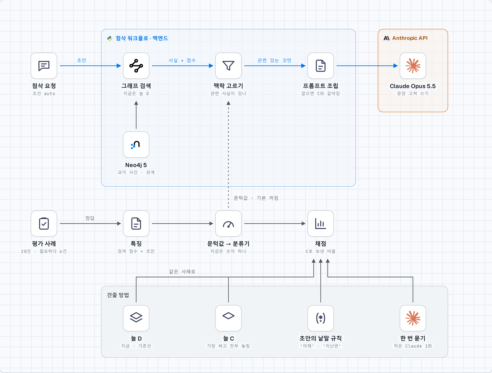

# 조건 선택기 설계

2026-11-25 · 설계입니다. 만든 것도, 학습시킨 것도 없습니다. [학습 모델 설계안](ml-design-2026-11-24.md)의 "조건 선택기" 절을 풀어 쓴 것입니다. 설계안이 "나중에"로 둔 과제이고, 이 문서도 그 판단을 바꾸지 않습니다. 지금 할 수 있는 것과 없는 것을 가르는 데 무게를 둡니다.

그림 원본은 [images/ml-condition-selector-stack-ko.html](../images/ml-condition-selector-stack-ko.html)입니다. 어두운 배경 판은 `images/ml-condition-selector-stack-ko-dark.png`입니다.

## 먼저 결론

- **무엇을 만드나**: 첨삭 요청마다 과거 맥락(지식 그래프)이 필요한지를 가려, 필요 없으면 조건 D 대신 C로 보내는 장치입니다.
- **초안만 보고는 가리기 어렵습니다.** 맥락이 필요한지는 초안만이 아니라 그래프에 무엇이 들어 있는지에도 달렸습니다. 그래서 고르는 자리를 검색 앞에서 검색 뒤로 옮기자고 제안합니다.
- **학습시킬 자료가 없습니다.** 정답이 달린 사례가 20건이고 그중 "필요하다"가 6건입니다. 지금은 큰 모델은 물론 작은 분류기도 믿을 만하게 만들 수 없습니다.
- **지금 할 수 있는 것은 문턱값 하나입니다.** 검색 점수가 낮으면 맥락을 빼는 규칙을 먼저 두고, 사례가 모이면 분류기로 바꿉니다.
- **먼저 재야 할 것**: D가 C보다 느리고 비싼 것이 검색 때문인지 길어진 프롬프트 때문인지입니다. 어디서 아낄 수 있는지가 여기서 갈립니다.

## 지금은 이렇게 고릅니다

`auto`는 쓸 수 있는 조건 가운데 가장 많이 넣는 쪽을 고릅니다(`services/rewrite_service.py`의 `resolve_auto`).

| 순서 | 조건 | 고르는 기준 |
|---|---|---|
| 1 | D | 그래프를 쓸 수 있고, 이 상대의 메시지가 그래프에 1건이라도 들어 있다 |
| 2 | C | 이 상대의 문체 묶음이 1개라도 있다 |
| 3 | B | 저장된 말투 설정이 있다 |
| 4 | A | 아무것도 없다 |

초안은 보지 않습니다. 그래프에 메시지가 한 건이라도 있는 상대에게는 "넵 확인했습니다"를 고칠 때도 D가 됩니다.

설계안에 적힌 실측(11/24)으로는 D가 A보다 입력 토큰이 3배쯤, 걸리는 시간이 1.7배쯤입니다. 그보다 앞선 기록(`docs/project/decisions.md`)에는 D의 입력 토큰이 C의 1.8배라고 적혀 있습니다.

## 정답이 얼마나 있나

평가 사례(`evals/eval_cases.csv`)에 `needs_graph` 칸이 있습니다. 11/25에 세어 봤습니다.

| 묶음 | 필요 없다 | 필요하다 |
|---|---|---|
| dev | 11 | 5 |
| test | 3 | 1 |
| 합 | 14 | 6 |

"필요하다" 6건을 보면 상대가 치우쳐 있습니다. 동기(이서연)가 4건, 친구(최유진)가 2건이고, 팀장과 동생은 없습니다.

여기서 두 가지가 나옵니다.

**20건으로는 학습도 채점도 할 수 없습니다.** "필요하다"를 95% 넘게 지키는지 재려면 "필요하다"가 100건은 있어야 합니다. 시험 묶음에는 1건뿐입니다.

**정답이 초안이 아니라 상대를 따라갑니다.** 과거에 사건이 있었던 상대에게만 "필요하다"가 붙습니다. 이 자료로 가르치면 모델은 "이 초안에 맥락이 필요한가"가 아니라 "이 상대가 누구인가"를 배웁니다.

## 문제를 다시 봅니다

"맥락이 필요한가"는 두 가지가 다 맞아야 "예"입니다.

1. 초안이 과거의 일과 이어져 있다. ("어제는 제가 좀 예민했던 것 같아요")
2. 그 일이 그래프에 들어 있다.

초안만 보는 선택기는 1번만 봅니다. 2번은 검색을 해 봐야 압니다. 그래서 고르는 자리가 둘 있습니다.

| 자리 | 보는 것 | 아끼는 것 | 판단 |
|---|---|---|---|
| 검색 앞 | 초안, 상대의 통계 | 검색 시간 + 프롬프트 토큰 | 신호가 약합니다. 사례가 모인 뒤에 |
| **검색 뒤** | 초안 + 검색해 온 사실과 그 점수 | 프롬프트 토큰 | 신호가 강합니다. 먼저 이것부터 |

검색 뒤에서 고르면 "찾아온 사실이 이 초안과 실제로 관련 있는가"를 봅니다. 그래프 검색기는 이미 사실마다 점수를 매깁니다(비슷한 정도 0.75, 최근인 정도 0.15, 검색 순위 0.10, `graph/retriever.py`). 가장 높은 점수가 낮으면 관련된 사실이 없다는 뜻이고, 그때 맥락 블록을 빼면 프롬프트가 조건 C와 같아집니다.

검색 뒤에서 고르면 검색 시간은 아끼지 못합니다. 그것이 얼마나 아까운지는 D의 시간이 어디서 드는지에 달렸는데, 재 본 적이 없습니다. 그래프 검색이 모델을 부르지 않는다는 것은 제 이해이고 코드에서 확인하지 않았습니다.

## 만드는 것

### 1단계: 문턱값

- **입력**: 검색해 온 사실들의 점수.
- **규칙**: 가장 높은 점수가 문턱 아래면 맥락 블록을 넣지 않습니다.
- **문턱 정하기**: 평가 사례에서 "필요하다" 6건을 모두 지키는 가장 높은 값으로 둡니다. 6건으로 정한 값이라 믿을 만하지 않습니다. 경고만 남기고 실제로 빼지는 않는 상태로 먼저 돌립니다.

학습이 아닙니다. 숫자 하나를 정하는 일입니다. 그래도 "늘 D"와 견줄 기준이 생기고, 나중에 분류기가 이겨야 할 대상이 됩니다.

### 2단계: 작은 분류기 (사례가 모인 뒤)

- **입력**: 숫자 여남은 개입니다.
  - 검색 쪽: 가장 높은 점수, 문턱을 넘는 사실의 수, 가장 가까운 사실이 며칠 전 것인지, 사건의 종류와 중요도.
  - 초안 쪽: 의도(사과·거절 등), 과거를 가리키는 말이 있는지("어제", "지난번", "그때"), 날짜·사람이 들어 있는지.
- **모델**: 로지스틱 회귀나 작은 트리. GPU가 필요 없습니다.
- **출력**: 맥락이 필요할 확률.

큰 모델을 미세조정하지 않는 이유는 자료가 적고, 넣는 것이 문장이 아니라 숫자이기 때문입니다.

### 견줄 방법

| # | 방법 | 비고 |
|---|---|---|
| 1 | 늘 D (지금) | 기준선. 놓치는 것이 없고 가장 비쌉니다 |
| 2 | 늘 C | 반대쪽 끝. 가장 싸고 맥락을 전부 놓칩니다 |
| 3 | 초안의 낱말 규칙 | "어제", "지난번" 같은 말이 있으면 D |
| 4 | 검색 점수 문턱 | 1단계 |
| 5 | 작은 분류기 | 2단계 |
| 6 | 작은 Claude에게 한 번 묻기 | 초안과 찾아온 사실을 주고 관련 있는지 묻습니다 |

## 정답을 늘리는 법

| 방법 | 비용 | 걱정 |
|---|---|---|
| 평가 사례를 늘립니다 (20개를 넘겨 늘리는 일은 백로그에 아직 줄이 없습니다) | 사람 시간 | 느립니다. 20건을 만드는 데도 시간이 걸렸습니다 |
| 이미 돌린 평가 결과에서 읽습니다 | 없음 | D와 C의 결과가 실제로 달랐는지, 경고가 그래프 사실을 짚었는지를 봅니다. 사례는 여전히 20건입니다 |
| 합성 초안을 만듭니다 | Claude 호출 | 합성 대화의 사건을 가리키는 초안과 무관한 초안을 짝지어 만듭니다. 만든 대로가 정답입니다 |

세 번째가 수를 늘리는 유일한 길입니다. 합성 대화 4개에 사건이 몇 개 없어서, 초안을 많이 만들어도 가리키는 사건이 되풀이됩니다. 대화부터 늘려야 할 수 있고, 대화를 늘리면 그래프 수집 비용이 듭니다.

상대가 한쪽으로 치우치지 않게, 사건이 있는 상대에게도 "필요 없다" 초안을, 사건이 없는 상대에게도 과거를 가리키는 초안을 만듭니다. 뒤쪽은 초안은 과거를 가리키는데 그래프에 없는 경우이고, 정답은 "필요 없다"입니다. 넣을 사실이 없기 때문입니다.

## 재는 것

**가장 먼저 볼 숫자: 맥락이 필요한 요청을 95% 넘게 지키면서 C로 보낼 수 있는 비율.**

틀리는 방향에 따라 손해가 다릅니다.
- 필요 없는데 D로 보내면 토큰을 더 씁니다. 지금 늘 일어나는 일입니다.
- 필요한데 C로 보내면 과거 사실이 빠진 문장이 나갑니다. 이 서비스가 내세우는 기능이 조용히 꺼지는 것입니다.

뒤쪽이 훨씬 나쁘므로 "필요하다"를 지키는 쪽에 문턱을 둡니다.

| 함께 적는 것 | 왜 |
|---|---|
| C로 보낸 요청에서 줄어든 입력 토큰과 시간 | 실제로 아낀 양입니다 |
| C로 보낸 것 가운데 사람이 "필요했다"고 본 건수 | 놓친 것입니다 |
| 상대별로 나눈 숫자 | 상대만 보고 고르는지 봅니다 |
| 첨삭 평가의 맥락 적중과 사실 보존 | 서비스 결과가 나빠지는지 봅니다 |

얼마나 아낄 수 있는지 어림하면 이렇습니다. 평가 사례에서는 20건 중 14건이 "필요 없다"입니다. 그 14건이 모두 C로 가면 그 요청들의 입력 토큰이 절반 가까이 줄어듭니다(D가 C의 1.8배라는 기록 기준). 실제 사용에서 "필요 없다"가 몇 %일지는 모릅니다.

## 서비스에 붙이는 모양

- **자리**: 워크플로의 검색과 프롬프트 조립 사이입니다. 순서는 여전히 코드가 정합니다.
- **플래그**: `CONTEXT_GATE=off|log|on`, 기본 `off`. `log`는 판단을 기록만 하고 프롬프트는 그대로 둡니다. 실제 요청에서 문턱이 어떻게 동작하는지 먼저 보려는 것입니다.
- **기록**: 실행 기록에 "맥락을 뺐다"와 그때의 점수를 남깁니다. 검색기 버전 이름에도 표시를 붙여, 빼고 만든 결과와 넣고 만든 결과를 섞어 견주지 않게 합니다.
- **사용자가 조건을 직접 고르면 건드리지 않습니다.** `auto`일 때만 동작합니다.
- **멱등 해시는 그대로입니다.** 요청은 `auto`인 채로 해시하기 때문입니다.

## 순서

| 단계 | 할 일 | 비용 | 여기서 정해지는 것 |
|---|---|---|---|
| 0 | D의 시간과 토큰이 어디서 드는지 잽니다 | 없음 (기록 읽기) | 검색 뒤에서 골라도 충분한지 |
| 1 | 이미 돌린 평가 결과에서 검색 점수와 `needs_graph`를 나란히 놓습니다 | 없음 | 점수로 가를 수 있는지 |
| 2 | 문턱값을 `log`로 붙입니다 | 없음 | 실제 요청에서 몇 %가 걸리는지 |
| 3 | 사례를 늘립니다 | 사람 시간 또는 Claude 호출 | 학습할 수 있는지 |
| 4 | 작은 분류기와 방법 6을 견줍니다 | 호출 조금 | 문턱값보다 나은지 |

1단계에서 점수가 "필요하다"와 "필요 없다"를 가르지 못하면, 문턱값도 분류기도 쓸모가 없습니다. 그때는 검색기 쪽을 먼저 고쳐야 합니다.

## 확인한 것과 못 한 것

확인한 것:
- `auto`는 초안을 보지 않고 가장 풍부한 조건을 고릅니다(`resolve_auto`).
- 정답이 달린 사례는 20건, "필요하다"는 6건이고 상대 둘에 몰려 있습니다 (11/25).

못 한 것:
- D의 시간이 검색에서 드는지 프롬프트에서 드는지.
- 그래프 검색이 모델을 부르는지. 부르지 않는다고 알고 있지만 코드에서 확인하지 않았습니다.
- 검색 점수가 "필요하다"를 실제로 가르는지. 이미 있는 평가 결과로 볼 수 있는데 아직 보지 않았습니다.
- 실제 사용에서 맥락이 필요한 요청의 비율.

## 정할 것

1. 고르는 자리를 검색 뒤로 옮기는 데 동의하는지. 검색 시간은 아끼지 못합니다.
2. 문턱값을 `log`로 먼저 붙여 볼지, 사례가 모일 때까지 기다릴지.
3. 사례를 늘리는 일을 누가 얼마나 할지. 백로그에 아직 줄이 없습니다(예전 B1은 20개를 기다리던 본실행이었고 11/24에 A15로 옮겨졌습니다).
4. 합성 대화를 늘릴지. 늘리면 그래프 수집 비용이 듭니다.
