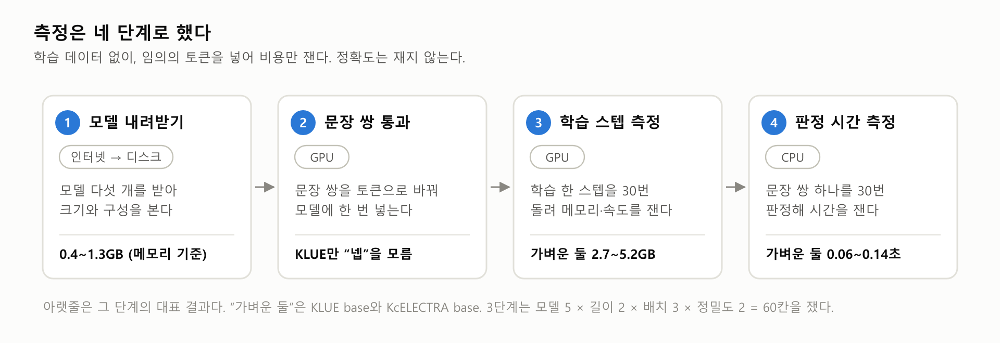
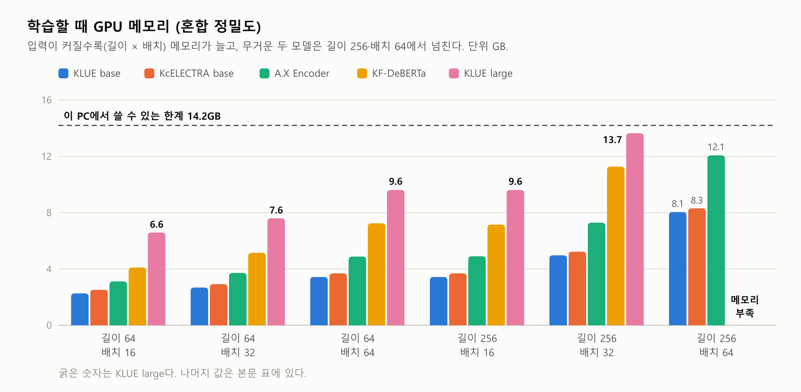
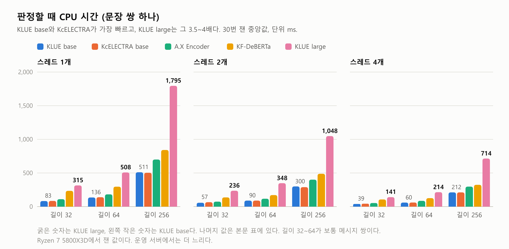
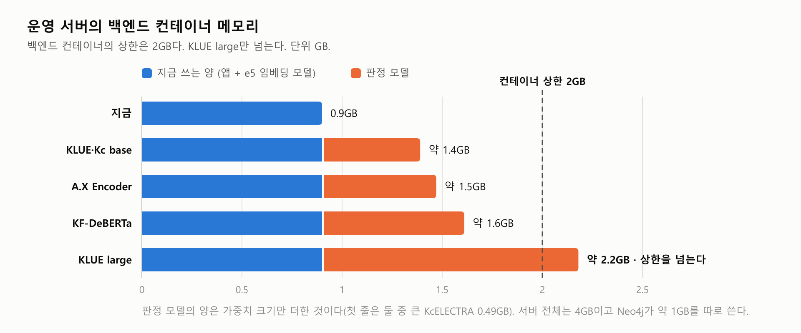
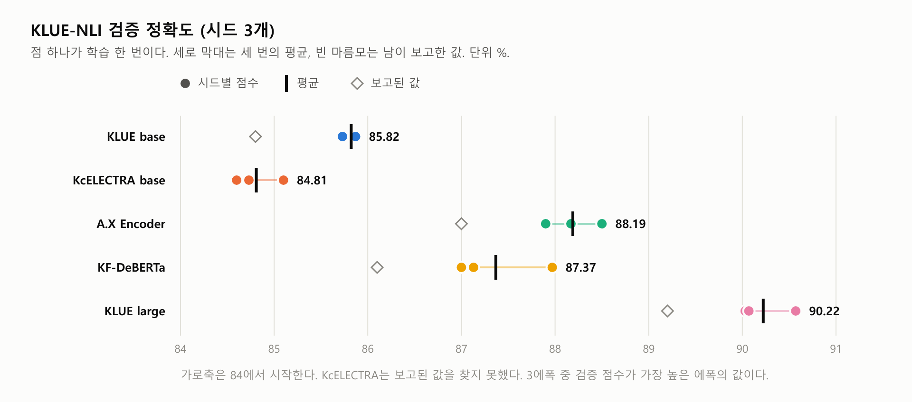

# 판정 모델 기반 모델 측정 (GPU 메모리·학습 속도·CPU 판정 시간·KLUE-NLI 정확도)

2026-11-25

[의미 보존 판정 모델 설계서](ml-judge-design-2026-11-25.md)에는 GPU 메모리나 학습 시간이 전부 짐작으로 적혀 있었습니다. 학습 데이터를 만들기 전에 그 짐작이 맞는지부터 확인하고 싶어서, 후보 모델을 내려받아 직접 재 봤습니다.

처음에는 설계서에 적힌 세 개만 쟀습니다. 그 뒤 다른 후보가 없는지 논문과 모델 카드를 찾아봤고, 거기서 나온 두 개(A.X Encoder, KF-DeBERTa)를 같은 방식으로 더 쟀습니다. 그래서 모두 다섯 개입니다.

우리 과제의 학습 데이터가 아직 없어서, 비용은 아무 토큰이나 넣고 쟀습니다(1~4장). 그것만으로는 어느 모델이 더 똑똑한지 알 수 없어서, 공개된 문장 쌍 시험인 KLUE-NLI로 다섯 모델을 실제로 학습시켜 점수도 비교했습니다(5장).

그래도 이 문서로 알 수 있는 건 "얼마나 드는가"와 "글말 문장 쌍을 얼마나 잘 배우는가"까지입니다. 채팅 말투에서 위반을 얼마나 잘 잡는지는 우리 데이터를 만든 뒤에야 알 수 있습니다.



## 결론부터

비용만 놓고 줄을 세우면 이렇습니다.

**KLUE base ≈ KcELECTRA base < A.X Encoder < KF-DeBERTa < KLUE large**

가장 가벼운 둘(KLUE base, KcELECTRA base)은 걱정할 게 없었습니다. 설계서에서 가장 큰 학습으로 잡은 1만 쌍 × 5에폭이 메모리 2.7~5.2GB, 시간 1.5~2.4분이면 끝납니다. 16GB GPU에서 한참 남습니다.

KLUE large는 돌아가긴 하는데 빠듯합니다. 길이 256에서 배치 32를 넣으면 13.7GB를 써서 한계(14.2GB) 바로 밑이고, 배치 64는 아예 안 들어갑니다. 배치 16으로 낮추면 9.6GB, 8.4분으로 편해집니다.

새로 잰 둘은 기대와 좀 달랐습니다. A.X Encoder는 이름이 "base"인데 22층이라 가벼운 둘보다 메모리를 1.4~1.5배 쓰고, CPU 판정도 1.3~1.4배 느립니다. KF-DeBERTa는 12층인데도 메모리가 2배를 넘습니다. 둘 다 large보다는 쌉니다.

운영 쪽은 차이가 더 큽니다. 판정은 GPU 없는 서버에서 CPU로 해야 하는데, 보통 메시지 하나에 가벼운 둘은 0.06~0.14초, large는 0.2~0.5초가 걸렸습니다. 지금 서버(메모리 4GB)에는 large만 못 올리고 나머지 넷은 올라갑니다.

KLUE-NLI로 실제로 학습시켜 보니 점수 순서는 비용 순서와 거의 같았습니다. KLUE large가 90.2점으로 가장 높고, A.X Encoder 88.2점, KF-DeBERTa 87.4점, KLUE base 85.8점, KcELECTRA 84.8점입니다. 시드 3개의 평균입니다. 눈에 띄는 건 A.X Encoder로, KLUE base보다 2.4점 높은데 비용은 1.4배쯤이고 운영 서버에도 그대로 올라갑니다.

정리하면 설계서에 적은 순서, 그러니까 가벼운 모델로 먼저 해 보고 목표에 못 미칠 때만 큰 모델을 꺼내는 순서를 바꿀 이유가 없습니다. 달라진 점이 하나 있다면, large로 바로 넘어가기 전에 A.X Encoder라는 중간 단계가 생겼다는 것입니다.

## 어디서 쟀나

| 항목 | 값 |
|---|---|
| GPU | RTX 5070 Ti 16GB (잴 때 비어 있던 양은 14.7GB) |
| CPU | Ryzen 7 5800X3D (8코어 16스레드) |
| 실행 환경 | Docker 이미지 `gpu-train:cu132` (Python 3.12, PyTorch 2.15.0, CUDA 13.2) |
| 스크립트 | `C:\Users\gkfkd\dev\gpu-train`의 `step1_download.py` ~ `step4_cpu_latency.py` |

스크립트는 이 저장소 밖에 있습니다. 나중에 `ml/` 폴더를 만들면 옮겨야 합니다.

## 잰 모델

| 모델 | 구조 | 층 | 파라미터 | 사전 크기 | 메모리에 올린 크기 | KLUE-NLI |
|---|---|---|---|---|---|---|
| `klue/roberta-base` | RoBERTa | 12 | 1.106억 | 32,000 | 422MB | 84.8 |
| `beomi/KcELECTRA-base-v2022` | ELECTRA | 12 | 1.272억 | 54,343 | 487MB | 못 찾음 |
| `skt/A.X-Encoder-base` | ModernBERT | 22 | 1.487억 | 49,999 | 570MB | 87.0 |
| `kakaobank/kf-deberta-base` | DeBERTa-v2 | 12 | 1.853억 | 130,000 | 709MB | 86.1 |
| `klue/roberta-large` | RoBERTa | 24 | 3.367억 | 32,000 | 1,284MB | 89.2 |

숨은 차원은 large만 1024이고 나머지는 768입니다.

맨 오른쪽 KLUE-NLI 점수는 제가 잰 게 아닙니다. 문장 쌍의 관계를 맞히는 공개 시험 점수로, 우리 과제와 가장 가까워서 참고로 적었습니다. KLUE 두 모델은 KLUE 공식 표의 값이고, A.X와 KF-DeBERTa는 A.X 모델 카드에 실린 비교표의 값입니다. 만든 쪽이 스스로 보고한 숫자이고, 카드의 표가 읽는 곳마다 조금씩 달라서 그대로 믿기는 어렵습니다.

눈여겨볼 점이 둘 있습니다.

A.X Encoder는 허브에 올라온 가중치 파일이 286MB라 가장 작아 보이는데, 반정밀도로 저장돼 있어서 그렇습니다. 학습하려고 일반 정밀도로 풀면 570MB입니다. 파일 크기만 보고 가볍다고 판단하면 안 됩니다.

KcELECTRA는 우리가 잰 v2022 저장소에 "v2023이 나와서 더는 관리하지 않는다"는 표시가 붙어 있습니다. 실제 학습 때는 새 판을 써야 합니다. 새 판은 재지 않았습니다.

## 1. 문장 쌍이 토큰으로 바뀌는 모습

설계서에 예로 든 쌍을 그대로 넣어 봤습니다. 원문은 "넵 내일까지 보내드릴게요ㅎㅎ", 고친 문장은 "네, 알겠습니다."입니다.

| 모델 | 토큰 수 | "넵" |
|---|---|---|
| `klue/roberta-base`, `-large` | 20 | `[UNK]` (모르는 낱말) |
| `beomi/KcELECTRA-base-v2022` | 15 | 아는 낱말 |
| `skt/A.X-Encoder-base` | 20 | 아는 낱말 |
| `kakaobank/kf-deberta-base` | 17 | 아는 낱말 |

"넵"을 모르는 건 KLUE뿐이었습니다. 설계서에서 "KLUE는 채팅 말투가 낯설 수 있다"고 걱정했는데 첫 문장부터 그 걱정이 맞아떨어졌습니다. 다만 문장 하나만 본 것이라, 실제 채팅에서 이런 일이 얼마나 잦은지는 따로 세어 봐야 합니다.

KLUE large로 바꿔도 이건 그대로입니다. base와 사전이 같으니까요. 채팅 말투 문제는 크기를 키워서 풀리는 게 아니고, 사전이 다른 모델을 골라야 풀립니다.

출력 모양은 다섯 모델 모두 설계대로 나왔습니다. 문장 쌍 하나를 넣으면 라벨 4개(`fact_changed`, `negation_flipped`, `commitment_changed`, `fact_added`)에 대한 점수가 하나씩 나옵니다. 학습 전이라 점수 자체는 아무 뜻이 없습니다.

## 2. 학습할 때 GPU 메모리와 속도

학습 한 스텝을 실제와 똑같이 돌렸습니다. 답을 내고, 틀린 정도를 계산하고, 어디를 고칠지 거꾸로 계산해서, 가중치를 고치는 데까지입니다. 처음 5스텝은 준비 작업이 섞여 느리므로 버리고 그다음 30스텝을 쟀습니다.

입력이 가짜인데 믿어도 되느냐고 물을 수 있는데, 메모리와 속도는 입력의 내용이 아니라 모양(배치 크기 × 길이)으로 정해집니다. 그래서 실제 학습 때도 같은 값이 나옵니다.

아래에서 "시간"은 1만 쌍을 5에폭 돌리는 데 걸리는 시간입니다. 길이 64는 보통 메시지 쌍이고, 256은 설계서에서 잡은 상한입니다.



### 혼합 정밀도 (이걸로 학습할 겁니다)

| 길이 | 배치 | KLUE base | KcELECTRA base | A.X Encoder | KF-DeBERTa | KLUE large |
|---|---|---|---|---|---|---|
| 64 | 16 | 2.27GB · 3.1분 | 2.52GB · 3.0분 | 3.12GB · 4.6분 | 4.10GB · 5.7분 | 6.59GB · 6.4분 |
| 64 | 32 | 2.68GB · 1.5분 | 2.93GB · 1.5분 | 3.72GB · 2.4분 | 5.15GB · 2.8분 | 7.60GB · 3.2분 |
| 64 | 64 | 3.43GB · 0.7분 | 3.69GB · 0.8분 | 4.88GB · 1.2분 | 7.24GB · 1.4분 | 9.62GB · 2.1분 |
| 256 | 16 | 3.43GB · 3.0분 | 3.69GB · 3.1분 | 4.90GB · 5.1분 | 7.15GB · 6.1분 | 9.62GB · 8.4분 |
| 256 | 32 | 4.97GB · 2.3분 | 5.23GB · 2.4분 | 7.29GB · 4.2분 | 11.28GB · 5.1분 | 13.65GB · 7.4분 |
| 256 | 64 | 8.05GB · 2.2분 | 8.31GB · 2.2분 | 12.08GB · 4.3분 | 메모리 부족 | 메모리 부족 |

### 일반 정밀도

| 길이 | 배치 | KLUE base | KcELECTRA base | A.X Encoder | KF-DeBERTa | KLUE large |
|---|---|---|---|---|---|---|
| 64 | 16 | 2.27GB · 2.3분 | 2.53GB · 2.4분 | 3.35GB · 3.9분 | 4.65GB · 4.8분 | 6.58GB · 6.2분 |
| 64 | 32 | 2.85GB · 1.7분 | 3.11GB · 1.7분 | 4.38GB · 2.4분 | 6.49GB · 2.6분 | 8.14GB · 5.0분 |
| 64 | 64 | 4.08GB · 1.4분 | 4.34GB · 1.4분 | 6.45GB · 2.0분 | 10.17GB · 2.1분 | 11.27GB · 4.4분 |
| 256 | 16 | 4.08GB · 6.2분 | 4.34GB · 6.4분 | 6.50GB · 9.1분 | 9.45GB · 9.7분 | 11.27GB · 19.3분 |
| 256 | 32 | 6.38GB · 5.7분 | 6.63GB · 5.8분 | 10.71GB · 8.8분 | 메모리 부족 | 메모리 부족 |
| 256 | 64 | 11.13GB · 5.6분 | 11.38GB · 5.7분 | 메모리 부족 | 메모리 부족 | 메모리 부족 |

### 표에서 읽은 것

메모리는 배치 크기와 길이를 곱한 만큼 늡니다. 길이 64·배치 64와 길이 256·배치 16은 토큰 수가 같은데, 메모리도 다섯 모델 모두 거의 같게 나왔습니다.

혼합 정밀도는 입력이 클 때 효과가 큽니다. KLUE base에서 길이 256·배치 64를 돌리면 메모리가 11.1GB에서 8.1GB로 줄고 속도는 2.5배가 됩니다. 반대로 가장 작은 입력에서는 일반 정밀도가 조금 더 빨랐습니다. 우리는 큰 입력 쪽이 문제라서 혼합 정밀도를 쓰는 게 맞습니다.

KLUE base와 KcELECTRA는 사실상 같은 비용입니다. KcELECTRA가 사전이 커서 0.25GB쯤 더 쓰는 정도입니다. 그러니 둘 중 무엇을 고를지는 비용이 아니라 정확도로 정하면 됩니다.

A.X Encoder는 가벼운 둘과 large의 중간입니다. 메모리는 KLUE base의 1.4~1.5배, 시간은 1.6~2배쯤 듭니다. 층이 22개라 그렇습니다. 모델 카드는 "기존보다 최대 3배 빠르다"고 하는데, 우리처럼 짧은 문장 쌍으로 학습할 때는 그 효과가 보이지 않았습니다. 수천 토큰짜리 긴 글에서 나는 차이로 보입니다.

KF-DeBERTa는 층 수에 비해 무겁습니다. 12층인데 메모리가 KLUE base의 2배를 넘고, 길이 256·배치 64는 large처럼 넘칩니다. DeBERTa는 낱말 사이의 상대 위치를 따로 계산하는 구조라 같은 층 수에서도 메모리를 더 씁니다.

KLUE large는 길이 256에서 배치 16으로 돌리는 게 안전합니다. 배치 32도 들어가긴 하지만 13.65GB라, 브라우저 같은 다른 프로그램이 GPU를 조금만 더 써도 넘칩니다. 배치 32의 효과가 필요하면 배치 16으로 두 번 계산한 뒤 한 번에 고치는 방법(기울기 누적)을 쓰면 됩니다.

설계서에 적은 실험 40회(모델 2 × 학습률 4 × 시드 5)를 다 돌리면 가벼운 둘로는 1시간 반 안쪽입니다. large는 한 번에 8분쯤이라 5~6시간이 걸립니다. 하룻밤이면 끝나는 양입니다.

### 설계서의 짐작은 얼마나 맞았나

| | 설계서의 짐작 | 잰 값 (혼합 정밀도) |
|---|---|---|
| base, 배치 32 메모리 | 3~5GB | 2.7~5.2GB |
| base, 1만 쌍 5에폭 | 몇 분 | 1.5~2.4분 |
| large, 배치 16 메모리 | 8~11GB | 6.6~9.6GB |
| large, 1만 쌍 5에폭 | 10~20분 | 6.4~8.4분 |

base는 거의 그대로 맞았고, large는 짐작보다 덜 들었습니다. 여기서 base는 설계서가 후보로 적은 KLUE base와 KcELECTRA base입니다.

## 3. 판정할 때 CPU 시간

운영 서버에는 GPU가 없어서 판정은 CPU로 해야 합니다. 문장 쌍 하나를 30번 판정해서 중앙값을 냈습니다. 단위는 ms입니다.



| 스레드 | 길이 | KLUE base | KcELECTRA base | A.X Encoder | KF-DeBERTa | KLUE large |
|---|---|---|---|---|---|---|
| 1 | 32 | 83 | 85 | 110 | 234 | 315 |
| 1 | 64 | 136 | 139 | 182 | 296 | 508 |
| 1 | 256 | 511 | 503 | 700 | 842 | 1,795 |
| 2 | 32 | 57 | 66 | 74 | 137 | 236 |
| 2 | 64 | 90 | 90 | 117 | 171 | 348 |
| 2 | 256 | 300 | 290 | 401 | 488 | 1,048 |
| 4 | 32 | 39 | 43 | 53 | 106 | 141 |
| 4 | 64 | 60 | 61 | 86 | 126 | 214 |
| 4 | 256 | 212 | 212 | 297 | 324 | 714 |

가벼운 둘은 보통 메시지(길이 32~64)라면 스레드 하나로도 0.1초 안팎입니다. 첨삭 한 건에 Claude 호출이 몇 초씩 걸리는 걸 생각하면 티도 안 나는 수준입니다. 설계서에서 "수십~수백 밀리초"로 짐작했는데 실제로 40~510ms였습니다.

A.X Encoder는 KLUE base보다 1.3~1.4배 느립니다. 보통 메시지에 0.05~0.18초라 여전히 부담 없는 수준입니다.

KF-DeBERTa는 짧은 입력에서 특히 느립니다. 길이 32에서 KLUE base의 2.8배(234ms)이고, 길이가 길어지면 차이가 1.5배쯤으로 줄어듭니다. 입력 길이와 상관없이 드는 고정 비용이 큰 구조로 보입니다.

KLUE large는 KLUE base보다 3.5~4배 느립니다. 보통 메시지에 0.2~0.5초, 가장 긴 입력에는 0.7~1.8초가 걸립니다. 못 쓸 정도는 아니지만 첨삭마다 눈에 띄는 시간이 더해집니다.

## 4. 운영 서버에 올릴 수 있나

운영 서버는 AWS 서울의 EC2 한 대이고 메모리는 4GB입니다([deploy.md](../guides/deploy.md) 16장). 백엔드 컨테이너에는 메모리 상한 2GB가 걸려 있고, 지금은 0.84~0.96GB를 씁니다. 이 숫자는 deploy.md에 적힌 11월 11일 실측값입니다.



| | 더해지는 양 | 백엔드 메모리 | 상한 2GB |
|---|---|---|---|
| 지금 | — | 약 0.9GB | 여유 |
| KLUE base / KcELECTRA base | +0.42 / +0.49GB | 약 1.4GB | 들어감 |
| A.X Encoder | +0.57GB | 약 1.5GB | 들어감 |
| KF-DeBERTa | +0.71GB | 약 1.6GB | 들어감 (여유 0.4GB) |
| KLUE large | +1.28GB | 약 2.2GB | 넘음 |

large를 뺀 넷은 설정을 하나도 안 바꾸고 올릴 수 있습니다.

large는 그대로 올리면 상한을 넘어서 컨테이너가 죽었다가 다시 뜨기를 반복할 겁니다. 상한을 올리면 되긴 하는데, 그러면 Neo4j(약 1GB)와 OS까지 합쳐 4GB를 거의 다 쓰게 됩니다. large를 쓰려면 서버를 8GB로 키우는 게 맞습니다.

한 가지 조심할 점이 있습니다. 위 표에서 더한 값은 모델 가중치 크기뿐입니다. 판정하는 동안 잠깐 더 쓰는 메모리는 재지 않았으니 실제로는 조금 더 듭니다. 여유가 0.4GB뿐인 KF-DeBERTa는 올리기 전에 실제로 재 봐야 합니다.

## 5. KLUE-NLI로 실제로 학습해 보니

여기까지는 전부 비용 이야기였습니다. 어느 모델이 더 잘 배우는지 보려고, 공개된 시험인 KLUE-NLI로 다섯 모델을 같은 조건에서 실제로 학습시켰습니다.

KLUE-NLI는 문장 두 개를 주고 관계를 맞히는 시험입니다. 앞 문장이 참이면 뒤 문장도 참인지(함의), 거짓인지(모순), 알 수 없는지(중립) 셋 중 하나를 고릅니다. 문장 쌍의 뜻을 비교한다는 점에서 우리 과제와 가장 가까운 공개 시험입니다. 학습용 24,998쌍, 검증용 3,000쌍을 썼습니다. 시험용은 비공개라, 다들 그러듯 검증용 점수로 비교했습니다.

### 어떻게 돌렸나

| 항목 | 값 |
|---|---|
| 에폭 | 3 |
| 배치 | 32 |
| 최대 길이 | 128 |
| 학습률 | 2e-5 (KLUE large만 1e-5), 앞 6% 워밍업 뒤 줄임 |
| 정밀도 | 혼합 |
| 시드 | 42, 43, 44 |
| 점수 | 에폭이 끝날 때마다 검증용으로 재고, 세 번 중 가장 높은 값 |

다섯 모델 × 시드 3개로 모두 15번 학습했고, 실패한 것은 없었습니다. 전부 합쳐 1시간쯤 걸렸습니다.

### 결과



| 모델 | 평균 | 흔들림 | 시드 42 · 43 · 44 | 보고된 값 | 한 번 학습 | 최대 메모리 |
|---|---|---|---|---|---|---|
| KLUE large | 90.22 | ± 0.30 | 90.57 · 90.03 · 90.07 | 89.2 | 5.8분 | 8.9GB |
| A.X Encoder | 88.19 | ± 0.30 | 88.50 · 88.17 · 87.90 | 87.0 | 4.2분 | 4.5GB |
| KF-DeBERTa | 87.37 | ± 0.52 | 87.13 · 87.97 · 87.00 | 86.1 | 4.9분 | 5.8GB |
| KLUE base | 85.82 | ± 0.08 | 85.73 · 85.87 · 85.87 | 84.8 | 2.7분 | 3.1GB |
| KcELECTRA base | 84.81 | ± 0.26 | 84.73 · 85.10 · 84.60 | 못 찾음 | 2.8분 | 3.2GB |

"흔들림"은 세 값의 표준편차입니다.

### 확실히 말할 수 있는 것

KLUE large가 가장 높습니다. 세 번 중 가장 낮은 값(90.03)이 2위 A.X Encoder의 가장 높은 값(88.50)보다 1.5점 위에 있습니다.

A.X Encoder와 KF-DeBERTa는 가벼운 둘보다 확실히 높습니다. 둘의 가장 낮은 값(87.90, 87.00)이 KLUE base의 가장 높은 값(85.87)을 1점 넘게 앞섭니다.

KLUE base는 KcELECTRA보다 높습니다. 평균 차이는 1점인데 세 번의 범위가 겹치지 않습니다.

순서는 남이 보고한 것과 같았습니다. 네 모델 모두 보고된 값보다 1.0~1.3점 높게 나왔는데, 순서가 그대로라서 모델 카드의 점수를 대체로 믿어도 된다는 뜻으로 읽었습니다.

### 아직 말할 수 없는 것

A.X Encoder와 KF-DeBERTa 중 어느 쪽이 높은지는 확정하지 못했습니다. 평균은 A.X가 0.8점 높지만, KF-DeBERTa의 시드 43(87.97)이 A.X의 시드 44(87.90)보다 높아서 범위가 겹칩니다. 다만 A.X가 더 가볍고 덜 흔들리므로, 둘 중 하나를 고른다면 A.X입니다.

### 에폭별로 보면

다섯 모델 모두 2에폭까지 크게 오르고 3에폭에서는 거의 멈췄습니다. 2에폭에서 3에폭으로 가며 오른 폭이 0.1~0.7점입니다. 에폭을 더 늘려도 얻을 게 많지 않아 보입니다.

| 모델 (시드 42) | 1에폭 | 2에폭 | 3에폭 |
|---|---|---|---|
| KLUE base | 84.23 | 85.57 | 85.73 |
| KcELECTRA base | 82.00 | 84.27 | 84.73 |
| A.X Encoder | 86.67 | 88.27 | 88.50 |
| KF-DeBERTa | 85.70 | 87.03 | 87.13 |
| KLUE large | 89.80 | 90.47 | 90.57 |

이 시드에서는 A.X Encoder와 KLUE large가 1에폭만 돌려도 KLUE base의 최종 점수를 넘었습니다. KLUE large는 세 시드 모두 그랬고, A.X Encoder는 시드 43에서 1에폭이 85.33으로 조금 못 미쳤습니다.

### 이 점수를 어떻게 써야 하나

A.X Encoder를 후보에 넣을 근거가 생겼습니다. KLUE base보다 2.4점 높고, 비용은 1.4배쯤이며, 운영 서버에 그대로 올라갑니다. KLUE large와는 2.0점 차이인데, 그 2점을 얻으려면 서버를 키우고 판정 시간을 2.5~3배 써야 합니다.

KcELECTRA는 여기서 꼴찌지만 후보에서 빼면 안 됩니다. KLUE-NLI의 문장은 뉴스, 위키, 리뷰에서 온 글말이라 댓글로 학습한 모델에 불리합니다. 우리 과제는 채팅 말투이고, 1장에서 본 것처럼 KLUE는 "넵"조차 모릅니다. 채팅에서의 순서는 다를 수 있습니다.

이 학습으로 만든 모델은 버리지 않고 쓸 수 있습니다. KLUE-NLI로 먼저 가르친 모델을 우리 위반 데이터 학습의 출발점으로 삼으면(중간 과제 거치기), 합성 데이터가 수천 쌍뿐이어도 유리합니다. 다만 이번에는 학습된 모델을 저장하지 않아서, 그렇게 하려면 저장하도록 고친 뒤 다시 돌려야 합니다.

### 조심해서 읽을 점

- 학습률을 모델마다 맞추지 않았습니다. 전부 2e-5이고 large만 1e-5입니다. ELECTRA 계열은 더 높은 학습률에서 잘 나오는 경우가 있어서 KcELECTRA가 손해를 봤을 수 있습니다.
- 검증용으로 가장 좋은 에폭을 고르고 그 점수를 그대로 적었습니다. 공개된 점수들도 같은 방식이라 비교에는 문제없지만, 조금 부푼 값입니다.
- 시드가 3개뿐입니다. 표준편차 0.1~0.5점은 대략의 크기로만 봐야 합니다.

## 재다가 걸려 넘어진 것들

**RoBERTa에 문장 번호를 넘기면 GPU에서 멈춥니다.** 토크나이저는 첫 문장에 0, 둘째 문장에 1을 붙여 주는데(`token_type_ids`), RoBERTa는 0 하나밖에 모릅니다(`type_vocab_size=1`). 그대로 넘겼더니 `device-side assert`라는 알아보기 힘든 오류로 멈췄습니다. 모델이 아는 번호가 하나뿐이면 이 값을 빼고 넘기도록 고쳤습니다. A.X Encoder(ModernBERT)와 KF-DeBERTa는 이 설정이 아예 없거나 0이라 마찬가지로 빼고 넘깁니다. 실제 학습 코드에서도 똑같이 걸릴 자리입니다.

**Windows에서는 GPU 메모리가 넘쳐도 오류가 안 납니다.** 전용 메모리가 다 차면 조용히 일반 메모리로 넘겨 쓰는데, 그 순간부터 수십 배 느려집니다. large를 처음 잴 때 이것 때문에 10분 넘게 멈춰 있었습니다. 오류가 안 나니 뭐가 잘못됐는지도 바로 안 보였습니다. `torch.cuda.set_per_process_memory_fraction`으로 상한(비어 있는 양 − 0.5GB)을 걸어서, 넘치면 바로 메모리 부족 오류가 나게 바꿨습니다. 학습 스크립트에도 같은 상한을 꼭 넣어야 합니다.

**가중치가 반정밀도로 저장된 모델이 있습니다.** A.X Encoder가 그랬습니다. 아무 생각 없이 올리면 이 모델만 반정밀도로 올라가서 다른 모델과 조건이 달라집니다. 모든 모델을 일반 정밀도로 바꾼 뒤 재도록 스크립트를 고쳤습니다.

**CPU 시간은 다른 작업과 겹치면 부풀니다.** 처음에 GPU 측정과 겹쳐 돌렸더니 10%쯤 높게 나왔습니다. 위 표는 아무것도 안 돌리는 상태에서 다시 잰 값입니다.

## 아직 모르는 것

가장 큰 건 우리 과제에서의 정확도입니다. 5장의 KLUE-NLI 점수는 글말 문장 쌍으로 잰 것이라, 채팅 말투에서 위반을 잡는 순서를 보장하지 않습니다. 그건 학습 데이터를 만든 뒤에야 알 수 있습니다.

운영 서버에서 판정이 실제로 얼마나 걸리는지도 모릅니다. 서버의 vCPU 수와 인스턴스 종류를 확인하려 했는데, 이 PC에 접속 키가 없고 AWS 로그인도 만료돼 있어서 못 했습니다. 2 vCPU라면 스레드를 한두 개밖에 못 쓰고 코어도 이 PC보다 느릴 테니, 가벼운 둘은 0.2초 안팎, large는 1초 안팎쯤으로 짐작만 하고 있습니다.

그 밖에 남은 것들입니다.

- 채팅 말투에서 `[UNK]`가 얼마나 자주 나오는지. 문장 하나만 봤습니다.
- KcELECTRA 새 판(v2023)의 비용. 구조가 같다면 v2022와 같겠지만 재지 않았습니다.
- 작은 입력에서 속도가 초당 17스텝쯤에서 더 안 오르는 이유. GPU 계산 말고 스텝마다 드는 고정 시간이 한계인 것 같은데 확인하지는 않았습니다.
- ONNX로 바꾸거나 양자화하면 판정이 얼마나 빨라지는지. 설계서에 대안으로 적어 두기만 했습니다.
- `klue/*` 모델의 라이선스. 허브에 태그가 없어서 설계서 때부터 확인하지 못한 채입니다. A.X Encoder는 Apache 2.0, KF-DeBERTa는 MIT로 표시돼 있어 이 문제가 없습니다.

## 그림 원본

그림 다섯 장은 `../images/ml-judge-bench-{flow,gpu-memory,cpu-latency,server-memory,klue-nli}.png`이고, 같은 이름의 `.svg`가 원본입니다. 그림에 나온 값은 전부 본문 표에도 있습니다.

## 다시 재려면

`C:\Users\gkfkd\dev\gpu-train` 폴더에서 실행합니다. 모델 이름을 안 적으면 KLUE base와 KcELECTRA base 두 개를 잽니다. 이름은 여러 개를 이어 적을 수 있습니다.

```bash
docker compose run --rm train python step1_download.py
docker compose run --rm train python step2_forward.py
docker compose run --rm train python step3_gpu_bench.py
docker compose run --rm train python step4_cpu_latency.py
docker compose run --rm train python step3_gpu_bench.py klue/roberta-large skt/A.X-Encoder-base kakaobank/kf-deberta-base
```

KLUE-NLI 학습은 `step5_klue_nli.py`입니다. 모델 이름과 시드를 적습니다. 진행 상황은 `dashboard/progress.json`에 쌓이고, 같은 폴더의 `index.html`이 그걸 읽어 보여 줍니다.

```bash
docker compose run --rm train python step5_klue_nli.py klue/roberta-base skt/A.X-Encoder-base --seeds 42,43,44 --all-seeds 42,43,44 --reset
```

## 참고한 자료

- KLUE 논문과 공식 표: <https://arxiv.org/abs/2105.09680>, <https://github.com/KLUE-benchmark/KLUE>
- A.X Encoder 모델 카드: <https://huggingface.co/skt/A.X-Encoder-base>
- KF-DeBERTa 모델 카드: <https://huggingface.co/kakaobank/kf-deberta-base>
- KcELECTRA 모델 카드: <https://huggingface.co/beomi/KcELECTRA-base-v2022>
- ModernBERT 논문: <https://arxiv.org/abs/2412.13663>
