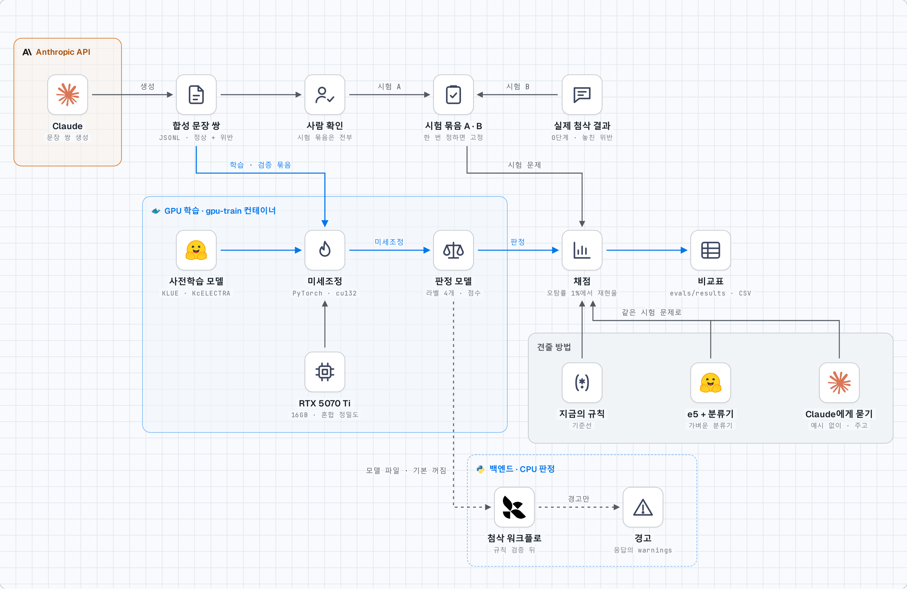

# 의미 보존 판정 모델 설계 (과제 1의 가운데)

2026-11-25 · 설계입니다. 아직 학습시킨 것도, 데이터를 만든 것도 없습니다. [학습 모델 설계안](ml-design-2026-11-24.md)의 과제 1 가운데 "의미 보존" 판정 하나를 실제로 만들 수 있는 수준까지 풀어 쓴 것입니다. 그 문서와 어긋나는 데가 있으면 아래 "설계안에서 바꾸자는 것"에 적어 둔 세 가지뿐이고, 나머지는 그 문서를 따릅니다.



그림 원본은 [images/ml-judge-stack-ko.html](../images/ml-judge-stack-ko.html)입니다. 어두운 배경 판은 `images/ml-judge-stack-ko-dark.png`입니다.

이 문서의 숫자 가운데 GPU 메모리, 학습 시간, 판정 시간은 전부 짐작입니다. 재 본 것은 "확인한 것" 절에 따로 적었습니다.

## 먼저 결론

- **무엇을 만드나**: 원문과 고친 문장을 함께 넣으면 "뜻이 달라진 곳이 있는가"를 네 가지로 답하는 분류기입니다.
- **어떻게 만드나**: 공개된 한국어 사전학습 모델(1억 개 안팎의 파라미터)을 가져와 우리가 만든 문장 쌍으로 미세조정합니다.
- **기반 모델**: `klue/roberta-base`와 `beomi/KcELECTRA-base-v2022` 둘을 같은 조건으로 학습시켜 견줍니다. 어느 쪽이 나을지는 재 보기 전에는 모릅니다.
- **가장 먼저 볼 숫자**: 규칙이 통과시킨 위반 가운데 모델이 잡아내는 비율입니다. 멀쩡한 결과를 100개 중 1개만 잘못 잡도록 맞춘 상태에서 잽니다.
- **서비스에는**: 꺼 둔 채로 붙이고, 켜도 경고만 냅니다. 규칙 검증은 그대로 둡니다.

## 설계안에서 바꾸자는 것

세 가지입니다. 정해진 것이 아니라 제안이고, 이유를 붙였습니다.

| 설계안 | 여기서는 | 이유 |
|---|---|---|
| 다섯 가지 중 하나를 고른다 (그대로 / 날짜·수량 / 부정 / 약속 / 없던 사실) | 네 가지를 각각 예·아니오로 답한다 | 고친 문장 하나에 위반이 둘 있을 수 있습니다. 요일도 바뀌고 사유도 붙은 경우가 그렇습니다. 하나만 고르게 하면 그런 문장의 정답을 정할 수 없습니다 |
| 시험 묶음 A는 300쌍 | 위반 300쌍 + 정상 1,000쌍 이상 | 오탐률 1%를 재려면 정상 문장이 많아야 합니다. 정상이 300쌍이면 1%는 3건이고, 1건만 달라져도 숫자가 크게 흔들립니다 |
| "약속이 흐려졌다" | "약속이 달라졌다" (흐려짐과 세짐 모두) | "해볼게요"가 "꼭 하겠습니다"가 되는 것도 뜻이 달라진 것입니다. 사용자가 하지 않은 약속을 대신 하게 됩니다 |

## 판정하는 것

### 네 가지 라벨

| 라벨 | 뜻 | 예 (원문 → 고친 문장) | 지금 규칙 |
|---|---|---|---|
| `fact_changed` | 날짜·시각·수량·사람이 다른 값으로 바뀌었거나 빠졌다 | "수욜까지 드릴게" → "목요일까지 드리겠습니다" | 글자로 드러나면 잡습니다. 줄임말 요일, 한 자리 수, 직함 없는 이름은 못 잡습니다 |
| `negation_flipped` | 부정·불가의 방향이 뒤집혔다 | "아직 안 봤습니다" → "확인했습니다" | 불가·어려움은 잡습니다. 일반 부정만 사라진 것은 못 잡습니다 |
| `commitment_changed` | 약속의 세기나 주체가 달라졌다 | "내일까지 보내드릴게요" → "알겠습니다" | 약속 표현이 아예 없어진 것만 잡습니다 |
| `fact_added` | 원문에 없던 사실·사유·약속이 생겼다 | "오늘 못 가요" → "몸이 안 좋아서 오늘 못 갑니다" | 날짜·수량·사람이 생긴 것만 잡습니다. 사유는 못 잡습니다 |

넷 다 아니오면 "그대로"입니다. 라벨 이름은 지금 검증의 위반 이름(`preserve_missing`, `negation_changed`, `fact_added`)과 나란히 놓고 볼 수 있게 골랐습니다.

### 위반이 아닌 것

말투를 바꾸는 것이 이 서비스의 일이므로, 아래는 달라져도 정상입니다. 정답을 붙일 때 이 기준을 씁니다.

- 문장 끝과 존대 수준 ("갈게" → "가겠습니다").
- 설정된 호칭을 붙이거나 바꾸는 것.
- 예의 표현을 더하거나 빼는 것 ("죄송하지만", "감사합니다", "혹시 괜찮으시면").
- 이모지, 웃음 표시, 문장부호.
- 같은 날짜의 다른 표기 ("10/14" → "10월 14일").
- 문장 순서를 바꾸거나 둘을 하나로 잇는 것.

경계가 애매한 것이 하나 있습니다. 예의 표현과 사유의 구분입니다. "죄송하지만"은 정상이고 "일정이 겹쳐서"는 `fact_added`입니다. 기준은 "원문을 쓴 사람이 사실이 아니라고 할 수 있는 내용인가"로 둡니다.

### 이번에 하지 않는 것

- **초안에 답장을 써 버리는 경우.** 실패 유형 표에 있지만 생김새가 전혀 달라서 따로 다뤄야 합니다. 0단계에서 실제로 나오는지 본 뒤에 정합니다.
- **길이·이모지 설정 위반.** 뜻이 아니라 형식이고, 규칙으로 셀 수 있습니다.
- **어디가 달라졌는지 짚어 주기.** 라벨만 냅니다. 위치까지 내려면 정답을 글자 단위로 붙여야 합니다.
- **보존 신호, 말투, 의도 판정.** 설계안의 나머지 세 판정입니다. 이 모델이 돈 뒤에 같은 틀에 얹습니다.

## 모델

### 입력과 출력

- **입력**: 원문과 고친 문장을 한 줄로 이어 넣습니다. `[CLS] 원문 [SEP] 고친 문장 [SEP]`. 두 문장을 따로 숫자로 바꿔 견주는 방식보다 낱말 하나의 차이를 잘 봅니다.
- **길이**: 토큰 256개까지. 메시지는 대부분 한두 문장이라 넉넉할 것으로 봅니다. 넘는 입력은 자르지 않고 "판정하지 않음"으로 둡니다. 잘린 채 판정하면 뒤쪽 위반을 놓치고도 정상이라고 답하기 때문입니다. 실제 길이 분포는 데이터를 만든 뒤에 셉니다.
- **출력**: 라벨마다 0~1 사이 점수 넷. 점수가 문턱값을 넘으면 그 라벨을 붙입니다.
- **순서가 뜻을 가집니다.** 원문에 있던 것이 빠지면 `fact_changed`, 없던 것이 생기면 `fact_added`이므로 두 문장을 바꿔 넣으면 정답이 달라집니다.

### 기반 모델 후보

Hugging Face 허브에서 11/25에 있는 것을 확인한 목록입니다. 내려받아 돌려 본 것은 없습니다.

| 모델 | 파라미터 | 라이선스 (허브 표시) | 쓰는 자리 |
|---|---|---|---|
| `klue/roberta-base` | 1.1억 | 표시 없음 | 주 후보. 한국어 문장 쌍 과제에서 가장 널리 쓰입니다 |
| `beomi/KcELECTRA-base-v2022` | 약 1.1억 | MIT | 주 후보. 댓글로 배운 모델이라 구어체·줄임말에 가깝습니다 |
| `team-lucid/deberta-v3-base-korean` | 1.4억 | Apache-2.0 | 여력이 되면. 쓰는 사람이 적어 검증이 덜 됐습니다 |
| `klue/roberta-large` | 3.4억 | 표시 없음 | 큰 모델을 쓰면 얼마나 오르는지 보는 용도. 운영 서버에는 무겁습니다 |
| `klue/roberta-small` | 0.7억 | 표시 없음 | 운영 서버(CPU)용 후보 |
| `monologg/koelectra-small-v3-discriminator` | 확인 못 함 | 표시 없음 | 운영 서버용 후보, 더 작습니다 |
| `MoritzLaurer/mDeBERTa-v3-base-xnli-multilingual-nli-2mil7` | 2.8억 | MIT | 설계안의 방법 3. 학습 없이 그대로 씁니다 |
| `intfloat/multilingual-e5-small` | 1.2억 | MIT | 설계안의 방법 2. 지금 서비스가 쓰는 임베딩입니다 |

주 후보를 둘로 둔 이유는 서로 약점이 다르기 때문입니다. KLUE 계열은 뉴스·백과 같은 글로 배워 "넵 확인함다ㅋㅋ" 같은 입력이 낯설 수 있습니다. KcELECTRA는 그런 글에 익숙하지만 고친 문장 쪽의 격식체는 KLUE 쪽이 더 익숙할 수 있습니다. 우리 입력은 한쪽이 구어, 한쪽이 격식체입니다.

`klue/*` 모델은 허브에 라이선스 표시가 없습니다. 모델을 공개하거나 배포하기 전에 KLUE 저장소의 조건을 확인해야 합니다.

### 학습 설정

처음 한 번은 아래 값으로 돌리고, 그 뒤에 학습률만 바꿔 봅니다.

| 항목 | 값 | 비고 |
|---|---|---|
| 손실 | 라벨마다 이진 교차 엔트로피 | 드문 라벨에는 가중치를 줍니다 |
| 학습률 | 2e-5 | 그다음 1e-5, 3e-5, 5e-5를 견줍니다 |
| 배치 | 32 | |
| 에폭 | 최대 5 | 검증 묶음 점수가 안 오르면 멈춥니다 |
| 워밍업 | 전체 스텝의 6% | |
| 가중치 감쇠 | 0.01 | |
| 정밀도 | 혼합 정밀도 (fp16) | |
| 반복 | 시드 5개 | 평균과 흔들림을 함께 적습니다 |

### GPU에 맞는가

RTX 5070 Ti는 16GB이고, 바탕화면 프로그램이 2GB쯤 쓰고 있어 실제 여유는 14GB입니다.

| 모델 | 배치 | 예상 메모리 | 1만 쌍 5에폭 예상 시간 |
|---|---|---|---|
| base (1.1억) | 32 | 3~5GB | 몇 분 |
| large (3.4억) | 16 | 8~11GB | 10~20분 |

둘 다 들어갈 것으로 봅니다. 시드 5개에 학습률 4가지를 다 돌려도 base는 한두 시간 안입니다. 전부 짐작이고, 첫 학습에서 실제 값을 적습니다.

## 데이터

### 한 줄의 모양

JSONL 한 줄이 문장 쌍 하나입니다.

```json
{
  "pair_id": "syn1-000123-c2",
  "group_id": "syn1-000123",
  "source": "synthetic-v1",
  "original": "내일까지 보내드릴게요",
  "rewritten": "알겠습니다.",
  "labels": {"fact_changed": true, "negation_flipped": false, "commitment_changed": true, "fact_added": false},
  "corruption": {"type": "commitment_changed", "subtype": "promise_to_ack"},
  "meta": {"relation": "팀장", "intent": ["보고"], "register_from": "haeyo", "register_to": "hapsyo"},
  "human_verified": false,
  "split": "train"
}
```

- `group_id`는 같은 초안에서 나온 쌍을 묶습니다. 초안 하나에서 정상 쌍 하나와 망가뜨린 쌍 여럿이 나옵니다.
- `source`는 만든 방법과 버전입니다. 실제 첨삭 결과에서 사람이 찾은 것은 `observed`로 적습니다.
- `corruption`은 일부러 망가뜨린 쌍에만 있습니다. 정상 쌍은 `null`입니다.
- 위 예처럼 약속과 함께 기한이 사라지면 라벨이 둘 붙습니다.

### 망가뜨리는 방법

설계안의 "한 군데만 망가뜨린다"를 종류별로 나눴습니다. 종류마다 건수를 맞춰 만들고, 점수도 종류별로 봅니다.

| 라벨 | 종류 | 예 |
|---|---|---|
| `fact_changed` | 요일·날짜 바꿈 | 수요일 → 목요일 |
| | 시각 바꿈 | 오전 → 오후, 3시 → 4시 |
| | 수량 바꿈 | 3부 → 5부 |
| | 사람 바꿈 | 민수 → 민지 |
| | 값이 빠짐 | "내일 3시에" → "내일" |
| `negation_flipped` | 부정이 빠짐 | "안 봤습니다" → "봤습니다" |
| | 불가 → 가능 | "어렵습니다" → "가능합니다" |
| | 가능 → 불가 | 반대 방향 |
| `commitment_changed` | 약속 → 수신 확인 | "보내드릴게요" → "알겠습니다" |
| | 약속 → 가능성 | "보내드릴게요" → "보내 볼게요" |
| | 가능성 → 약속 | "해볼게요" → "꼭 하겠습니다" |
| | 주체 바뀜 | "제가 할게요" → "해 주시면 됩니다" |
| `fact_added` | 사유 추가 | "못 가요" → "몸이 안 좋아서 못 갑니다" |
| | 새 약속 추가 | 뒤에 "다음엔 꼭 가겠습니다" |
| | 새 일정·수치 추가 | 뒤에 "3시쯤 연락드리겠습니다" |

### 어려운 예를 일부러 넣습니다

쉬운 예만 있으면 모델이 "많이 달라졌으면 위반"처럼 엉뚱한 기준을 배웁니다. 두 가지를 섞습니다.

- **많이 달라졌는데 정상인 쌍.** 반말을 합쇼체로 바꾸고, 호칭을 붙이고, 이모지를 빼고, 순서를 바꾼 것. 겉으로는 가장 다르게 생겼습니다.
- **거의 같은데 위반인 쌍.** '안' 한 글자가 빠진 것, 요일 한 글자가 다른 것.

정상과 위반은 반반으로 둡니다. 실제 서비스에서는 위반이 훨씬 드물 것이므로, 문턱값은 학습 비율이 아니라 시험 묶음의 정상 쌍으로 따로 맞춥니다.

### 묶음 나누기

| 묶음 | 건수 | 어디서 | 사람 확인 |
|---|---|---|---|
| 학습 | 500 → 2천 → 1만 쌍 | Claude가 생성 | 표본만 |
| 검증 | 1천 쌍 | Claude가 생성 | 표본만 |
| 시험 A | 위반 300 + 정상 1,000 이상 | Claude가 생성 | 전부 |
| 시험 B | 0단계에서 나온 만큼 | 실제 첨삭 결과 | 전부 |

- **같은 초안은 한 묶음에만 넣습니다.** `group_id`로 나눕니다. 같은 초안의 정상 쌍이 학습에, 망가뜨린 쌍이 시험에 있으면 점수가 부풀려집니다.
- **상황 틀도 겹치지 않게 합니다.** 초안을 "팀장에게 일정 지연 양해" 같은 틀에서 만든다면, 시험 묶음의 틀은 학습에 쓰지 않은 것으로 둡니다.
- **시험 묶음은 한 번 정하면 바꾸지 않습니다.** 파일의 해시를 결과표에 함께 적습니다.
- **평가 사례 20건(`evals/eval_cases.csv`)의 원문은 학습에 넣지 않습니다.** 첨삭 평가와 겹칩니다.

사람이 볼 양이 설계안보다 늘어납니다. 시험 A의 정상 1,000쌍을 전부 읽어야 해서입니다. 정상 쌍은 "뜻이 같은가"만 보면 되므로 위반 쌍보다 빠르지만, 누가 볼지는 정해야 합니다.

### 생성 비용

Claude 호출이 필요합니다. 한 번에 초안 하나와 그 쌍들(정상 1 + 위반 3~4)을 만들게 하면, 1만 쌍에 2천~2,500회쯤입니다. 한 번에 여러 초안을 묶으면 횟수는 줄고 품질 확인이 어려워집니다. 어느 모델로 몇 번 돌릴지는 실행 전에 따로 정합니다. 처음에는 500쌍(100~125회)만 만들어 방법 1·2를 돌려 보는 것이 순서에 맞습니다.

## 재는 것

### 가장 먼저 볼 숫자

**규칙이 통과시킨 위반 가운데, 오탐률 1%에서 모델이 잡는 비율.**

이 모델은 규칙을 대신하지 않고 규칙 뒤에서 한 번 더 봅니다. 그래서 규칙이 이미 잡는 것을 모델도 잡는지는 덜 중요합니다. 시험 묶음에 지금의 규칙을 먼저 돌려 통과한 쌍만 남기고, 그 안에서 잽니다.

문턱값은 이렇게 정합니다. 시험 묶음이 아니라 검증 묶음의 정상 쌍에서, 네 점수 가운데 가장 큰 값이 문턱을 넘는 비율이 1%가 되는 지점을 찾습니다. 그 문턱을 시험 묶음에 그대로 씁니다.

### 함께 적는 것

| 재는 것 | 왜 |
|---|---|
| 라벨별·종류별 정밀도, 재현율, F1 | 어느 종류에서 약한지 봅니다 |
| 전체 쌍에서의 같은 숫자 | 규칙 없이 모델만 썼을 때와 견줍니다 |
| 시험 A와 B의 차이 | 만든 문제만 잘 푸는지 봅니다 |
| 학습 데이터 500 / 2천 / 1만 쌍 | 더 만들 가치가 있는지 봅니다 |
| 시드 5개의 평균과 표준편차 | 차이가 우연인지 봅니다 |
| CPU에서 한 건 판정 시간, 모델 파일 크기 | 운영 서버에는 GPU가 없습니다 |

오탐률 1%의 믿을 만한 정도도 적어 둡니다. 정상 1,000쌍에서 1%는 10건입니다. 이 정도면 2~3건의 흔들림은 있어도 0.5%와 2%는 구분됩니다. 300쌍으로는 구분하기 어렵습니다.

## 서비스에 붙이는 모양

설계안대로 검증 뒤에 단계 하나를 더합니다. 여기서는 모양만 정합니다.

- **같은 모양으로 감쌉니다.** 규칙이든 학습한 모델이든 Claude든 `judge(원문, 고친 문장) → {라벨: 점수}`입니다. 실험 틀과 서비스가 같은 모양을 씁니다.
- **플래그는 `SEMANTIC_JUDGE`, 기본 꺼짐.** 꺼져 있으면 결과가 지금과 글자 하나 다르지 않아야 합니다.
- **켜도 경고만 냅니다.** 응답의 `warnings`에 한 줄을 더합니다. 다시 쓰게 하거나 원문으로 돌리지 않습니다.
- **모델 파일은 저장소에 넣지 않습니다.** 경로를 설정으로 받고, 파일이 없으면 판정을 건너뜁니다.
- **실행 기록에 버전을 남깁니다.** `judge:klue-roberta-base:data-v1:seed42` 같은 이름입니다.
- **CPU 판정.** 운영 서버에는 GPU가 없습니다. base 모델이 한 건에 수십~수백 밀리초일 것으로 짐작합니다. 느리면 작은 모델로 바꾸거나 ONNX로 내보냅니다. 첨삭 한 건이 Claude 호출에 몇 초를 쓰므로 여유는 있습니다.

## 코드를 두는 곳

저장소 맨 위에 `ml/` 폴더를 새로 두자는 제안입니다. 서비스 코드(`backend/app`)와 섞지 않으려는 것입니다.

```
ml/
  Dockerfile, docker-compose.yml   GPU 학습 이미지 (지금 C:\Users\gkfkd\dev\gpu-train에 있는 것)
  data/                            생성 스크립트, 시험 묶음 (합성이라 저장소에 넣습니다)
  judges/                          규칙·임베딩·미세조정 모델·Claude를 같은 모양으로 감싼 것
  train.py, evaluate.py
  configs/
  artifacts/                       모델 파일, 학습 기록 (git이 무시)
```

서비스가 쓰는 부분은 `backend/app/ai/`에 얇게 둡니다. 모델 파일을 읽어 판정하는 코드만입니다.

## 확인한 것과 못 한 것

확인한 것:
- GPU 학습 환경이 돕니다. `gpu-train` 컨테이너에서 PyTorch `2.15.0+cu132`가 RTX 5070 Ti를 쓰고, 혼합 정밀도 학습과 DataLoader 워커가 동작합니다 (11/25).
- 위 표의 기반 모델들이 허브에 있고 접근 제한이 없습니다 (11/25, 목록 조회만).

못 한 것:
- 모델을 내려받아 돌려 보지 않았습니다. 메모리, 학습 시간, 판정 시간은 전부 짐작입니다.
- 어느 기반 모델이 나은지 모릅니다.
- Claude가 실제로 이런 위반을 얼마나 내는지 모릅니다. 0단계가 답합니다. 거의 안 낸다면 이 모델은 시험 점수가 좋아도 잡을 것이 없습니다.
- 일부러 망가뜨린 문장이 실제 실수와 닮았는지 모릅니다. 시험 B가 답합니다.
- `klue/*` 모델의 사용 조건.

## 정할 것

1. 네 가지를 각각 답하는 방식으로 갈지, 설계안대로 다섯 중 하나를 고를지.
2. 시험 A의 정상 쌍을 1,000쌍으로 늘릴지, 그러면 누가 읽을지.
3. `ml/` 폴더를 두고 GPU 학습 이미지를 저장소로 옮길지.
4. 데이터 생성에 어느 모델을 쓰고 몇 번까지 부를지. 처음 500쌍부터.
5. 0단계를 먼저 할지, 500쌍으로 방법 1·2를 먼저 돌려 볼지.
