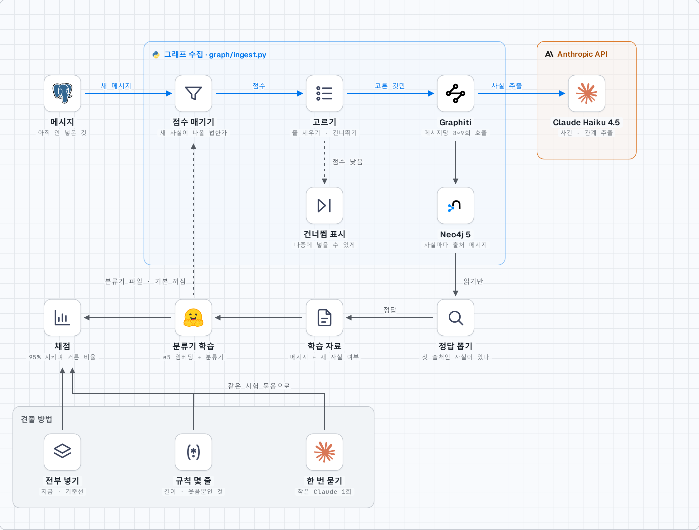

# 수집 전 거르기 설계

2026-11-25 · 설계입니다. 만든 것도, 학습시킨 것도 없습니다. [학습 모델 설계안](ml-design-2026-11-24.md)의 "수집 전 거르기" 절을 실제로 만들 수 있는 수준까지 풀어 쓴 것입니다. 틀은 [의미 보존 판정 모델 설계](ml-judge-design-2026-11-25.md)와 같이 씁니다.



그림 원본은 [images/ml-prefilter-stack-ko.html](../images/ml-prefilter-stack-ko.html)입니다. 어두운 배경 판은 `images/ml-prefilter-stack-ko-dark.png`입니다.

설계안은 "정답을 실제로 뽑아 본 적이 없다"고 적었습니다. 이번에 개발 PC의 Neo4j에서 처음 뽑아 봤고, 그 결과가 설계안의 전제 하나를 바꿉니다. "먼저 세어 본 것" 절에 적었습니다.

## 먼저 결론

- **무엇을 만드나**: 메시지를 그래프에 넣기 전에 "이 메시지에서 새로 뽑힐 사실이 있을까"를 점수로 내는 분류기입니다.
- **정답의 정의를 바꿉니다.** 설계안은 "사실이 하나라도 나온 메시지"를 정답으로 삼자고 했는데, 세어 보니 거의 모든 메시지가 여기에 해당했습니다(112건 중 111건). "새 사실을 만든 메시지"로 바꿔야 가를 것이 생깁니다.
- **건너뛰기보다 줄 세우기를 먼저 씁니다.** 점수가 낮은 메시지를 버리지 않고 뒤로 미룹니다. 예산이 모자랄 때만 효과가 나고, 놓친 사실이 영영 사라지지 않습니다.
- **큰 모델이 필요 없을 수 있습니다.** 정답이 달린 메시지가 수백 건뿐이라, 지금 쓰는 임베딩 위에 가벼운 분류기를 얹는 쪽이 크기에 맞습니다. 규칙 몇 줄이 더 나을 수도 있습니다.
- **만들지 말지는 숫자 하나에 달렸습니다.** 실제 카카오톡 551건의 그래프에서 "새 사실을 만들지 않은 메시지"가 몇 %인지입니다. 합성 대화에서는 8~11%뿐이었습니다. 실제 대화에서도 그 정도면 접는 것이 맞습니다.

## 먼저 세어 본 것

개발 PC의 Neo4j에 들어 있는 합성 대화 36건의 그래프 두 벌(`eval`, `demo` 사용자)을 읽기만 해서 셌습니다. 같은 36건을 따로 두 번 수집한 것이라, 설계안이 맨 먼저 하자던 "두 번 넣어 보고 얼마나 겹치는지"도 같이 볼 수 있었습니다.

| 센 것 | `eval` | `demo` |
|---|---|---|
| 메시지(에피소드) | 36 | 36 |
| 사실이 하나라도 인용한 메시지 | 36 | 35 |
| 새 사실을 하나도 만들지 않은 메시지 | 3 | 4 |
| 새 사건 사실을 만들지 않은 메시지 | 20 | 22 |

"새 사실을 만들었다"는 그 메시지가 사실의 첫 출처라는 뜻입니다(`r.episodes[0]`). 뒤에 같은 사실을 다시 말한 메시지는 출처 목록에 덧붙기만 합니다.

여기서 세 가지가 나옵니다.

**"사실이 하나라도 나왔나"는 정답으로 쓸 수 없습니다.** 거의 전부 "예"입니다. 에피소드 본문이 `김민수 → 박지현: …` 꼴이라, 추출기가 메시지마다 두 사람의 관계 사실을 찾아 출처로 붙이기 때문으로 보입니다.

**합성 대화에서는 건너뛸 것이 거의 없습니다.** 새 사실을 만들지 않은 메시지가 8~11%입니다. 다만 합성 대화는 메시지마다 내용이 있도록 지어낸 것이라 "넵", "ㅋㅋ" 같은 메시지가 거의 없습니다. 실제 대화의 비율은 이 PC에서 알 수 없습니다. 카카오톡 551건의 그래프는 여기에 없습니다.

**정답이 흔들립니다.** "새 사건 사실을 만들었나"를 두 벌에서 견주면 36건 중 30건이 같았습니다(83%). 둘 다 "예" 12건, 둘 다 "아니오" 18건, 엇갈림 6건입니다. 우연히 맞을 확률을 빼면 0.66 정도입니다. 접을 만큼 나쁘지는 않지만, 정답 여섯에 하나가 뒤집힌다는 뜻이라 모델 점수의 천장이 낮습니다.

36건으로 낸 숫자이므로 몇 건만 달라져도 비율이 크게 움직입니다.

## 정답을 어떻게 정하나

세 가지 후보가 있고, 가운데 것을 씁니다.

| 정답 | 뜻 | 합성에서 "아니오" | 판단 |
|---|---|---|---|
| 인용됨 | 사실 하나라도 이 메시지를 출처로 든다 | 0~3% | 못 씀. 가를 것이 없습니다 |
| **새 사실** | 이 메시지가 첫 출처인 사실이 하나라도 있다 | 8~11% | 이것을 씁니다 |
| 새 사건 | 이 메시지가 첫 출처인 사건 사실이 있다 | 56~61% | 참고로만 봅니다 |

"새 사건"은 건너뛸 것이 많아 보이지만 쓰지 않습니다. 관계 사실(관계 유형, 상하, 호칭)도 조건 D가 읽는 것이고, 말투가 바뀐 계기를 찾을 때도 씁니다. 관계 사실만 새로 만든 메시지를 건너뛰면 그것을 잃습니다.

"새 사실"이 "아니오"인 메시지를 건너뛰면 잃는 것은 출처 한 줄입니다. 이미 있는 사실에 "이 메시지도 같은 말을 했다"가 덧붙지 않습니다. 사실 자체는 남습니다.

흔들림을 줄이려고, 두 번 수집한 자료에서는 **한 번이라도 새 사실을 만든 메시지를 "예"**로 둡니다. 놓치는 쪽이 더 위험하므로 "예" 쪽으로 기울입니다.

## 어떻게 쓰나: 버리지 않고 뒤로 미루기

지금 수집은 예산이 모자라면 가장 최근 메시지부터 골라 넣습니다(`graph/ingest.py`의 `pick_recent`). 설계안은 점수가 낮은 메시지를 아예 건너뛰자고 했습니다. 여기서는 두 단계로 나눕니다.

**1단계, 줄 세우기.** 예산이 모자랄 때 고르는 순서에 점수를 더합니다. 최근이면서 사실이 있을 법한 메시지를 먼저 넣습니다. 예산이 넉넉하면 지금과 똑같이 전부 넣습니다.
- 놓친 사실이 영영 빠지지 않습니다. 예산이 생기면 미뤄 둔 것도 들어갑니다.
- 틀려도 손해가 작아서, 정답이 흔들려도 써 볼 만합니다.
- 비용은 줄지 않습니다. 같은 예산으로 더 쓸모 있는 것을 넣을 뿐입니다.

**2단계, 건너뛰기.** 점수가 문턱 아래인 메시지는 모델을 부르지 않습니다. 비용이 실제로 줄어드는 것은 이쪽입니다.
- 1단계의 숫자를 본 뒤에 정합니다.
- 건너뛴 메시지는 따로 표시해 둡니다(`graph_skipped_at` 같은 열). 수집된 것으로 치지 않고, 운영자가 나중에 넣을 수 있게 합니다.

두 단계 모두 플래그로 넣고 기본은 꺼 둡니다. 꺼져 있으면 수집 순서와 결과가 지금과 같아야 합니다.

### 맥락이 끊기는 문제

수집할 때 Graphiti는 앞의 에피소드 몇 개를 맥락으로 읽습니다. "그거 내일로 하자"의 "그거"가 앞 메시지에 있다면, 앞 메시지를 건너뛴 그래프에서는 뒤 메시지의 추출이 나빠질 수 있습니다.

방법 하나는 건너뛴 메시지도 에피소드 노드만은 만들어 두는 것입니다. 모델을 부르지 않고 본문만 넣습니다. 그러면 뒤 메시지가 맥락으로 읽을 수 있습니다. Graphiti가 맥락을 에피소드 노드에서 읽는다는 것은 제 기억이고 확인하지 않았습니다. 2단계에 들어가기 전에 코드에서 확인해야 합니다.

## 모델

### 입력과 출력

- **입력**: 수집할 때와 같은 꼴의 본문입니다. `[2026-10-05 월 09:31] 김민수 → 박지현: 다음 주 수요일(=2026-10-14)까지 가능합니다`. 앞의 메시지 둘셋을 함께 붙입니다. 대명사가 가리키는 것이 앞에 있기 때문입니다.
- **출력**: 0~1 사이 점수 하나. 새 사실이 나올 법한 정도입니다.

### 견줄 방법

판정 모델의 일곱 가지에 맞춰 적되, 이 과제에만 있는 것이 둘 있습니다.

| # | 방법 | 비용 | 비고 |
|---|---|---|---|
| 1 | 전부 넣기 (지금) | 메시지당 약 0.034달러, 8.7초 | 기준선. 놓치는 것이 없습니다 |
| 2 | 규칙 몇 줄 | 없음 | 글자 수, 웃음·감탄만 있는 메시지, 날짜·수·이름이 있는지 |
| 3 | e5 임베딩 + 가벼운 분류기 | 없음 | 임베딩은 이미 만들어 둡니다. 주 후보 |
| 4 | 사전학습 모델 미세조정 | GPU 몇 분 | 정답이 수천 건 모이면 |
| 5 | 작은 Claude에게 한 번 묻기 | 호출 1회 | 수집은 8~9회를 부릅니다. 한 번 물어 거르면 8분의 1 값입니다 |

2번을 넣은 이유는, 규칙만으로도 대부분을 가를 수 있을 것 같아서입니다. "ㅋㅋㅋ"에 사실이 없다는 것은 모델 없이도 압니다. 모델이 규칙보다 얼마나 더 거르는지가 이 과제의 핵심 비교입니다.

5번은 학습과 무관하지만 빼면 안 됩니다. 정답이 흔들리는 과제에서는 "같은 모델에게 싸게 한 번 묻기"가 가장 정확할 수 있습니다.

메시지당 값과 시간은 demo 551건 재수집의 실측(약 19달러, 80분)을 건수로 나눈 것입니다.

### 3번을 주 후보로 두는 이유

정답이 달린 메시지가 적습니다. 지금 있는 것은 합성 36건(두 벌)과, 다른 곳에 있는 카카오톡 551건입니다. 1억 개짜리 모델을 600건으로 미세조정하면 외워 버리기 쉽습니다. 임베딩은 서비스가 이미 만들고 있어서, 분류기만 얹으면 판정에 드는 시간이 거의 없습니다.

## 데이터

### 정답 뽑기

그래프에서 메시지별 정답을 읽는 질의가 하나 필요합니다. 설계안이 "새로 써야 한다"고 한 것입니다. 이번에 손으로 돌린 질의가 그 초안입니다.

```cypher
MATCH (e:Episodic {group_id: $group_id})
OPTIONAL MATCH ()-[r:RELATES_TO]->()
  WHERE r.group_id = e.group_id AND r.episodes[0] = e.uuid
RETURN e.name AS message, count(r) AS created,
       sum(CASE WHEN r.name = "Involved" THEN 1 ELSE 0 END) AS created_events
```

`e.name`이 `c1:m03` 꼴의 메시지 열쇠라 PostgreSQL의 메시지와 바로 이어집니다.

빠진 것이 하나 있습니다. 새 사람·사건 노드만 만들고 사실은 만들지 않은 메시지입니다. 이번 집계에서는 모든 에피소드가 개체를 하나 이상 언급했는데, 새 개체인지는 가려 세지 않았습니다.

### 한 줄의 모양

```json
{
  "message_id": "c3:m07",
  "group_id": "c3",
  "source": "synthetic-36-run1",
  "body": "[2026-10-21 수 10:05] 김민수 → 이서연: 서연 파트장님, 자료 확인 부탁드립니다",
  "context": ["[2026-10-17 토 17:40] 이서연 → 김민수: 나 파트장 됐어"],
  "label": {"created": 2, "created_events": 0, "new_fact": true},
  "extractor": "haiku-4-5 / 추출 지시문 2026-11-24",
  "split": "train"
}
```

- 대화방 하나는 한 묶음에만 넣습니다(`group_id`). 같은 대화의 앞뒤 메시지가 학습과 시험에 갈리면 점수가 부풀려집니다.
- `extractor`를 적습니다. 추출 지시문이나 모델이 바뀌면 정답도 바뀝니다. 다른 버전의 정답을 섞지 않습니다.

### 정답을 늘리는 값

정답 하나가 수집 한 번입니다. 메시지 1,000건의 정답을 새로 만들려면 수집 1,000건, 실측으로 어림해 35달러쯤과 두 시간 반입니다. 판정 모델의 데이터(Claude 한 번에 쌍 여러 개)보다 훨씬 비쌉니다.

그래서 순서를 이렇게 둡니다.

1. 이미 있는 그래프에서 읽기만 합니다. 비용이 없습니다. 카카오톡 551건이 여기에 해당합니다.
2. 그것으로 부족할 때만 새로 수집합니다. 얼마나 넣을지는 그때 정합니다.

카카오톡 551건은 실제 대화입니다. 이 PC에서 학습에 쓰는 것은 방침에 걸리지 않지만, 대화도 그걸로 학습한 모델 파일도 저장소나 밖에 올리면 안 됩니다. 판정 모델 설계의 주의와 같습니다.

## 재는 것

### 가장 먼저 볼 숫자

**새 사실이 있는 메시지를 95% 넘게 지키면서, 건너뛸 수 있는 메시지의 비율.**

건너뛴 비율이 곧 줄어드는 비용입니다. 10%를 건너뛰면 551건 기준 2달러, 8분쯤을 아낍니다. 이 숫자가 작으면 만들 이유가 없습니다.

95%를 믿을 만하게 재려면 시험 묶음에 "예"가 200건은 있어야 합니다. 지금 합성 36건에는 "예"가 서른 건 남짓이라 잴 수 없습니다.

### 함께 적는 것

| 재는 것 | 왜 |
|---|---|
| 전부 넣기·규칙·임베딩 분류기·Claude 한 번 묻기를 같은 표에 | 모델이 규칙보다 얼마나 나은지 봅니다 |
| 두 번 수집한 정답끼리의 일치율 | 모델 점수의 천장입니다. 지금 83% |
| 놓친 메시지가 만든 사실의 종류 | 사건을 놓쳤는지, 관계 사실을 놓쳤는지 |
| 거른 그래프로 돌린 조건 D의 검색 점수 | 서비스에서 실제로 나빠지는지 봅니다 |
| 줄 세우기: 예산의 절반만 썼을 때 들어간 새 사실의 비율 | 1단계의 효과입니다. 지금의 "최근부터"와 견줍니다 |

조건 D 평가를 다시 돌리려면 거른 그래프를 새로 수집해야 합니다. 평가용 36건 기준으로 1달러 남짓입니다.

## 서비스에 붙이는 모양

- **자리**: `graph/ingest.py`의 `_run`에서 넣을 메시지를 고르는 곳입니다. 1단계는 `pick_recent` 옆에 점수를 쓰는 고르기 함수를 하나 더 둡니다.
- **플래그**: `GRAPH_PREFILTER=off|rank|skip`, 기본 `off`.
- **점수를 내는 쪽은 같은 모양으로 감쌉니다.** `score(본문, 앞 메시지) → 0~1`. 규칙이든 분류기든 같습니다.
- **분류기 파일은 저장소에 넣지 않습니다.** 없으면 `off`처럼 동작합니다.
- **기록**: 수집 작업에 건너뛴 수와 미룬 수를 남깁니다. 화면에서 "수집 안 됨"과 "건너뜀"이 구분되어야 합니다.
- **예산 세기**: 건너뛴 메시지는 예산에서 빼지 않습니다. 모델을 부르지 않았기 때문입니다.

## 순서

| 단계 | 할 일 | 비용 | 여기서 정해지는 것 |
|---|---|---|---|
| 0 | 카카오톡 551건의 그래프에서 위 질의를 돌립니다 | 없음 | "새 사실 없음"의 비율. 낮으면 여기서 접습니다 |
| 1 | 정답을 파일로 뽑는 스크립트를 만듭니다 | 없음 | 학습·시험 자료 |
| 2 | 방법 2, 3을 돌립니다 | 없음 | 규칙 대 분류기의 첫 표 |
| 3 | 방법 5를 시험 묶음에만 돌립니다 | 호출 수백 회 | 싸게 묻는 것과의 비교 |
| 4 | 줄 세우기를 꺼 둔 채로 붙입니다 | 없음 | 1단계 |
| 5 | 건너뛰기와 조건 D 재평가 | 재수집 1달러 남짓 | 2단계를 켤지 |

0단계는 그 그래프가 있는 곳에서 질의 하나를 돌리면 끝납니다.

## 확인한 것과 못 한 것

확인한 것:
- 합성 36건 두 벌에서 정답 분포와 일치율을 셌습니다 (11/25, 읽기만).
- 사실마다 출처 메시지가 순서대로 적혀 있어 "첫 출처"를 질의로 뽑을 수 있습니다.

못 한 것:
- 실제 대화에서의 비율. 이 과제를 할지 말지를 정하는 숫자입니다.
- 정답이 왜 흔들리는지. 추출이 매번 달라서인지, 같은 사실을 다른 메시지에 붙여서인지 보지 않았습니다.
- Graphiti가 앞 맥락을 어디서 읽는지. 건너뛴 메시지를 에피소드 노드로만 남기는 방법이 되는지가 여기에 달렸습니다.
- 새 개체만 만든 메시지가 얼마나 되는지.
- 규칙 몇 줄이 얼마나 거르는지. 모델이 필요 없다는 결론이 날 수도 있습니다.

## 정할 것

1. 정답을 "새 사실"로 두는 데 동의하는지. 관계 사실의 출처 한 줄을 잃는 것을 받아들이는 선택입니다.
2. 줄 세우기부터 하고 건너뛰기는 나중에 정하는 순서로 갈지.
3. 0단계를 누가 어디서 돌릴지. 카카오톡 551건의 그래프가 있는 곳이어야 합니다.
4. 카카오톡 대화를 이 PC의 학습에 쓸지.
