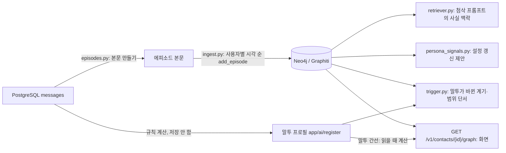

# 지식그래프 구조 (2026-11-19 기준)

코드에서 읽어 정리한 현재 구조다. 정본은 `backend/app/graph/`이고, 이 문서와 코드가 다르면 코드가 맞다.
스키마의 배경과 스파이크 기록은 `graph/graph_schema.md`·`graph/graph-spike-report.md`, 재설계 논의는 `docs/graph-redesign-2026-11-16.md`.

## 1. 한눈에

- **무엇인가**: 대화 메시지에서 뽑은 사람·사건·관계의 시간 그래프 (D 경로). Graphiti 0.31.2가 Neo4j에 만든다.
- **단위**: 메시지 1건 = 에피소드 1건. 추출은 Claude `GRAPH_LLM_MODEL`(기본 haiku-4-5), 임베딩은 백엔드의 로컬 e5, 리랭커는 패스스루.
- **격리**: 모든 노드·엣지에 `group_id = user_id`. 사용자 그래프끼리는 섞이지 않는다.
- **두 저장소**: 사건·관계는 Neo4j에 저장한다. 말투 프로필(구간·바뀐 시점)은 저장하지 않고 PostgreSQL 메시지에서 읽을 때 규칙으로 계산한다(`app/ai/register*.py`).



## 2. 논리 스키마 (`schema.py`)

클래스 docstring과 Field 설명이 그대로 추출 프롬프트에 들어간다.

### 엔티티

| 타입 | 뜻 | 속성 |
|---|---|---|
| `Person` | 대화에 나오는 사람 (본인·상대·제3자) | `role` 직업·직책·가족 관계 |
| `Event` | 시점이 있는 사건·약속·상태 변화 | `event_type` request / refusal / apology / schedule / promise / conflict / status / other · `status` open / resolved · `importance` 1~10 |

사람과 사건만 엔티티다. 음식·문서·물건은 엔티티로 만들지 않고 그것이 등장한 사건을 `Event`로 만든다.

### 엣지

| 타입 | 방향 | 속성 |
|---|---|---|
| `Relationship` | Person → Person (source가 target을 어떻게 대하나) | `relation_type` family / friend / colleague / partner / acquaintance · `hierarchy` target_higher / target_lower / equal · `speech_style` 반말 / 존댓말 / 혼용 · `address_term` source가 target을 직접 부른 말(메시지 내용에 그대로 있는 말만) · `closeness` 1~5 |
| `Involved` | Person → Event | `participant_role` 당사자 / 상대 / 요청자 / 수행자 / 목격자 / 관련자 · `feeling` |

- 허용 조합은 `EDGE_TYPE_MAP`의 둘뿐이다: (Person, Person) → Relationship, (Person, Event) → Involved.
- 상하 관계는 `relation_type`이 아니라 `hierarchy`에 적는다. 앱의 `relationship_type`으로 옮길 때 `colleague + target_higher → superior`, `colleague + target_lower → subordinate`.
- 한 쌍에 유효한 Relationship 사실은 하나라는 것이 추출 규칙이다. 바뀌면 새 사실을 만들고 옛 사실은 끝난 것으로 본다.
- 취소·거절·불참·연기도 `Involved` 사실로 남긴다.

### 추출 지시문 (`EXTRACTION_INSTRUCTIONS`)

메시지 형식 읽는 법, 호칭 병합(가장 완전한 실명을 엔티티 이름으로), 엣지 이름 제한, 말투는 발화자의 어미로만 판단, `(=YYYY-MM-DD)` 날짜를 그대로 옮겨 적기, 민감한 특성 추정 금지를 담는다.

호칭(`address_term`) 규칙은 2026-11-24에 보강했다. 실제 규모 수집(11/19, 551건)에서 값이 대부분 틀렸기 때문이다. 지시문과 필드 설명이 함께 금지하는 것: source 자신의 이름·직함(발화자 '김과장'의 '과장'), 이름·조사 조각('님'), 대화에 등장한 제3자의 호칭('부장님', '기사님'), target의 이름을 그대로 옮긴 것(메시지 내용에서 그 말로 부른 경우만 적는다), 영어 대화에 한국어 호칭 지어내기. 부른 말이 메시지 내용에 없으면 비운다. **지시문만 고쳤고 재수집은 하지 않았다** — 효과는 재수집해야 알 수 있다. 그때까지 읽는 쪽의 거름(`persona_signals.py`의 `called_in`·`_plausible_address`)이 계속 필요하다.

## 3. Neo4j에 실제로 들어가는 모양

`store.py`의 Cypher 기준이다.

| 종류 | 라벨 / 타입 | 주요 속성 |
|---|---|---|
| 개체 노드 | `:Entity` + `:Person` 또는 `:Event` | `uuid`, `name`, `summary`, `group_id`, 추출 속성(`event_type`, `importance` 등) |
| 에피소드 노드 | `:Episodic` | `uuid`, `name`(`c1:m03`), `content`, `valid_at`(메시지 발화 시각), `group_id` |
| 사실 엣지 | `(:Entity)-[:RELATES_TO]->(:Entity)` | `uuid`, `name`(`Relationship` 또는 `Involved`), `fact`(사실 문장), `valid_at`, `invalid_at`, `episodes`(근거 에피소드 uuid 목록), `group_id`, 추출 속성(`speech_style`, `address_term`, `hierarchy` 등) |
| 언급 엣지 | `(:Episodic)-[:MENTIONS]->(:Entity)` | — |

- Neo4j의 관계 타입은 항상 `RELATES_TO`다. `Relationship`/`Involved`는 엣지의 `name` 속성이다. 실제 데이터에는 `name`이 `RELATES_TO`인 엣지도 섞여 있다(10절).
- 그 밖에 Graphiti가 붙이는 속성: 개체 `labels`·`name_embedding`·`created_at`, 사실 엣지 `fact_embedding`·`reference_time`·`expired_at`·`source_node_uuid`·`target_node_uuid`·`created_at`, 에피소드 `source`(`message`)·`source_description`·`entity_edges`·`created_at`.
- 모든 사실은 `episodes`로 출처 메시지를 가진다. 삭제와 `as_of` 필터가 이것에 기댄다.
- 개체 요약(`summary`)은 앱이 읽지 않는다. 검색은 사실 엣지를 쓴다.

확인용 Cypher(읽기 전용)는 `docs/api.md` 맨 아래.

## 4. 만드는 과정

### 에피소드 본문 (`episodes.py`, `dates.py`)

```
[2026-10-05 월 09:31] 김민수 → 박지현: 다음 주 수요일(=2026-10-14)까지 가능합니다
```

- 날짜·요일·시각은 한국 시간이다. 수신자를 적어 짧은 답에서 자기참조 엣지가 생기는 것을 막는다.
- 상대 날짜는 코드가 먼저 계산해 `(=…)`로 붙이고 모델은 옮겨 적기만 한다. 담화 문맥(앞 메시지가 특정한 요일)은 대화방 안에서만 이어지므로 **대화방 메시지 전체**를 넘겨야 한다.
- 에피소드 이름은 `{대화방 source_key}:{메시지 source_key}`. `reference_time`은 UTC로 바꿔 넣는다(Graphiti 프롬프트가 UTC를 전제).
- 상대 노드 이름은 `Contact.name_in_graph`(처음 수집할 때의 이름). 별칭을 바꿔도 노드 이름은 그대로다. 다만 추출 모델이 본문의 이름을 다르게 적을 수 있어('김상무님' → 노드 '김상무') 수집 뒤에 대조한다(아래 "수집 뒤 이름 대조").

### 수집 (`ingest.py`)

- 미수집 메시지를 **사용자별 잠금 아래, 대화방을 가리지 않고 전체 시각 순**으로 `add_episode` 한다. Graphiti가 넣는 순서대로 앞 사실을 무효화하기 때문이다. 잠금은 서버 프로세스 하나 안에서만 유효하다.
- 가져오기 API 뒤에는 백그라운드로 돈다. 작업의 `graph_status`: skipped → pending → running → completed / failed / limited.
- 에피소드 하나에 haiku 약 8~9회, 10~15초.

PostgreSQL 쪽 상태:

| 위치 | 뜻 |
|---|---|
| `messages.graph_ingested_at` | 수집 완료 표시 (재실행이 멱등) |
| `messages.graph_attempts`, `graph_held_at` | 실패 횟수와 보류. `GRAPH_EPISODE_MAX_ATTEMPTS`(기본 3)를 넘으면 보류하고 다음 메시지로 간다. 일시 장애는 세지 않는다 |
| `usage_counters.graph_episodes` | 사용자·일 단위의 지워지지 않는 카운터 (수집 상한용) |

- 상한(`GRAPH_INGEST_USER_MESSAGE_CAP`, `GRAPH_INGEST_DAILY_GLOBAL_CAP`)은 API 경로에만 건다. 메시지 1건이 1, 본문 1,000자마다 1을 더 센다. 예산이 모자라면 가장 최근 메시지부터 넣는다. 운영자 스크립트 경로는 상한을 타지 않는다.
- 서버가 죽으면 미수집분은 다음 시작 때 `resume_all`이 잇는다(`GRAPH_RESUME_ON_START`).

### 수집 뒤 이름 대조 (`ingest.py` `reconcile_names`, 11/24 추가)

앱은 상대 노드를 이름이 **정확히 같은** 엔티티로 찾는다(`find_entity_uuid(user_id, name_in_graph)`). 11/19 수집에서 별칭 '김상무님'의 노드가 '김상무'로 만들어져 화면과 사실 맥락이 비었다. 그래서 `ingest_user`·`ingest_pending`이 에피소드를 하나 이상 넣고 끝나면 그 사용자의 상대마다(그래프에 들어간 메시지가 있는 상대만) 이름을 대조한다.

1. `name_in_graph`와 이름이 정확히 같은 노드가 있으면 그대로 둔다.
2. 없으면 그 상대의 대화방 에피소드가 언급한(`MENTIONS`) Person 노드의 이름을 읽는다(`GraphStore.person_names`, 읽기 전용 Cypher). 그중 후보는 경칭 '님'·'씨' 하나를 붙이거나 뗐을 때 같아지는 이름, 또는 공백만 다른 이름이다(`same_person_name`). 내 이름(`me_name`)과 50자를 넘는 이름은 뺀다.
3. 후보가 **정확히 하나**면 `contacts.graph_name`을 그 노드 이름으로 고쳐 쓴다(`ContactRepo.set_graph_name`). 이후 조회가 그 노드를 찾고, 다음 수집의 에피소드 본문도 그 이름을 쓴다.
4. 후보가 없거나 둘 이상이면 바꾸지 않고 경고 로그(`graph name mismatch`, 이름만 찍는다)를 남긴다. 이때는 `graph_name`을 손으로 고친다.

- 모델을 부르지 않는다. 대조가 실패해도(Neo4j 장애 등) 수집 결과는 그대로이고 다음 수집 뒤에 다시 한다.
- 수집이 도중에 실패하거나(예외) 넣은 것이 0건이면 대조하지 않는다. 이미 수집된 그래프의 이름만 맞추는 명령은 따로 없다 — 다음 수집이 한 건이라도 들어가야 돈다.
- 조회 쪽(`find_entity_uuid`)은 느슨하게 하지 않았다. 읽을 때마다 비슷한 이름을 받아 주면 다른 사람과 섞일 수 있다.
- 성만 같거나 직함이 다른 이름('김상무' / '김철수 상무'), 대소문자만 다른 영어 이름은 후보로 보지 않는다.

### 삭제 (`store.py`)

- 대화·메시지 삭제: `remove_episodes`가 에피소드를 이름으로 찾아 Cypher로 직접 지운다. 그 에피소드만 근거인 사실·개체는 함께 지우고, 다른 근거가 남은 사실은 `episodes` 목록에서만 뺀다. 남는 개체의 요약은 비운다.
- `graphiti.remove_episode`는 쓰지 않는다. 지울 때마다 요약을 LLM으로 다시 만든다(11/14 실측: 36건 삭제에 haiku 159회, 248초).
- 계정 삭제: `remove_group`으로 그 `group_id`의 노드를 한 번에 지운다.

## 5. 읽는 경로

| 경로 | 코드 | 읽는 것 | 쓰이는 곳 |
|---|---|---|---|
| 사실 맥락 검색 (D) | `retriever.py` `GraphContextRetriever` (`graph-context-v3`) | 상대 주변의 사실 문장 | 첨삭 프롬프트의 [사실 맥락] 블록 (`purpose=context`, 어조 조정에만) |
| 설정 갱신 제안 | `persona_signals.py` | 나 → 상대 Relationship의 `speech_style`·`address_term`·`hierarchy`, 근거 메시지의 발화 시각(`observed_at`) | `/v1/contacts/{id}/persona/suggestion` (제안일 뿐, 저장 안 함) |
| 계기·범위 단서 | `trigger.py` | 변화 시점 ±7일의 `Event`와 Relationship 사실 문장 | 말투 프로필 제안 카드의 근거, 화면 응답의 말투 간선 |
| 화면 | `GET /v1/contacts/{id}/graph` | 상대 주변 노드·엣지, 말투 간선(`register`) | 맥락 그래프 화면 |

**"상대 주변"의 범위**는 검색·계기 조회·화면이 같다(`GraphStore.neighborhood`, 질의 검색은 같은 기준의 필터). 설정 갱신 제안만 나 → 상대 방향의 Relationship 사실을 직접 읽는다(`relationship_facts`). 범위의 기준: 양 끝 중 하나가 상대 노드이거나, 상대와 이어진 `Event` 노드인 엣지. Person 이웃은 기준으로 삼지 않는다 — 사용자 노드는 모든 방에 걸쳐 있어 걸러지는 것이 없다. 상대 노드를 이름으로 못 찾으면 사실 맥락을 비운다(이름이 어긋난 경우는 수집 뒤 이름 대조가 맞춘다, 4절).

### 사실 맥락 검색의 순서

1. 질의 = 상황 + 초안. 상대 노드를 `name_in_graph`로 찾는다.
2. **관계 상태 슬롯**: 상대에 닿은 Relationship 사실 중 가장 최근 3건을 질의와 무관하게 먼저 넣는다.
3. Graphiti 하이브리드 검색(BM25 + 임베딩, RRF)으로 `top_k × 4`건을 받는다.
4. 거른다: 상대 주변이 아닌 사실, 같은 메시지에서 나온 중복, 출처가 `as_of` 이후인 사실, 무효화된 사실(아래 방식에 따라).
5. 재정렬: 유사도 0.75 + 최근성 0.15(반감기 30일) + 원래 순위 0.10. 사건 유형(conflict·apology·refusal·promise 1.0 … status 0.75)과 중요도로 가중한다. 가중 전 점수가 1위보다 0.12 넘게 낮으면 버리되 최소 2건은 남긴다.
6. 결과 = 관계 상태 슬롯 + 상위 `GRAPH_SEARCH_TOP_K`(기본 4)건. 모델 호출은 없다.

### 화면 응답의 말투 간선 (`services/register_view.py`, 11/17 추가)

`GET /v1/contacts/{id}/graph` 응답의 `register`는 내가 이 상대에게 쓰는 말투를 (나)→(상대) 간선 하나처럼 보여 주는 값이다. Neo4j에 저장하지 않고 PostgreSQL 메시지(최근 500건까지)에서 읽을 때 규칙으로 계산한다.

- 내용: 시간 순 말투 구간(`level` hapsyo / haeyo / hae, `start`, `end`, `count`, `status` confirmed / candidate / previous, 근거 메시지 최대 5개), 현재 호칭(`address`), 본 메시지 수(`based_on_messages`).
- 계기 사건(`trigger`: 사건 이름과 날짜)은 **말투가 바뀐 확정된 현재 구간**에만 붙는다. 이 조건은 `ai/register.py`의 `changed_segment` 하나이고 제안 카드도 같은 함수를 쓴다. 한쪽만 고치면 두 화면이 같은 상대에 대해 다른 구간·다른 계기를 말하게 된다.
- 그래프가 꺼져 있거나 상대 노드가 없어도 구간과 호칭은 온다(계기만 없다). 그래프가 켜져 있으면 화면용으로 이미 읽은 이웃을 `find_trigger(hood=…)`에 넘겨 같은 조회를 두 번 하지 않는다.
- 응답에서 `register`가 빠지는 경우: 내 메시지가 없을 때, `REGISTER_SUGGESTIONS=false`일 때(메시지를 읽지도 않는다), 계산이 실패했을 때(나머지 응답은 그대로 나간다).
- 이 값을 그리는 화면은 아직 없다. 웹 화면 코드는 `register`를 읽지 않는다.

## 6. 시간과 무효화

- 사실 엣지는 `valid_at`(성립 시각)과 `invalid_at`(무효가 된 시각)을 가진다. 둘 다 모델이 정한 값이다. 에피소드의 `valid_at`은 메시지 발화 시각이라 믿을 수 있다.
- 로컬 그래프 실측(합성 36건): 무효화된 사실 26건 중 11건이 유효해진 지 1시간 안에 무효화된 추출 부산물이었고, 지금도 참인 사실이 무효로 찍혀 있었다. 그래서 경로마다 `invalid_at`을 다르게 다룬다.

| 경로 | `invalid_at` | 시간 기준 |
|---|---|---|
| 질의 검색 | `GRAPH_INVALIDATION_MODE`: `trust`(기본, 버린다) / `artifacts`(부산물로 보이는 무효화만 무시) / `ignore` | 사실 `valid_at`, 없으면 출처 발화 시각 |
| 관계 상태 슬롯 | 보지 않는다 | 최근 순 |
| 설정 갱신 제안 | 보지 않는다 | 근거 메시지 중 가장 이른 발화 시각(`observed_at`) 순서, 근거 에피소드가 없는 사실만 `valid_at` |
| 계기·범위 단서 | 보지 않는다 | 출처 메시지 발화 시각만 |

설정 갱신 제안의 시간 기준은 11/17에 바꿨다. 모델이 적은 `valid_at`이 9시간 밀린 사실이 있어서다(10절). `relationship_facts`가 사실마다 `observed_at`을 함께 돌려주고, 정렬·`as_of`·"MM/DD부터" 문구가 모두 그것을 쓴다. 이 Cypher는 `FakeGraphStore` 테스트와 cypher-shell(읽기 전용)로만 확인했고, 파이썬 드라이버로 실제 Neo4j에 돌려 보지는 않았다.

`artifacts`가 부산물로 보는 경우: `invalid_at`이 `valid_at`에서 1시간 안이거나, 무효화한 메시지가 같은 대화·같은 날(KST)인 경우. 기본값을 바꿀지는 평가로 정하기로 하고 아직 정하지 않았다.

## 7. 설정

| 환경 변수 | 기본 | 뜻 |
|---|---|---|
| `NEO4J_URI` | `.env.example`은 `bolt://localhost:7687` | 비면 그래프가 꺼진다 |
| `GRAPH_LLM_MODEL` | `claude-haiku-4-5` | 5.5 계열은 graphiti의 강제 tool_choice에 400 |
| `GRAPH_SEARCH_TOP_K` | 4 | 질의 검색 결과 수 |
| `GRAPH_INVALIDATION_MODE` | `trust` | 6절 |
| `GRAPH_EPISODE_MAX_ATTEMPTS` | 3 | 0이면 세지 않는다 |
| `GRAPH_RESUME_ON_START` | true | 시작 때 미수집분 잇기 |
| `GRAPH_INGEST_USER_MESSAGE_CAP`, `GRAPH_INGEST_DAILY_GLOBAL_CAP` | 0 | 0이면 무제한 |
| `REGISTER_SUGGESTIONS` | true | 제안에 규칙 기반 말투 프로필을 붙인다 |
| `REGISTER_WARNINGS`, `REGISTER_STATE_BLOCK`, `REGISTER_POST_CHECK`, `STYLE_EXAMPLE_GATING` | false | 재설계의 권장 경로 (꺼져 있음) |

## 8. 파일 지도

| 파일 | 역할 |
|---|---|
| `backend/app/graph/schema.py` | 엔티티·엣지 타입, 추출 지시문 |
| `backend/app/graph/dates.py`, `episodes.py` | 상대 날짜 계산, 에피소드 본문 |
| `backend/app/graph/client.py` | Settings → Graphiti (LLM·임베더·리랭커 연결) |
| `backend/app/graph/store.py` | `GraphStore` Protocol과 `GraphitiStore`. 수집·검색 코드는 Graphiti를 직접 만지지 않는다 |
| `backend/app/graph/ingest.py` | 수집, 상한, 보류, 이어받기, 수집 뒤 이름 대조 |
| `backend/app/graph/retriever.py` | 사실 맥락 검색기 |
| `backend/app/graph/persona_signals.py`, `trigger.py` | 설정 갱신 제안, 계기·범위 단서 |
| `backend/app/ai/register*.py` | 말투 프로필 (규칙, 그래프 밖). `register.changed_segment`가 계기를 찾을 구간을 정한다 |
| `backend/app/services/register_view.py` | 화면 응답의 말투 간선 (5절) |
| `backend/tests/test_graph*.py` | `FakeGraphStore`로 Neo4j·LLM 없이 검사 |
| `graph/` | 담당자 폴더: 스키마 문서, 질의·호칭 정답 CSV, 스파이크 보고. `graph/graphiti_p0/`는 동결된 스파이크 |
| `scripts/graph_reset.py`, `import_synthetic.py --graph`, `prepare_demo.py --graph` | 다시 만들기·합성 적재 |

## 9. 다른 문서와 어긋난 곳

코드와 맞춰 보며 찾은 것이다. 고치지는 않았다.

- `graph/graph_schema.md`: 제목이 "초안 v0"이고 코드 링크가 동결된 스파이크(`graphiti_p0/p0/schema.py`)를 가리킨다. `docs/roles/graph.md`는 이 파일을 "v1 — 11/10 확정"이라고 적는다.
- `graph/graph_schema.md`의 격리 규칙은 `group_id = "user:{user_id}"`인데, 코드는 접두 없이 `user_id`를 쓴다.
- 루트 `CLAUDE.md`는 `retriever.py`를 v2로 설명한다. 코드는 v3(관계 상태 슬롯)이다.
- `docs/graph-redesign-2026-11-16.md` 머리말은 "제안 (채택 전), 아직 구현하지 않았다"인데, 말투 프로필과 계기 조회는 구현돼 `REGISTER_SUGGESTIONS=true`로 켜져 있다.
- `graph/graph_schema.md`의 "검토할 질문" 네 개(관계 유형 확장, Event 날짜 속성, 호칭 연결, 그룹 대화방)는 체크되지 않은 채 남아 있다.

## 10. 실제 데이터 대조 (2026-11-17, 로컬 Neo4j)

로컬 컨테이너의 그래프를 읽기 전용 Cypher로 조회해 위 내용과 맞춰 봤다. 그래프는 셋이다: `demo`와 `eval`(같은 합성 36건을 따로 수집한 것), 그리고 UUID 사용자 하나(36건 중 7건만 수집됨). 규모가 작으므로 비율은 참고치다.

| 그래프 | 에피소드 | Person | Event | Relationship | Involved | 이름이 `RELATES_TO`인 엣지 |
|---|---|---|---|---|---|---|
| demo | 36 | 5 | 11 | 22 | 18 | 6 |
| eval | 36 | 6 | 11 | 27 | 17 | 2 |
| UUID 사용자 | 7 | 4 | 5 | 5 | 8 | 0 |

### 문서·코드와 맞는 것

- **물리 구조**: 라벨(`Entity`+`Person`/`Event`, `Episodic`), 관계 타입(`RELATES_TO`, `MENTIONS`), 속성 이름이 3절과 같다.
- **격리**: `group_id`는 접두 없는 사용자 id다. 근거 에피소드 참조 135건 중 다른 사용자 것을 가리키는 것은 없다.
- **출처**: 사실 엣지 105건 모두 `valid_at`과 근거 에피소드가 1건 이상 있고, 없는 에피소드를 가리키는 참조는 0건이다. 사실이 하나도 안 나온 에피소드, `MENTIONS`가 없는 개체도 없다.
- **에피소드**: 이름은 `c1:m01` 꼴, 본문은 4절의 형식, `valid_at`은 UTC 발화 시각이다.
- **수집 표시**: PostgreSQL의 `graph_ingested_at` 수(36·36·7)가 Neo4j의 에피소드 수와 같다. 보류된 메시지는 없다.
- **엣지 방향**: `Relationship`은 전부 Person→Person, `Involved`는 전부 Person→Event다. 자기참조 엣지는 없다.
- **인물 병합**: 같은 사람이 둘로 선 경우는 없다.
- **무효화 실측**: demo·eval의 무효화 26건 중 11건이 1시간 안에 찍혔다(demo 3, eval 8). 6절의 수치가 재현된다.
- **`participant_role`**: 43건 모두 채워졌고 닫힌 값 안이다(당사자 24, 수행자 10, 요청자 5, 관련자 4).

### 스키마·추출 규칙과 어긋난 것

- **엣지 이름 규칙 위반**: 105건 중 8건의 `name`이 `RELATES_TO`다. 추출 지시문은 이 이름을 금지한다. 내용은 대부분 사건 사실인데 사람↔사람에 붙었고("점심을 함께 먹을 것을 제안했다"), 1건은 Event→Person 방향이다. 이 엣지들은 질의 검색과 화면에는 나오지만, 이름으로 거르는 관계 상태 슬롯·설정 갱신 제안·범위 단서에서는 빠진다.
- **"한 쌍에 유효한 Relationship은 하나" 미준수**: 방향 쌍 20개 중 11개에 무효화되지 않은 Relationship이 2~4건 있다. 사건 내용이 Relationship 사실로 들어간 경우가 많다("케이크를 사가기로 했다" 류).
- **`relation_type` 흔들림**: 20쌍 중 10쌍에서 값이 둘 이상이다(예: 김준호→김민수가 family·colleague·acquaintance). 54건 중 acquaintance가 16건이다.
- **`hierarchy` 방향 오류**: 박지현(팀장)→김민수가 equal·target_higher로 찍힌 사실이 있다(맞는 값은 target_lower).
- **`valid_at` 시간대 혼재**: 105건 중 13건의 `valid_at`이 근거 메시지 시각보다 정확히 9시간 늦다. 한국 시간을 UTC로 적은 것이다. 지시문에 금지 규칙이 있는데도 남아 있다. 이 조사 때는 설정 갱신 제안이 `valid_at` 순서를 써서 같은 날 사실의 순서와 "언제부터" 날짜가 틀어질 수 있었다. 같은 날(11/17) 제안이 근거 메시지의 발화 시각을 쓰도록 고쳤다(6절). 그래프에 저장된 `valid_at` 값은 그대로 틀린 채 남아 있고, 질의 검색의 최근성 계산은 여전히 `valid_at`을 먼저 쓴다. 계기 조회는 메시지 시각만 써서 영향이 없다.
- **속성 채움률**:

| 대상 | 속성 | 채워진 수 |
|---|---|---|
| Relationship 54건 | `relation_type` | 46 (85%) |
| | `hierarchy` | 36 (67%) |
| | `speech_style` | 31 (57%) |
| | `closeness` | 15 (28%) |
| | `address_term` | 13 (24%) |
| Involved 43건 | `feeling` | 4 (9%) — 값이 감정이 아니라 발화 인용이다("못 갈 것 같아", "불참") |
| Event 27건 | `event_type` | 26 |
| | `status` | 23 |
| | `importance` | 12 (44%) — 나머지는 재정렬에서 기본값 5로 계산된다 |
| Person 15건 | `role` | 11 — 영어 값이 2건("Brother", "형 (older brother)"), 뒤쪽은 동생 김준호에게 붙은 틀린 값이다 |

### 같은 데이터를 두 번 수집한 결과의 차이 (demo vs eval)

- Person 5 vs 6: 제3자 "김준호의 어머니"가 eval에서만 Person이 됐다.
- Event는 둘 다 11개지만 이름이 다른 것이 2개다("김준호의 어머니 생신" vs "어머니 생신", "테스트" vs "점심 식사").
- 같은 사건의 `event_type`이 다르다: "대시보드 개편"이 promise / status, "주간보고 초안 공유"가 schedule / request.
- 같은 발화의 호칭이 demo에는 "팀장"과 "팀장님" 둘로, eval에는 "팀장님"으로만 들어갔다.
- 이서연이 김민수를 부른 "민수님"은 eval에만 있다.

### 읽는 경로에 주는 영향

- **설정 갱신 제안**은 실제 데이터에서도 의도대로 읽힌다. demo의 김민수→이서연은 10/07 반말 → 10/17 존댓말 → 10/21 존댓말·'파트장님' 순이다. 다만 호칭은 쌍당 1~2건뿐이라 사실 1건에 기대는 제안이 된다.
- **재정렬의 중요도 가중**은 Event의 절반 이상에서 기본값으로 돈다.
- **UUID 사용자**는 36건 중 29건이 미수집으로 남아 있다(보류·실패 횟수 0). 수집이 중간에 멈춘 상태다. → 11/19에 전체를 다시 수집했다(아래).

### UUID 사용자 재수집 (2026-11-19)

UUID 사용자는 로그인 계정 `demo`다(문자열 id `demo`·`eval` 그래프와는 다른 사용자이고, 그 둘은 건드리지 않았다). 재수집 직전에는 36건 중 20건이 수집돼 있었다. `scripts/graph_reset.py --user demo --yes`로 그래프(노드 33개)를 지우고 36건을 다시 넣었다. 343초(에피소드당 약 9.5초), 보류·실패 0건, 비용 어림 1.26달러(36 × `COST_GRAPH_PER_EPISODE`, 실제 청구액은 확인하지 않았다). 추출 코드와 모델은 11/17과 같다.

| 에피소드 | Person | Event | Relationship | Involved | 이름이 `RELATES_TO`인 엣지 |
|---|---|---|---|---|---|
| 36 | 6 | 10 | 28 | 16 | 2 |

- **맞는 것**: PostgreSQL의 수집 표시 36건 = 에피소드 36개. 사실 46건 모두 `valid_at`과 근거 에피소드가 있다. `Relationship`은 전부 Person→Person, `Involved`는 전부 Person→Event, 자기참조 엣지는 없다. `participant_role`은 16건 모두 채워졌다.
- **같은 어긋남이 다시 나왔다**:
  - 이름이 `RELATES_TO`인 엣지 2건(둘 다 Person→Person).
  - 무효화되지 않은 Relationship이 있는 방향 쌍 9개 중 6개에 2건 이상, 3개에서 `relation_type`이 둘 이상.
  - `valid_at`이 근거 메시지보다 정확히 9시간 늦은 사실 3건(46건 중).
  - 무효화 16건 중 3건이 유효해진 지 1시간 안.
- **속성 채움률**: Relationship 28건 중 `relation_type` 22, `hierarchy` 15, `speech_style` 15, `address_term` 7, `closeness` 4. Involved `feeling` 0. Event 10건 중 `event_type` 10, `status` 10, `importance` 2(나머지 8건은 재정렬에서 기본값). Person `role`은 6명 중 5명이고 그중 3건이 영어다("younger sibling", "part leader", "friend").
- **수집 로그의 경고**: `Materialized 1 dangling edge endpoint node(s)` 2번, `LLM returned invalid duplicate_facts idx values` 1번. 수집은 멈추지 않았고, 이 경고가 결과에 준 영향은 따져 보지 않았다.
- 엣지 방향·`hierarchy` 값이 내용상 맞는지, 인물 병합이 맞는지는 이번에 사람 눈으로 보지 않았다(제3자 "김민수의 엄마"가 Person으로 들어갔다).
