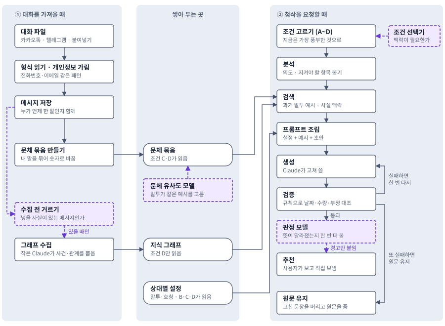
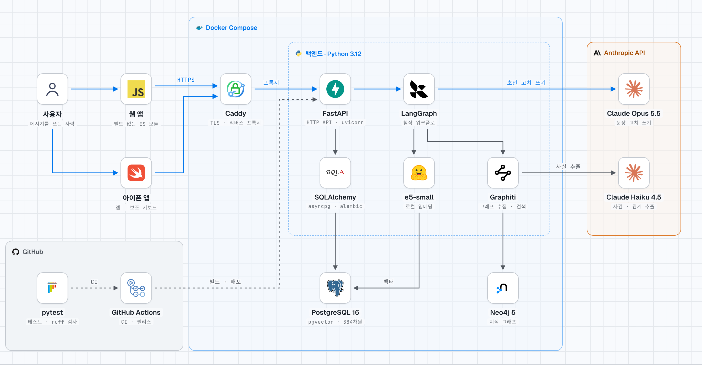
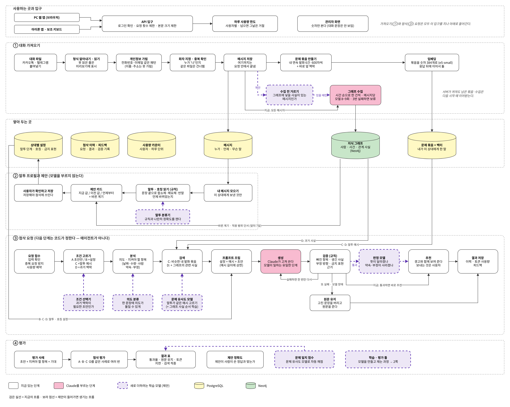
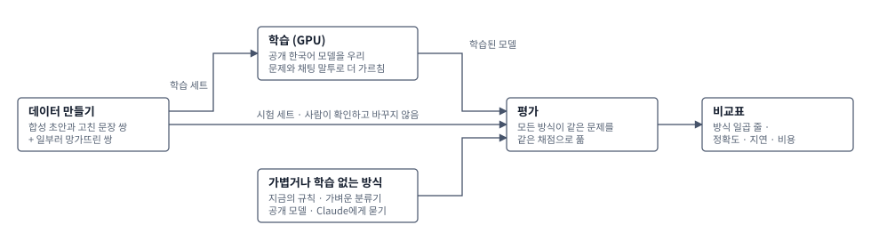
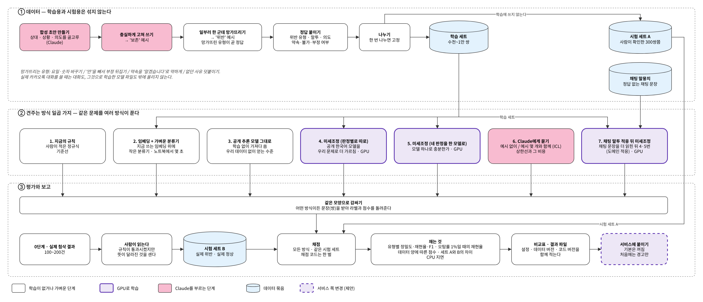

# 학습 모델을 어디에, 어떻게 넣을까 (제안)

2026-11-24 · 아직 제안입니다. 만든 것도, 학습시켜 본 것도 없습니다. 팀에서 같이 읽고 정하려고 씁니다. `docs/project-design.md`와 어긋나는 데가 있으면 그쪽이 맞습니다.

그림 원본은 [ml-overview.drawio](ml-overview.drawio)에 있습니다(두 쪽). draw.io에서 열어 고치면 됩니다.

## 먼저 결론

우리 서비스에서 Claude가 하는 일은 문장을 고쳐 쓰는 것 하나입니다. 고친 문장이 원문의 사실을 지켰는지는 Claude가 아니라 우리가 적어 둔 규칙이 봅니다. 이 규칙은 날짜나 숫자처럼 글자로 드러나는 것은 잘 잡는데, "보내드릴게요"가 "알겠습니다"로 바뀌는 것처럼 글자는 멀쩡하고 뜻만 달라진 경우는 못 잡습니다.

그 자리를 메울 작은 모델을 우리가 직접 학습시켜 보자는 것이 이 문서의 제안입니다. 학습만 하고 끝내지 않고, 지금의 규칙과 다른 방법들을 같은 시험 문제로 나란히 채점해서 표 하나로 보여 주는 데까지가 목표입니다. 공모전에서 "학습시켰고, 이만큼 나아졌다"를 숫자로 말할 수 있게 하려는 것이기도 합니다.

Claude를 다른 모델로 바꾸자는 이야기가 아닙니다. 첨삭 과정을 에이전트로 바꾸자는 이야기도 아닙니다. 검증 옆에 한 번 더 봐 주는 장치를 다는 일입니다.

## 낯선 말 풀이

아래 말들이 계속 나옵니다. 아는 분은 건너뛰어도 됩니다.

| 말 | 뜻 |
|---|---|
| 규칙 기반 | 사람이 "이런 글자가 있으면 이렇게 본다"를 하나하나 적어 둔 방식. 지금 우리 검증이 이렇습니다 |
| 머신러닝 | 규칙을 적는 대신, 정답이 달린 예시를 많이 보여 주고 기계가 기준을 찾게 하는 방식 |
| 딥러닝 | 머신러닝 가운데 신경망이라는 큰 모델을 쓰는 쪽. 문장의 뜻을 다룰 때 강합니다 |
| 분류기 | 입력을 몇 가지 중 하나로 가르는 모델. "이 문장은 존댓말인가 반말인가" 같은 것 |
| 사전학습 모델 | 누가 한국어 글을 잔뜩 읽혀서 미리 만들어 둔 모델. 우리는 이걸 가져다 씁니다 |
| 미세조정 | 사전학습 모델을 우리 문제의 예시로 조금 더 가르치는 일. 이 문서에서 "학습"이라고 하면 거의 이것입니다 |
| 임베딩 | 문장을 숫자 수백 개로 바꾼 것. 뜻이 비슷한 문장은 숫자도 비슷해집니다. 지금 말투 예시를 찾을 때 쓰고 있습니다 |
| 라벨 | 예시에 붙인 정답. 사람이 직접 붙이면 손 라벨이라고 부릅니다 |
| 학습 세트, 시험 세트 | 가르칠 때 쓰는 예시와 점수 낼 때만 쓰는 예시. 둘이 섞이면 점수를 믿을 수 없습니다 |
| 기준선 | 새 방법과 견줄 기존 방법. 여기서는 지금의 규칙 |
| 정밀도 | 모델이 "위반"이라고 한 것 가운데 진짜 위반의 비율 |
| 재현율 | 진짜 위반 가운데 모델이 잡아낸 비율 |
| F1 | 정밀도와 재현율을 한 숫자로 합친 점수. 둘 다 높아야 높습니다 |
| 오탐 | 멀쩡한 것을 위반이라고 잘못 잡는 것. 우리 서비스에서는 잘 고친 문장이 버려지고 원문이 나갑니다 |
| ICL | 모델을 다시 가르치지 않고, 질문과 함께 예시 몇 개를 보여 줘서 따라 하게 하는 방법 |
| 인텐트(의도) | 메시지가 하려는 일. 부탁, 거절, 사과 같은 것 |
| 도메인 적응 | 모델이 배운 글(뉴스, 백과)과 우리가 다루는 글(채팅)이 달라서 생기는 차이를 줄이는 일 |
| 하네스 | 실험을 같은 조건으로 되풀이해 돌리고 결과를 같은 표로 뽑아 주는 틀 |

## 지금은 이렇게 돌아갑니다

왼쪽이 대화를 가져와 쌓는 쪽이고 오른쪽이 첨삭 요청이 지나가는 길입니다. 보라색 점선은 이번에 더하자는 것이니 일단 빼고 보면 됩니다.

첨삭 한 건은 조건 고르기 → 분석 → 검색 → 프롬프트 조립 → 생성 → 검증 순서로 갑니다. 검증에서 걸리면 한 번만 다시 쓰게 하고, 그래도 걸리면 고친 문장을 버리고 원문을 돌려줍니다.

여기서 자주 헷갈리는 것 세 가지만 짚습니다.

첫째, 이건 에이전트가 아닙니다. 다음에 어느 단계로 갈지를 모델이 고르지 않고 코드가 정합니다. 갈림길도 생성 뒤와 검증 뒤 두 군데뿐입니다. `docs/design.md`에서도 "고정 워크플로"라고 부릅니다.

둘째, LangGraph는 이 단계들을 순서대로 이어 주는 배선입니다. 저장소에서 LangGraph를 쓰는 파일은 `backend/app/ai/workflow.py` 하나입니다. Neo4j 지식 그래프는 Graphiti라는 다른 도구로 만들고, LangGraph와는 이름만 비슷합니다.

셋째, 검증은 모델을 부르지 않습니다. `backend/app/ai/validation.py`가 원문과 결과에서 같은 규칙으로 날짜, 수량, 사람, 약속, 부정 표현을 뽑아서 두 묶음을 맞춰 봅니다. 원문에 있던 것이 결과에 없거나 없던 것이 생기면 실패입니다. Claude가 "뜻을 지켰다"고 스스로 말하는 것은 일부러 믿지 않습니다.

이 구조는 의도해서 이렇게 만든 것이고, 이번 제안에서도 건드리지 않습니다.

조건 A~D는 프롬프트에 무엇을 더 넣느냐의 차이입니다.

| 조건 | 프롬프트에 들어가는 것 |
|---|---|
| A | 초안만 |
| B | 초안 + 상대별 말투·호칭 설정 |
| C | B + 내가 이 상대에게 썼던 말투 예시 |
| D | C + 과거에 있었던 일(지식 그래프) |

같은 구조를 쓰는 기술 기준으로 그리면 아래와 같습니다. 파란 선이 요청이 지나가는 길입니다. 화면에서 Caddy와 FastAPI를 거쳐 LangGraph 워크플로로 들어가고, 문장을 고쳐 쓸 때만 Claude를 부릅니다. 회색 선은 서버 안에서 저장소로 가는 연결이고, 점선은 테스트와 배포입니다.

단계별로 더 자세한 그림은 아래입니다. 입구, 저장소, 말투 제안, 평가까지 다 넣었습니다.

## 어디가 아쉬운가

### 규칙이 놓치는 것

규칙은 글자를 봅니다. 그래서 글자는 비슷한데 뜻이 달라지면 지나칩니다. `docs/backlog.md`에 이미 적어 둔 한계가 이렇습니다.

- 약속이 흐려지는 경우. "내일까지 보내드릴게요"가 "알겠습니다"가 되어도 통과합니다.
- 부정이 사라지는 경우. "아직 안 봤습니다"가 "봤습니다"가 되어도 통과합니다.
- 직함 없이 이름만 쓴 사람. "민수한테 전달했어"의 민수는 사람으로 읽지 못합니다.
- 줄여 쓴 요일. "수욜"은 날짜로 읽지 못합니다.

`docs/design.md`의 실패 유형 표에는 두 가지가 더 있습니다. 초안을 고쳐 쓰지 않고 초안에 답장을 써 버리는 경우는 잡는 장치가 없고, 길이나 이모지 설정을 어기는 것도 검사하지 않습니다.

백로그에는 이 한계 옆에 "모델 보조 검증을 넣을지는 수치를 보고 정한다"고 적혀 있습니다. 이 문서가 그 모델 보조 검증을 구체적으로 써 본 것입니다.

### 얼마나 맞는지 재 본 적이 없는 규칙들

말투 분류(`ai/register.py`)는 문장 끝 글자를 보고 합쇼체, 해요체, 반말을 가립니다. 파일 첫머리에 "손 라벨 문장으로 정확도를 재기 전까지는 가설"이라고 써 놓았는데, 아직 재지 않았습니다.

의도 분류(`ai/intent.py`)는 키워드를 순서대로 찾아서 먼저 걸리는 것으로 정합니다. "늦어서 죄송한데 회의 옮길 수 있을까요"는 사과로만 분류됩니다. 여기도 모델로 보조하겠다는 계획이 주석에 남아 있고 구현은 안 됐습니다.

### 지금 평가로는 알 수 없는 것

11/24에 5사례를 조건 네 개로 세 번씩, 모두 60번 돌렸고 전부 통과했습니다. 다만 이건 규칙 눈에 보이는 위반이 없었다는 뜻입니다. 규칙이 못 보는 위반이 그 안에 있었는지는 아무도 세어 보지 않았습니다.

또 하나, 결과가 정말 내 말투답게 나왔는지는 자동으로 점수를 낼 방법이 없습니다. 사람이 읽고 매겨야 합니다(백로그 B2).

### 데이터가 거의 없다

저장소에 있는 것은 합성 대화 4개(메시지 36건)와 평가 사례 5건입니다. 무엇을 학습시키든 데이터부터 만들어야 합니다. 이게 이번 일에서 가장 손이 많이 가는 부분입니다.

## 무엇을 더하려는가

위 그림의 보라색 점선이 더하려는 것들입니다. 표로 다시 적으면 이렇습니다.

| 이름 | 붙는 자리 | 하는 일 | 언제 |
|---|---|---|---|
| 판정 모델 | 검증 뒤 | 원문과 고친 문장의 뜻이 달라졌는지 봅니다 | 먼저 |
| 말투·의도 분류 | 분석, 말투 제안 | 규칙이 하던 분류를 모델과 나란히 재 봅니다 | 먼저 |
| 문체 유사도 모델 | 말투 예시 검색, 평가 | 말투가 같은 글을 찾고, 결과가 내 말투다운지 점수를 냅니다 | 여력이 되면 |
| 수집 전 거르기 | 그래프 수집 앞 | 뽑을 것이 없는 메시지는 건너뜁니다 | 여력이 되면 |
| 조건 선택기 | 조건 고르기 | 과거 맥락이 필요 없는 초안은 D 대신 C로 보냅니다 | 나중에 |

몇 가지는 처음부터 하지 않기로 합니다.

규칙 검증은 없애지 않습니다. 날짜, 숫자, 금액은 글자를 정확히 맞춰 보는 쪽이 더 믿을 만합니다. 모델은 규칙이 통과시킨 것을 한 번 더 보는 역할입니다.

문장을 고쳐 쓰는 일을 우리가 학습시킨 모델에 맡기지도 않습니다. 가진 GPU(RTX 5070 Ti, 16GB)로 작은 언어 모델을 가르칠 수는 있지만 Claude만큼 쓰기 어렵고, 사실을 틀리게 쓸 위험을 새로 떠안게 됩니다. LLM은 Claude로 간다는 프로젝트 방침과도 맞지 않습니다.

## 시작하기 전에: 실제로 얼마나 틀리는지 세어 보기

학습에 들어가기 전에 할 일이 하나 있습니다. 실제 첨삭 결과 100~200건을 사람이 읽으면서, 규칙은 통과시켰는데 뜻이 달라진 것을 세는 것입니다. 하루쯤 걸립니다.

이걸 먼저 하자는 이유는, 판정 모델이 실제로 쓸모가 있을지 지금은 모르기 때문입니다. Claude Opus 정도 되는 모델은 이런 실수를 잘 안 할 수도 있습니다. 그러면 판정 모델은 시험 점수는 잘 나와도 정작 잡을 것이 없습니다. 반대로 놓친 위반이 여럿 나오면 만들 이유가 분명해지고, 그때 모은 표본을 그대로 시험 문제로 쓸 수 있습니다.

놓친 위반이 꽤 나오면 판정 모델을 중심으로 전부 진행합니다. 거의 안 나오면 범위를 줄여서 말투·의도 분류 쪽에 무게를 둡니다. 어느 쪽이든 "학습 + 지표"는 얻습니다.

읽을 첨삭 결과는 합성 데이터로 만든 것만 씁니다. 합성 데이터만 밖으로 내보낸다는 원칙 그대로입니다.

## 과제 1. 검증을 돕는 모델

공개된 한국어 사전학습 모델 하나를 가져와 미세조정해서, 네 가지를 판정하게 합니다.

| 판정 | 넣는 것 | 맞히는 것 | 지금 이 일을 하는 곳 |
|---|---|---|---|
| 의미 보존 | 원문 + 고친 문장 | 그대로다 / 날짜·수량이 바뀌었다 / 부정이 뒤집혔다 / 약속이 흐려졌다 / 없던 사실이 생겼다 | `ai/validation.py` |
| 보존 신호 | 문장 하나 | 약속, 불가, 부정이 들어 있는가 | `ai/preserve.py` |
| 말투 | 문장 하나 | 합쇼체 / 해요체 / 반말 / 알 수 없음 | `ai/register.py` |
| 의도 | 문장 하나 | 부탁 / 거절 / 사과 / 일정 조율 / 보고 / 기타 | `ai/intent.py` |

가운데가 의미 보존 판정입니다. 앞에서 말한 약속이 흐려지는 경우와 부정이 사라지는 경우를 직접 겨냥합니다.

보존 신호는 같은 문제를 더 가볍게 푸는 방법입니다. 원문과 결과에 각각 "약속이 있나, 부정이 있나"를 묻고 답이 다르면 경고합니다.

말투와 의도는 규칙이 이미 있는 자리여서 모델이 규칙을 못 이길 수도 있습니다. 한국어 말투는 문장 끝에 거의 다 드러나니까요. 그래도 사람이 정답을 붙인 문장 묶음이 생기면 "지금 규칙은 몇 % 맞는다"는 숫자를 처음으로 갖게 됩니다. 의도는 한 문장에 둘 이상 붙을 수 있게 합니다(사과이면서 일정 조율).

### 데이터는 이렇게 만듭니다

학습용은 Claude에게 만들게 합니다.

1. 상대, 상황, 의도를 골고루 섞어 합성 초안을 만듭니다.
2. 초안을 충실하게 고쳐 쓴 문장을 만듭니다. 이게 "그대로다"의 예시입니다.
3. 고쳐 쓴 문장을 일부러 한 군데만 망가뜨립니다. 요일을 바꾸거나, '안'을 빼거나, 약속을 "알겠습니다"로 바꾸거나, 없던 사유를 덧붙입니다. 어떻게 망가뜨렸는지가 곧 정답입니다.
4. 문장마다 말투, 의도, 약속·부정 여부도 같이 붙입니다.

수천 쌍에서 1만 쌍 정도를 생각하고 있습니다.

시험용은 두 묶음으로 나눕니다. 하나(A)는 위 방식으로 만든 것 중 300쌍쯤을 사람이 하나씩 확인한 것입니다. 다른 하나(B)는 앞의 "세어 보기"에서 사람이 찾아낸 실제 위반과 실제 정상 결과입니다.

B가 꼭 필요합니다. 일부러 망가뜨린 문장과 Claude가 실제로 저지르는 실수는 생김새가 다를 수 있어서, A에서만 점수가 좋으면 만든 문제만 잘 푸는 것일 수 있습니다.

시험 문제는 한 번 정하면 바꾸지 않습니다. 바꾸면 그 전 점수와 견줄 수 없게 됩니다. 지금 평가에서 규칙 버전이 다른 수치를 섞어 비교하지 않는 것과 같은 이유입니다.

### 일곱 가지 방법을 나란히 견줍니다

점수 하나만 있으면 그게 좋은 건지 알 수 없습니다. 같은 시험 문제를 여러 방법으로 풀어 보고 비교합니다.

| # | 방법 | 무엇을 알 수 있나 |
|---|---|---|
| 1 | 지금의 규칙 | 기준선 |
| 2 | 임베딩 + 가벼운 분류기. 지금 쓰는 임베딩 위에 작은 분류기만 얹습니다. 노트북에서 몇 초면 학습됩니다 | 가장 싸게 얻을 수 있는 수준 |
| 3 | 공개된 추론 모델을 그대로. "앞 문장이 참이면 뒷 문장도 참인가"를 배운 모델을 학습 없이 씁니다 | 우리 데이터 없이 얻는 수준 |
| 4 | 미세조정, 판정마다 모델을 따로 | 직접 학습한 효과 |
| 5 | 미세조정, 네 판정을 모델 하나로 | 함께 배우면 서로 도움이 되는지, 운영에 모델 하나로 되는지 |
| 6 | Claude에게 묻기. 예시 없이 묻는 것과 예시 몇 개를 같이 주는 것 | 가장 잘 나올 수 있는 수준과 그 값(비용, 속도) |
| 7 | 채팅 말투를 더 읽힌 뒤 미세조정 | 뉴스로 배운 모델을 채팅에 맞추면 나아지는지 |

GPU는 4, 5, 7번에서 씁니다.

### ICL, 인텐트, 도메인 적응은 어디에 들어가나

이 세 가지를 따로 과제로 세우지는 않습니다. 위 표 안에 이미 들어 있습니다.

ICL은 6번입니다. 예시 없이 묻는 것과 예시를 주고 묻는 것을 나눠서 보면 "직접 학습시키는 것"과 "예시만 보여 주는 것"을 비교할 수 있습니다. 사실 지금 C 조건이 하는 일, 그러니까 내 과거 말을 찾아 프롬프트에 예시로 넣는 것부터가 ICL입니다. 여력이 되면 첨삭 쪽에서도 예시를 고르는 방법(없음 / 아무거나 / 지금의 검색 / 문체 유사도)을 견줘 볼 만합니다. 다만 이건 Claude를 실제로 부르는 실험이라 돈이 듭니다. 몇 건을 몇 번 돌릴지 미리 정해 놓고 해야 합니다.

인텐트는 과제 1의 네 판정 가운데 하나입니다.

도메인 적응은 7번입니다. 차이가 나는 데가 두 군데 있습니다. 공개 모델은 뉴스나 백과 같은 글로 배웠는데 우리 입력은 "넵 확인함다ㅋㅋ" 같은 채팅입니다. 그리고 학습은 Claude가 만든 글로 하는데 서비스에는 사람이 쓴 카카오톡이 들어옵니다. 방법은 단순합니다. 정답이 없는 채팅 문장을 모델에게 좀 더 읽힌 다음에 미세조정을 합니다. 정답을 붙일 필요가 없고 GPU로 몇 시간이면 될 것으로 봅니다. 더 복잡한 기법은 구현과 설명이 무거워서 넣지 않았습니다.

여기서 조심할 것이 있습니다. 실제 카카오톡 대화를 내 PC에서 학습에 쓰는 것 자체는 밖으로 내보내는 게 아니어서 방침에 걸리지 않습니다. 하지만 그 대화도, 그걸로 학습한 모델 파일도 저장소나 외부에 올리면 안 됩니다. 모델이 학습한 글 일부를 그대로 기억하고 있을 수 있습니다. 마음에 걸리면 공개된 한국어 채팅 말뭉치를 씁니다.

### 무엇을 재나

| 재는 것 | 왜 |
|---|---|
| 위반 유형별 정밀도, 재현율, F1 | 어느 유형에서 규칙보다 나은지 봅니다 |
| 오탐률을 1%로 묶었을 때의 재현율 | 가장 중요하게 볼 숫자입니다. 아래에 따로 적습니다 |
| 학습 데이터 양(500 / 2천 / 1만 쌍)에 따른 점수 | 데이터를 더 만들 가치가 있는지 봅니다 |
| 시험 묶음 A와 B의 점수 차 | 만든 문제만 잘 푸는 건 아닌지 봅니다 |
| 같은 설정으로 3~5번 학습한 평균과 흔들림 | 차이가 우연은 아닌지 봅니다 |
| CPU에서 한 건 판정하는 데 걸리는 시간, 모델 크기 | 운영 서버에는 GPU가 없습니다 |
| 첨삭 평가에 붙였을 때 원문 유지 비율과 잡아낸 위반 수 | 서비스에서 실제로 뭐가 달라지는지 봅니다 |

오탐률을 묶어 놓고 보는 이유는 이렇습니다. 판정 모델이 멀쩡한 결과를 위반이라고 하면 잘 고친 문장이 버려지고 원문이 나갑니다. 사용자에게는 놓친 위반 하나보다 이런 일이 더 자주 거슬릴 수 있습니다. 그래서 "멀쩡한 것 100개 중 1개만 잘못 잡도록 맞췄을 때 진짜 위반을 얼마나 잡느냐"를 먼저 봅니다.

### 서비스에는 이렇게 붙입니다

검증 단계 뒤에 단계 하나를 더합니다. 순서는 여전히 코드가 정합니다.

기본은 꺼 둡니다. 꺼져 있으면 결과가 지금과 글자 하나 다르지 않아야 합니다. 다른 말투 기능들도 이렇게 플래그로 넣었습니다.

켜더라도 처음에는 경고만 붙입니다("약속 표현이 달라진 것 같습니다"). 다시 쓰게 하거나 원문으로 돌리는 데 쓸지는 실제 데이터에서 오탐률을 본 뒤에 정합니다.

운영 서버에서는 학습하지 않습니다. 학습된 모델 파일을 읽어서 쓰기만 합니다.

## 과제 2. 문체 유사도 모델

지금 평가에서 자동으로 채점되는 것은 사실 보존뿐이고, "내 말투답게 나왔나"는 사람이 봐야 합니다. 이 빈칸을 메우는 모델입니다.

두 글을 넣으면 내용과 상관없이 말투가 얼마나 같은지를 점수로 냅니다. 지금 쓰는 임베딩은 뜻이 비슷한 글끼리 가깝게 놓습니다. 이걸 "내용이 달라도 말투가 같으면 가깝게, 내용이 같아도 말투가 다르면 멀게" 놓도록 다시 가르칩니다.

가르치려면 같은 내용을 여러 말투로 쓴 문장 묶음이 필요합니다. Claude로 만들거나 공개된 한국어 문체 변환 데이터를 씁니다.

재는 것은 두 가지입니다. 말투가 같은 글을 얼마나 잘 찾아오는지, 그리고 사람이 매긴 점수와 얼마나 같은 방향으로 움직이는지입니다. 뒤쪽이 높아야 자동 점수로 믿고 쓸 수 있습니다. 사람 점수가 먼저 있어야 하니 블라인드 평가(백로그 B2) 다음에 할 수 있습니다.

쓸 곳도 두 군데입니다. 조건 A~D를 비교하는 표에 "문체 일치 점수" 칸이 자동으로 생깁니다. 그리고 C 조건에서 예시를 찾을 때 이 모델로 바꿔 볼 수 있습니다. 임베딩 크기(384)를 그대로 두면 DB는 손댈 필요 없이 다시 색인만 하면 됩니다.

## 지식 그래프와 만나는 곳

지식 그래프는 대화에서 있었던 일과 관계를 뽑아 Neo4j에 쌓아 두었다가, 첨삭할 때 관련된 과거 사실을 찾아 주는 장치입니다(조건 D). 여기에도 학습 모델이 들어갈 자리가 세 군데 있습니다. 다만 그래프는 사용자 한 명당 수십에서 수백 항목 정도로 작고, 뽑는 일은 이미 모델(Claude의 작은 모델)이 하고 있어서 검증 쪽만큼 할 일이 많지는 않습니다. 셋 다 그래프 만드는 방식은 그대로 두고, 무엇을 넣을지와 언제 쓸지를 가리는 일입니다.

### 수집 전 거르기

그래프에 메시지 하나를 넣을 때마다 모델을 8~9번 부릅니다. demo 계정 551건을 다시 넣는 데 19달러쯤, 80분쯤 들었습니다(`docs/backlog.md`). "넵"이나 "ㅋㅋ"에도 똑같이 듭니다.

그래서 메시지를 넣기 전에 "여기서 뽑을 사실이 있나"를 먼저 가리는 분류기를 두자는 것입니다. 과제 1과 같은 틀에 얹을 수 있습니다.

좋은 점은 정답을 거의 공짜로 얻는다는 것입니다. 그래프에 들어 있는 사실마다 어느 메시지에서 나왔는지가 적혀 있습니다(`graph/store.py`). "이 메시지에서 사실이 하나라도 나왔다 / 하나도 안 나왔다"가 그대로 정답이 됩니다. 다만 지금은 한 사용자의 사실을 출처와 함께 전부 읽어 오는 기능이 없어서 읽기 질의 하나를 새로 써야 합니다.

재야 할 것은 사실이 있는 메시지를 놓치지 않는 비율입니다. 건너뛴 메시지에 있던 사실은 그래프에서 영영 빠지기 때문입니다. 이 비율을 95% 위로 맞춰 놓고 그때 건너뛸 수 있는 메시지가 몇 %인지를 봅니다. 그게 줄어드는 비용입니다. 거른 그래프로 D 조건 평가를 다시 돌려서 관련 메시지를 여전히 잘 찾아오는지도 확인해야 합니다.

걱정되는 점도 적어 둡니다.

- 정답이 모델이 뽑은 결과라서 흔들립니다. 같은 대화를 넣어도 뽑히는 것이 매번 조금씩 다르다는 실측이 있습니다(`docs/graph-redesign-2026-11-16.md`). 그래서 맨 먼저 같은 대화를 두 번 넣어 보고 정답이 얼마나 겹치는지부터 잽니다. 합성 36건으로 하면 돈이 얼마 안 듭니다. 많이 안 겹치면 이 과제는 접는 게 맞습니다.
- 수집할 때 앞 메시지를 맥락으로 씁니다. 사실은 없어도 맥락으로 필요한 메시지("그거 말이야")를 건너뛰면 뒤 메시지에서 뽑는 것이 나빠질 수 있습니다.
- 지금은 예산이 모자라면 가장 최근 메시지부터 끊기지 않게 이어서 넣습니다(`graph/ingest.py`). 골라서 넣기 시작하면 중간이 비게 되는데, 이게 그래프에 어떤 영향을 주는지는 아직 모릅니다.
- 학습 자료가 demo 계정의 실제 카카오톡이면 위에서 말한 주의가 똑같이 적용됩니다.

### 조건 선택기

지금 `auto`는 쓸 수 있는 조건 중 가장 많이 넣는 쪽을 무조건 고릅니다. 11/24에 재 보니 D는 A보다 입력 토큰이 3배쯤, 걸리는 시간이 1.7배쯤이었습니다. 그런데 평가 사례 5건 가운데 그래프가 정말 필요했던 것은 1건이었고, 나머지에서는 D와 C의 문장이 거의 같았습니다.

초안을 보고 과거 맥락이 필요한지를 가려낼 수 있으면, 필요 없는 요청은 C로 보내서 돈과 시간을 아낄 수 있습니다. 평가 사례에 `needs_graph` 칸이 이미 있어서 정답 형식은 준비돼 있습니다. 문제는 사례가 너무 적다는 것입니다. 20개가 모이고(백로그 B1) 그중 그래프가 필요한 것이 넉넉하면 그때 합니다.

### 그래프 검색 순서

그래프에서 찾은 사실을 어떤 순서로 보여 줄지는 지금 사람이 정한 숫자로 매깁니다. 비슷한 정도 0.75, 최근인 정도 0.15, 검색 순위 0.10이고 여기에 사건 종류별 가중치를 곱합니다(`graph/retriever.py`). 이 숫자를 데이터에서 배우게 하는 것이 세 번째 자리입니다. 방향은 맞다고 보지만 정답 데이터가 평가 5건과 질의 파일뿐이라 지금은 못 합니다. 질의를 늘린 뒤(백로그 B4)에 다시 봅니다.

### 그래프 쪽에서 안 하는 것

그래프 신경망이나 그래프 임베딩은 하지 않습니다. 그래프가 작아서 배울 구조가 없습니다. 사건과 관계를 뽑는 일을 우리가 학습시킨 모델로 바꾸는 것도 하지 않습니다. 정답 데이터가 대량으로 필요합니다. 말투와 호칭을 그래프에서 모델로 읽는 것도 하지 않습니다. 재설계 때 "말투는 규칙으로, 그래프는 계기와 범위만"으로 나눈 결정과 어긋납니다.

한 가지 덧붙이면, 과제 1의 말투 분류가 좋아지면 그래프에도 간접적으로 도움이 됩니다. 말투가 바뀐 날을 규칙이 정하고, 그래프는 그 날 앞뒤 7일에서 계기를 찾기 때문입니다(`graph/trigger.py`). 날짜가 정확해지면 찾는 범위도 정확해집니다.

## 실험을 묶는 틀

방법이 일곱 가지고 판정이 네 가지에 반복까지 하면, 손으로 돌려서는 어떤 숫자가 어떤 설정에서 나왔는지 금방 섞입니다. 그래서 데이터 만들기부터 표 뽑기까지를 명령 하나로 다시 돌릴 수 있게 묶어 둡니다.

가장 신경 쓸 것은 규칙이든 학습한 모델이든 Claude든 모두 "문장을 받아서 라벨과 점수를 돌려준다"는 같은 모양으로 감싸는 것입니다. 이렇게 해 두면 채점 코드는 누가 풀었는지 몰라도 되고, 방법을 하나 더 넣어도 표에 줄 하나만 늘어납니다.

지금 저장소에서 하던 방식을 그대로 따릅니다. 결과는 `evals/results/`에 CSV와 요약 문서로 남깁니다. 프롬프트를 폴더로 버전 관리하듯 데이터와 모델에도 버전 이름을 붙입니다. GPU용 라이브러리는 따로 설치하게 하고 운영 이미지에는 넣지 않습니다. 아주 작은 가짜 모델로 전체가 한 바퀴 도는 테스트도 하나 둡니다. 지금 `--embedding fake`로 테스트하는 것과 같은 방식입니다.

하지 않을 것도 정해 둡니다. 실험 기록을 외부 서비스에 올리지 않습니다. 실제 대화로 학습하면 기록에 대화가 섞여 나갈 수 있고, LangSmith 추적을 막아 둔 것과 같은 이유입니다. 내 PC에 파일로 남기면 충분합니다. 그리고 이걸 범용 틀로 키우지 않습니다. 설정 파일 하나에 스크립트 서너 개면 됩니다. 처음부터 다 짜 놓지도 않습니다. 실험 두세 개를 손으로 먼저 돌려 보고, 되풀이되는 부분만 묶습니다.

전체 일의 15~20% 정도가 적당하다고 봅니다. 그보다 커지면 틀을 만드는 데 빠진 것입니다.

자세한 그림은 아래입니다.

## 순서

| 단계 | 할 일 | 여기까지 하면 |
|---|---|---|
| 0 | 실제 첨삭 결과 100~200건을 읽고 놓친 위반을 셉니다 | 건수와 유형이 나오고, 과제 1의 범위를 정합니다 |
| 1 | 데이터 생성 스크립트를 만들고 시험 묶음 A, B를 확정합니다 | 사람이 확인한 시험 문제가 생깁니다 |
| 2 | 방법 1, 2를 손으로 돌립니다 | 규칙 대 가벼운 분류기, 첫 비교표 |
| 3 | GPU 학습 환경을 갖추고 방법 4를 돌립니다 | 직접 학습한 모델의 첫 점수 |
| 4 | 되풀이되는 부분을 틀로 묶습니다 | 명령 하나로 표가 다시 나옵니다 |
| 5 | 방법 3, 5, 6, 7을 더합니다 | 일곱 줄짜리 비교표 |
| 6 | 서비스에 꺼 둔 채로 붙이고 첨삭 평가와 같이 봅니다 | 원문 유지 비율, 잡아낸 위반 수 |
| 7 | 과제 2 (여력이 되면) | 자동 점수와 사람 점수가 얼마나 같이 움직이는지 |
| 8 | 그래프 수집 전 거르기 (여력이 되면) | 사실을 놓치지 않으면서 건너뛸 수 있는 비율 |

과제 1만 해도 2~3주는 걸릴 것으로 봅니다. 공모전 마감이 가까우면 0~4단계까지만, 판정도 의미 보존 하나로 줄입니다. 그래도 "규칙 대 직접 학습한 모델" 비교표는 나옵니다.

## 걱정되는 것, 아직 모르는 것

모델이 규칙을 못 이길 수 있습니다. 특히 말투와 의도가 그렇습니다. 그렇게 나와도 숨기지 않고 그대로 씁니다. 규칙이 얼마나 맞는지 처음 재 봤다는 것만으로도 남는 게 있습니다.

실제로 잡을 위반이 드물 수도 있습니다. 그래서 0단계를 맨 앞에 뒀습니다.

오탐이 사용자를 불편하게 할 수 있습니다. 처음에는 경고만 붙이고, 오탐률을 묶어 둔 숫자를 맨 앞에 두는 이유입니다.

운영 서버가 무거워집니다. 모델을 넣으면 이미지 크기, 서버 뜨는 시간, 요청 한 건의 응답 시간이 다 늘어납니다.

시험 문제는 사람이 봐야 합니다. 누가 얼마나 볼지 정해야 합니다.

아직 확인하지 않은 것도 있습니다.

- 공개 한국어 모델(KLUE 계열)이 채팅 말투에서 얼마나 잘 되는지.
- 문체 변환 데이터나 채팅 말뭉치 같은 공개 데이터의 정확한 이름과 사용 조건.
- 지금 쓰는 임베딩(e5-small)이 '안' 한 글자 차이를 가려낼 만큼 예민한지. 방법 2의 점수가 낮으면 글자 단위 특징을 섞어야 할 수도 있습니다.
- GPU 학습 환경. 개발 PC는 Smart App Control 때문에 호스트에서 torch가 안 뜹니다(`CLAUDE.md`). GPU 학습은 Docker(WSL2 + NVIDIA 지원) 안에서 돌려야 하고, 지금 이미지는 CPU용이라 학습용 이미지를 따로 만들어야 합니다. RTX 5070 Ti에 맞는 CUDA 버전도 확인해야 합니다.
- 그래프에서 메시지별 정답을 실제로 뽑아 본 적이 없습니다. 사실이 안 나오는 메시지가 얼마나 되는지, 그러니까 최대 얼마나 아낄 수 있는지도 모릅니다.
- 위에 적은 학습 시간과 기간은 전부 짐작입니다.

## 같이 정할 것

1. 공모전 마감이 언제인지, 그에 맞춰 전부 할지 줄여서 할지.
2. 0단계에서 첨삭 결과를 누가 몇 건 읽을지.
3. 시험 문제의 정답을 누가 확인할지. 평가 담당과 이야기해야 합니다.
4. 도메인 적응에 실제 카카오톡을 쓸지, 공개 말뭉치를 쓸지.
5. 방법 6과 ICL 실험에서 Claude 호출에 얼마까지 쓸지.

하기로 하면 결정은 `docs/decisions.md`에, 단계별 할 일은 `docs/backlog.md`에 옮기겠습니다.

## 그림 고치는 법

- 자세한 그림 두 장은 [ml-overview.drawio](ml-overview.drawio)의 1쪽과 2쪽입니다. draw.io에서 고친 뒤 PNG로 내보내 `images/ml-overview-detail-1.png`, `-2.png`를 바꿔 주세요.
- 간단한 그림 두 장(`images/ml-overview-service.svg`, `-harness.svg`)은 SVG라 글자만 고칠 때는 편집기에서 바로 고쳐도 됩니다.
- 기술 스택 그림(`images/architecture-stack-ko.png`, 영문은 `-en`, 어두운 배경은 `-dark`)은 같은 폴더의 `architecture-stack-*.html`이 원본입니다. HTML을 고친 뒤 브라우저에서 그림 부분을 다시 캡처합니다.
- 보라색 점선은 아직 없는 것, 분홍색은 Claude를 부르는 단계, 노란 통은 PostgreSQL, 초록 통은 Neo4j입니다.
