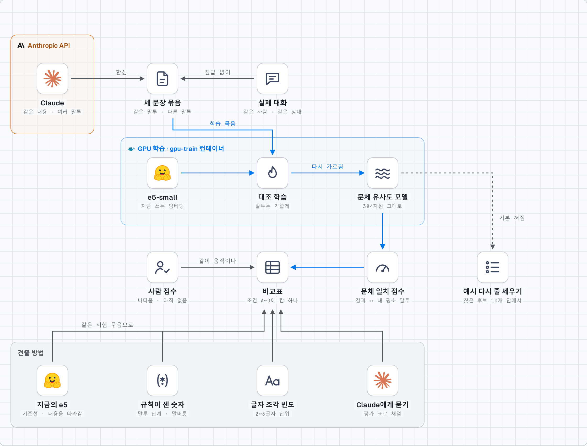

# 문체 유사도 모델 설계

2026-11-25 · 설계입니다. 만든 것도, 학습시킨 것도 없습니다. [학습 모델 설계안](ml-design-2026-11-24.md)의 과제 2를 실제로 만들 수 있는 수준까지 풀어 쓴 것입니다. GPU 메모리와 학습 시간은 짐작입니다.



그림 원본은 [images/ml-style-sim-stack-ko.html](images/ml-style-sim-stack-ko.html)입니다. 어두운 배경 판은 `images/ml-style-sim-stack-ko-dark.png`입니다.

## 먼저 결론

- **무엇을 만드나**: 두 글을 넣으면 내용과 상관없이 말투가 얼마나 같은지를 점수로 내는 모델입니다. 지금 쓰는 임베딩(e5-small)을 다시 가르쳐 만듭니다.
- **먼저 쓸 곳은 평가입니다.** 첨삭 결과가 "내 말투다운가"를 자동으로 채점해, 조건 A~D 비교표에 칸 하나를 더합니다.
- **검색에는 바로 넣지 않습니다.** 설계안은 말투 예시 검색을 이 모델로 바꿔 보자고 했는데, 그대로 바꾸면 엉뚱한 예시를 고릅니다. 이유와 대안을 "검색에 쓰는 법" 절에 적었습니다.
- **규칙이 강한 경쟁자입니다.** 말투 단계와 말버릇을 세는 규칙(`ai/register.py`, `ai/voice.py`)이 이미 있습니다. 그 숫자들을 나란히 놓고 견주는 것만으로 모델만큼 나올 수 있습니다.
- **믿고 쓰려면 사람 점수가 필요합니다.** 사람이 매긴 "나다움" 점수와 같은 방향으로 움직이는지가 최종 확인인데, 그 점수가 아직 없습니다.

## 재려는 것

"말투가 같다"를 두 층으로 봅니다.

| 층 | 예 | 지금 재는 곳 |
|---|---|---|
| 말투 단계 | 합쇼체 / 해요체 / 반말 | `ai/register.py` (규칙) |
| 말버릇 | 마침표를 안 찍는다, 'ㅋㅋ'를 붙인다, '~어'로 끝낸다, '넵'으로 시작한다 | `ai/voice.py` (규칙) |

말투 단계만 맞히는 모델은 쓸모가 적습니다. 규칙이 이미 하고, 조건 B(설정만 준 것)도 단계는 맞춥니다. 조건 C가 B보다 나은지를 가르려면 말버릇 층을 봐야 합니다. 평가 표의 "나다움" 축이 이것입니다(`evals/style_rubric.md`).

## 모델

### 구조

- **기반**: `intfloat/multilingual-e5-small`. 지금 서비스가 쓰는 모델이고 384차원입니다. 같은 차원을 지키면 DB를 바꿀 필요가 없습니다.
- **학습 방식**: 세 문장을 한 묶음으로 봅니다. 기준 문장, 말투는 같고 내용이 다른 문장, 내용은 같고 말투가 다른 문장. 앞의 둘은 가깝게, 뒤의 것은 멀게 놓도록 가르칩니다.
- **핵심은 세 번째 문장입니다.** 지금 임베딩은 내용이 같으면 가깝다고 봅니다. "내용은 같은데 말투가 다른" 문장을 멀리 놓게 해야 내용을 보지 않게 됩니다.

### 학습 설정

| 항목 | 값 | 비고 |
|---|---|---|
| 손실 | 묶음 안의 다른 문장을 모두 오답으로 쓰는 대조 손실 | sentence-transformers의 표준 방식 |
| 배치 | 64~128 | 이 방식은 배치가 클수록 낫습니다 |
| 학습률 | 2e-5 | |
| 에폭 | 1~3 | 검증 묶음 점수로 멈춥니다 |
| 길이 | 토큰 128 | 메시지는 짧습니다 |
| 반복 | 시드 3개 | |

모델이 작아(1.2억) 16GB에 넉넉히 들어갈 것으로 봅니다. 학습은 몇 분에서 수십 분으로 짐작합니다.

## 데이터

세 가지 출처가 있고, 성격이 다릅니다.

| 출처 | 만드는 법 | 좋은 점 | 걱정 |
|---|---|---|---|
| 합성 | Claude에게 같은 내용을 여러 사람의 말투로 쓰게 합니다 | 내용을 똑같이 맞출 수 있습니다 | Claude가 흉내 낸 말투가 실제와 다를 수 있습니다 |
| 공개 자료 | 한국어 문체 변환 데이터 | 값이 들지 않습니다 | 이름과 사용 조건을 확인하지 않았습니다 |
| 실제 대화 | 같은 사람이 같은 상대에게 쓴 메시지끼리 묶습니다 | 정답을 붙일 필요가 없고 진짜 말버릇입니다 | 밖으로 내보낼 수 없습니다 |

실제 대화를 쓰는 방법은 이렇습니다. 같은 대화방에서 내가 쓴 메시지 둘은 "말투가 같다"로, 상대가 쓴 메시지는 "말투가 다르다"로 봅니다. 같은 대화방이라 주제는 비슷하고 쓴 사람만 다르므로, 내용이 아니라 말투를 보게 만드는 데 맞습니다. 다만 그 대화도 그것으로 학습한 모델 파일도 저장소나 밖에 올리면 안 됩니다.

합성 말투는 사람마다 속성을 정해서 만듭니다. 말투 단계, 길이, 마침표, 웃음 표시, 이모지, 자주 쓰는 문장 끝, 말머리. `ai/voice.py`가 세는 항목과 같은 목록입니다.

### 한 줄의 모양

```json
{
  "triplet_id": "syn1-0042-a",
  "content_id": "syn1-0042",
  "anchor": {"text": "넵 내일 오전까지 드릴게요ㅎㅎ", "style": "p07"},
  "positive": {"text": "앗 그건 제가 확인해볼게요ㅎㅎ", "style": "p07"},
  "negative": {"text": "네, 내일 오전까지 드리겠습니다.", "style": "p02"},
  "source": "synthetic-v1",
  "split": "train"
}
```

- 시험 묶음에는 학습에 없던 말투(`style`)만 넣습니다. 본 적 있는 사람의 말투만 가려내는 것이 아닌지 봅니다.
- 평가 사례 20건의 원문과 결과는 학습에 넣지 않습니다.

## 재는 것

### 세 가지를 차례로

**1. 말투로 찾아오는가.** 문장 하나를 주고, 여러 후보 가운데 말투가 같은 것을 찾게 합니다. 후보에는 내용이 같고 말투가 다른 문장을 일부러 섞습니다. 지금 임베딩은 그 문장을 고를 것입니다.

**2. 아는 답과 맞는가.** 정답을 아는 경우 넷으로 확인합니다.
- 내가 실제로 쓴 메시지(학습에 안 쓴 것)의 점수가 가장 높아야 합니다.
- 조건 A(초안만)의 결과는 조건 C보다 낮아야 합니다.
- 다른 상대에게 쓴 내 메시지는 이 상대에게 쓴 것보다 낮아야 합니다.
- 초안을 그대로 돌려준 것은 고쳐 쓴 것보다 낮아야 합니다.

**3. 사람 점수와 같이 움직이는가.** 사람이 매긴 "나다움" 점수와의 순위 상관을 봅니다. 이것이 높아야 자동 점수로 씁니다.

3번은 지금 할 수 없습니다. 블라인드 평가 시트(`evals/blind/`)는 있지만 사람이 매긴 점수가 없습니다(백로그 B2). 1번과 2번까지는 사람 없이 갑니다.

### 견줄 방법

| # | 방법 | 비고 |
|---|---|---|
| 1 | 지금의 e5-small 그대로 | 기준선. 내용을 따라갈 것으로 봅니다 |
| 2 | 규칙이 센 숫자 견주기 | 말투 단계 비율, 마침표·웃음·이모지 비율, 문장 끝 분포를 벡터로 놓고 견줍니다. 만든 코드를 그대로 씁니다 |
| 3 | 글자 조각 빈도 | 글자 2~3개 단위의 빈도. 말버릇은 글자에 드러납니다 |
| 4 | 미세조정한 e5-small | 이 문서의 모델 |
| 5 | Claude에게 묻기 | 평가 표를 주고 점수를 받습니다. 값이 들고 느립니다 |

2번이 가장 싸고 설명하기 쉽습니다. 4번이 2번을 못 이기면 모델을 쓸 이유가 없습니다.

### 점수 내는 법

첨삭 결과 한 건의 "문체 일치 점수"는 이렇게 냅니다.

1. 이 상대에게 쓴 내 메시지(요청 시점 이전, 지금 말투 구간의 것)를 숫자로 바꿔 평균을 냅니다.
2. 결과 문장을 숫자로 바꿔 그 평균과 얼마나 가까운지 봅니다.
3. 초안의 점수도 같이 적습니다. 얼마나 가까워졌는지가 고쳐 쓴 효과입니다.

### 속기 쉬운 곳

- **베끼면 점수가 오릅니다.** 조건 C는 내 과거 문장을 프롬프트에 넣으므로, 결과가 그 문장을 베끼면 점수가 높게 나옵니다. 말투가 같은 것과 문장을 베낀 것을 가려 봐야 합니다. 예시로 들어간 문장은 평균에서 빼고 잽니다.
- **길이.** 짧은 글끼리 가깝게 나오는 모델이면 길이를 재는 것입니다. 길이를 맞춘 묶음으로 따로 봅니다.
- **메시지가 적은 상대.** 내 메시지가 서너 건이면 평균이 흔들립니다. 건수가 모자라면 점수를 내지 않습니다.

## 검색에 쓰는 법

지금 말투 예시 검색은 초안과 상황을 질의로 삼아 **비슷한 장면**을 찾습니다(`ai/retrieval/vector.py`). 이것을 문체 유사도 모델로 그대로 바꾸면 **초안과 말투가 같은** 과거 문장을 찾게 됩니다. 그런데 초안은 고치기 전의 글입니다. 반말로 대충 쓴 초안을 넣으면, 이 상대에게 쓰는 합쇼체 예시가 아니라 대충 쓴 문장과 닮은 것이 나옵니다. 찾으려는 것과 반대입니다.

그래서 검색을 바꾸지 않고 한 단계를 더합니다.

1. 지금처럼 비슷한 장면을 넉넉히 찾습니다(예: 10개).
2. 그 가운데 이 상대에게 쓰는 내 평소 말투(위의 평균)에 가까운 것을 앞에 둡니다.

후보 10개만 그 자리에서 숫자로 바꾸면 되므로 DB와 색인을 건드리지 않습니다. 플래그로 넣고 기본은 꺼 둡니다. 효과는 조건 C의 문체 일치 점수와 사람 평가로 봅니다. 실제 Claude 호출이 드는 실험이라 횟수를 미리 정하고 합니다.

## 서비스와 평가에 붙이는 모양

- **평가**: `evals/run_eval.py`의 결과에 `style_sim`(결과)과 `style_sim_draft`(초안) 칸을 더합니다. 모델 파일이 없으면 비워 둡니다.
- **검색**: `STYLE_RERANK`, 기본 꺼짐. 켜면 검색기 버전 이름에 표시를 붙입니다.
- **모델 파일**은 저장소에 넣지 않습니다. 실제 대화로 학습한 것은 밖에 올리지 않습니다.
- **버전 이름**: `stylesim:e5-small:data-v1:seed42`. 점수를 적을 때 함께 적습니다. 버전이 다른 점수는 견주지 않습니다.

## 순서

| 단계 | 할 일 | 비용 | 여기까지 하면 |
|---|---|---|---|
| 0 | 방법 1, 2, 3을 합성 대화 36건과 평가 결과에 돌려 "아는 답"을 봅니다 | 없음 | 규칙만으로 어디까지 되는지 |
| 1 | 세 문장 묶음을 만듭니다 | Claude 호출 | 학습·시험 자료 |
| 2 | 미세조정하고 "말투로 찾아오는가"를 잽니다 | GPU | 방법 4의 첫 점수 |
| 3 | 평가 결과표에 칸을 더합니다 | 없음 | 조건 A~D의 문체 일치 점수 |
| 4 | 사람 점수와 견줍니다 | 사람 시간 | 자동 점수를 믿을지 |
| 5 | 검색에 한 단계를 더해 봅니다 | Claude 호출 | 예시가 나아지는지 |

0단계는 지금 바로 할 수 있고 값이 들지 않습니다. 거기서 규칙이 "아는 답" 넷을 다 맞히면 모델의 몫은 줄어듭니다.

## 확인한 것과 못 한 것

확인한 것:
- 기반 모델(`intfloat/multilingual-e5-small`, MIT)이 허브에 있고 서비스가 이미 쓰고 있습니다.
- 지금 검색은 초안과 상황을 질의로 씁니다(`ai/retrieval/vector.py`).

못 한 것:
- 지금 임베딩이 말투를 얼마나 보는지 재지 않았습니다. 이미 꽤 볼 수도 있습니다.
- 규칙 숫자만으로 어디까지 되는지.
- 공개 문체 변환 데이터의 이름과 사용 조건.
- 사람 점수가 없어 최종 확인을 할 수 없습니다.
- 메시지가 몇 건이어야 평균이 안정되는지.

## 정할 것

1. 평가에 먼저 쓰고 검색은 뒤로 미루는 순서로 갈지.
2. 검색을 통째로 바꾸지 않고 한 단계를 더하는 방식으로 갈지.
3. 실제 카카오톡 대화를 학습에 쓸지. 쓰면 모델 파일을 밖에 올릴 수 없습니다.
4. 사람 평가(백로그 B2)를 누가 언제 할지. 이 모델의 최종 확인이 거기에 달렸습니다.
